# 苦手部分チートシート

過去問 3 回分で間違えた問題を分野ごとに分け、覚えることを短くまとめた。詳しい説明は、各節の最後に書いたノートの章にある。

## 過去問正答

- 以下は間違った問題一覧
- 過去問は上から順番にやった
- 講座動画で解説してたのを前に聞いていたので最初のは正答率高い
- 複線図関連の問題は最終的には大丈夫になった

### 1. 令和８年度上期

https://www.shiken.or.jp/construction/upload/20260524_co_second_q01.pdf

7, 31, 36, 39, 40, 47, 46, 49, 

### 2. 令和７年度下期 

https://www.shiken.or.jp/construction/upload/20251026_co_second_q01.pdf

8, 9, 13, 20, 23, 24, 25, 27, 28, 31, 33, 34, 36, 37, 39, 41, 42, 45, 46, 47, 49, 50

### 3. 令和５年度下期 午前

https://www.shiken.or.jp/construction/upload/20231029_co_second_q01.pdf

4, 8, 9, 11, 13, 16, 18, 21, 23, 28, 30, 31, 34, 38, 39, 47, 50

## 間違いの傾向

3 回分で間違えたのは 47 問（R8 上 8 問、R7 下 22 問、R5 下 午前 17 問）。R8 上は先に解説を聞いていた回なので、今の力に近いのは R7 下と R5 下 午前。

| 分野 | 問題数 | 間違えた問題 |
|---|---|---|
| 工具と材料 | 9 | R7 下 13、49、50 ／ R5 下 午前 11、13、16、18、47、50 |
| ボックス内の接続と最少電線本数 | 8 | R8 上 47、49 ／ R7 下 37、41、45、46、47 ／ R5 下 午前 31 |
| 電線管と施工方法 | 7 | R7 下 20、23、31、34 ／ R5 下 午前 21、23、38 |
| 図記号 | 6 | R8 上 36、40、46 ／ R7 下 27、36、42 |
| 絶縁抵抗と検査 | 4 | R8 上 39 ／ R7 下 24、25、39 |
| 許容電流と遮断器の位置 | 4 | R7 下 8、9 ／ R5 下 午前 8、9 |
| 法令 | 4 | R7 下 28 ／ R5 下 午前 28、30、39 |
| 小勢力回路 | 3 | R8 上 31 ／ R7 下 33 ／ R5 下 午前 34 |
| 計算 | 2 | R8 上 7 ／ R5 下 午前 4 |

計算の間違いは 2 問だけ。ほとんどは、数値や名前、記号を覚えていれば解ける問題だった。

## 最優先：2 回以上間違えた内容

別の回でも同じ内容を間違えたもの。R8 上で間違えた小勢力回路と絶縁抵抗は、R7 下でもまた間違えている。

| 内容 | 覚えること | 間違えた問題 |
|---|---|---|
| 小勢力回路 | 最大使用電圧 **60 V**、電線は直径 **0.8 mm** 以上 | R8 上 31、R7 下 33、R5 下 午前 34 |
| 単相 3 線式の 200 V 回路の絶縁抵抗 | 対地電圧は 100 V なので **0.1 MΩ** | R8 上 39、R7 下 39 |
| 2.0 mm を 4 本入れた管の許容電流 | 35 × 0.63 = **22 A** | R7 下 8、R5 下 午前 8 |
| 分岐回路の遮断器の位置 | 8 m 以下は **35 %**、制限なしは **55 %** | R7 下 9、R5 下 午前 9 |
| ねじなし電線管を曲げる工具 | **パイプベンダ**（2 回とも同じ問題）| R7 下 13、R5 下 午前 13 |
| 管の表記の数字 | `E19` は**外径**、`VE28` は**内径** | R7 下 34、R5 下 午前 38 |
| 配線図で使わない工具や材料 | 図にない工事のものを選ぶ | R7 下 49、50、R5 下 午前 47、50 |
| ボックスの図記号 | 斜線の丸は VVF 用ジョイントボックス、□ はアウトレットボックス | R7 下 36、42 |
| ボックス内の接続 | 接続点ごとに線の本数を数える | R8 上 47、49、R7 下 41、46、47 |

## 小勢力回路

呼び鈴やインターホンなどの回路。3 回とも 1 問ずつ出て、3 回とも間違えている。

| 項目 | 覚えること | 間違えた問題 |
|---|---|---|
| 最大使用電圧 | **60 V** | R8 上 問 31、R7 下 問 33 |
| 電線（軟銅線）の太さ | 直径 **0.8 mm** 以上 | R5 下 午前 問 34 |
| 電源 | 絶縁変圧器を使う | なし |

選択肢は、電圧が 24、30、40、60 V、太さが 0.5、0.8、1.2、1.6 mm だった。

> 小勢力は 60 V と 0.8 mm。

詳しくは [電気回路.md](電気回路.md) の「そのほかの工事と電線の接続」の章の「小勢力回路」。

## 絶縁抵抗と検査

| 電路 | 絶縁抵抗 | 例 |
|---|---|---|
| 対地電圧 150 V 以下 | **0.1 MΩ** 以上 | 単相 100 V、**単相 3 線式の 200 V** |
| 300 V 以下で、上記以外 | 0.2 MΩ 以上 | 三相 200 V |
| 300 V を超える | 0.4 MΩ 以上 | 三相 400 V |

- **配線図の 200 V 回路**：電源が `1φ3W 100/200V` なら、エアコンなどの 200 V の回路も対地電圧は 100 V なので **0.1 MΩ**（R8 上 問 39、R7 下 問 39）。三相 3 線式の 200 V なら 0.2 MΩ。
- **漏えい電流**：絶縁抵抗を測れないときは、電圧をかけたまま漏えい電流を測る。**1 mA 以下**なら適合で、100 V の回路も 200 V の回路も同じ値（R7 下 問 25：0.5 mA、1.5 mA、3 mA のうち、0.5 mA の回路だけ適合）。
- **竣工検査**（R7 下 問 24）：順番は目視点検、絶縁抵抗、接地抵抗、導通試験。空欄の答えは次のとおり。

| 検査 | 空欄の答え | 違う選択肢 |
|---|---|---|
| 絶縁抵抗の測定 | **無充電状態の回路**ごとに測る | 充電状態の回路 |
| 接地抵抗の測定 | **測定接地極**の抵抗が所定の値以下か確かめる | 補助接地極 |
| 導通試験 | **回路計**や導通チェッカーを使う | 検電器 |

接地抵抗計の E につなぐのが、抵抗を測りたい接地極（測定接地極、被測定接地極）。P と C につなぐのが補助接地極。

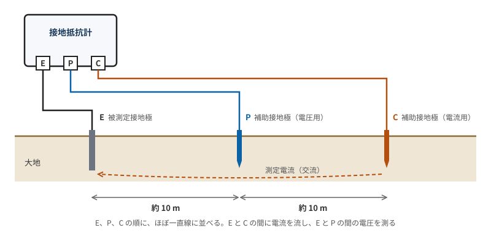

> 絶縁抵抗は対地電圧で見る。単相 3 線式なら 200 V の回路も 0.1 MΩ。漏えい電流は電圧に関係なく 1 mA。

詳しくは [電気回路.md](電気回路.md) の「絶縁抵抗と接地抵抗」と「竣工検査」の章。

## 許容電流と遮断器の位置

**許容電流**は、太さで決まる基本の値に、電流減少係数を掛ける。

| 太さ | 基本の値 |
|---|---|
| 1.6 mm | 27 A |
| 2.0 mm | **35 A** |
| 2.6 mm | 48 A |

| 同じ管に入れる本数 | 電流減少係数 |
|---|---|
| 3 本以下 | 0.70 |
| 4 本 | **0.63** |
| 5〜6 本 | 0.56 |

- **2.0 mm を 4 本**：35 × 0.63 = 22.05 → **22 A**（R7 下 問 8 は合成樹脂管、R5 下 午前 問 8 は金属管で、どちらも同じ答え）。
- **係数が書かれないこともある**：R7 下 問 8 の問題文には 0.63 がなかった。係数の表も覚えておく。

**分岐回路の遮断器の位置**は、分岐点からの距離で、分岐線に必要な許容電流が決まる。$I_B$ は幹線側の遮断器の定格電流。

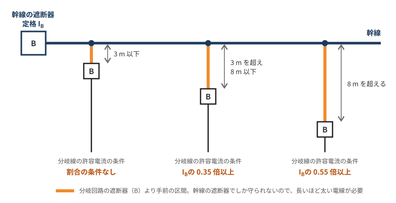

| 分岐点から遮断器までの距離 | 分岐線の許容電流 |
|---|---|
| 3 m 以下 | 条件なし |
| 8 m 以下 | $I_B$ の **35 %** 以上 |
| 制限なし | $I_B$ の **55 %** 以上 |

- **距離から許容電流を出す**（R7 下 問 9）：7 m なので、50 × 0.35 = **17.5 A**
- **許容電流から距離を出す**（R5 下 午前 問 9）：42 ÷ 50 = 84 %。55 % 以上なので**制限なし**

> 2.0 mm は 35 A、4 本なら 0.63 を掛けて 22 A。遮断器は、3 m までは条件なし、8 m までは 35 %、それより遠いと 55 %。

詳しくは [電気回路.md](電気回路.md) の「電線の許容電流」と「分岐回路の過電流遮断器」の章。

## 電線管と施工方法

**括弧の中の表記**（R7 下 問 34、R5 下 午前 問 38）

| 写真 | 表記 | 管 | 覚えること |
|---|---|---|---|
| 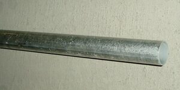 | `(E19)` | ねじなし電線管 | 数字は**外径** 19 mm |
| 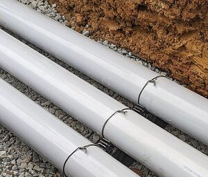 | `(VE28)` | 硬質ポリ塩化ビニル電線管 | 数字は**内径** 28 mm |
| 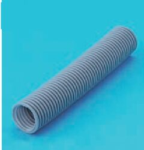 | `(PF16)` | 合成樹脂製可とう電線管 | 数字は内径 16 mm |
| 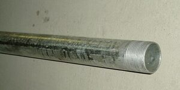 | `(16)` | 厚鋼電線管 | 記号がなく、数字だけ |
| 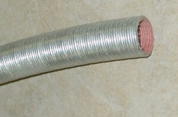 | `(F2 17)` | 2 種金属製可とう電線管 | F2 が付く |

PF 管の写真だけが過去問のもの。ほかの 4 枚は Wikimedia Commons の写真で、硬質ポリ塩化ビニル電線管は海外の同種の管。

R5 下 午前 問 21 は、線の種類と括弧の両方が合うものを選ぶ問題。答えは「`(F2 17)` を短い破線で書いたもの」で、2 種金属製可とう電線管で露出配線。

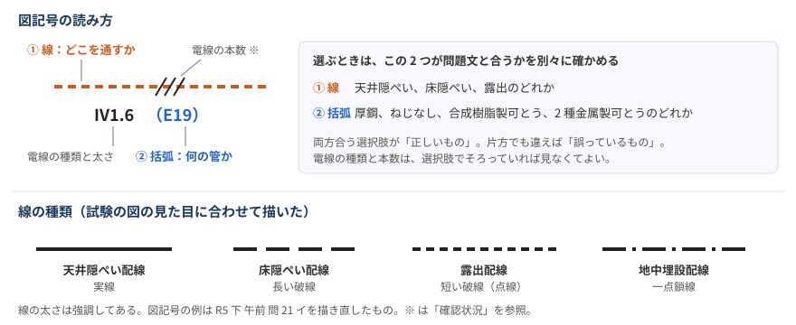

> E だけ外径、VE と PF は内径。数字だけなら厚鋼。

**施工のルール**

| ルール | 間違えた問題 |
|---|---|
| CD 管はコンクリートに埋め込む。木造の天井裏などには使わない | R7 下 問 20 |
| 交流は、1 つの回路の電線を全部同じ管に入れる（電磁的平衡）| R7 下 問 23 |
| 木造の屋側電線路（屋外の壁に沿う部分）は、がいし引き工事、合成樹脂管工事、ケーブル工事だけ。金属管、金属可とう電線管、金属線ぴは使えない | R7 下 問 31（答えは VVR のケーブル工事）|
| 硬質ポリ塩化ビニル電線管を造営材に沿って付けるとき、支持点間は **1.5 m 以下** | R5 下 午前 問 23 |
| プルボックスは、多数の金属管が集まる場所で、電線を引き入れやすくするために使う | R5 下 午前 問 11 |

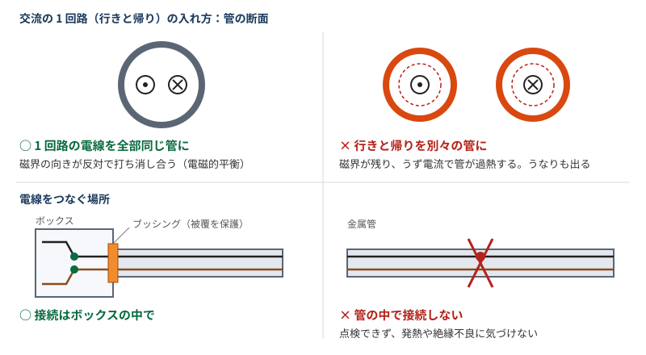

R7 下 問 31 の答えの VVR は、600V ビニル絶縁ビニルシースケーブル丸形。灰色で丸く、シースをはぐと介在物が見える。

> 木造の屋側に金属の管は付けない。CD 管はコンクリートの中だけ。

詳しくは [電工二種配管.md](電工二種配管.md) と、[電気回路.md](電気回路.md) の「金属管工事」「電線管の比較（金属管と合成樹脂管）」の章。

## 工具と材料

**管を曲げる工具**

| 写真 | 工具 | 曲げる管 | 間違えた問題 |
|---|---|---|---|
| 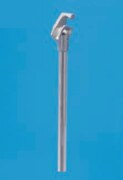 | **パイプベンダ** | 金属管（ねじなし電線管を含む）| R7 下 問 13、R5 下 午前 問 13 の答え |
| 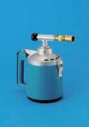 | **トーチランプ** | 硬質ポリ塩化ビニル電線管を温めて曲げる | R7 下 問 13、R5 下 午前 問 13 の違う選択肢 |
| 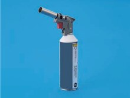 | **ガストーチ** | 硬質ポリ塩化ビニル電線管を温めて曲げる | R5 下 午前 問 18 |

問 13 の選択肢にはトーチランプもある。トーチランプは塩ビ管を温める道具なので、金属管には使わない。

**写真の名前**（R5 下 午前 問 16）：輪に穴が開いた金具は、**銅線用裸圧着端子**。

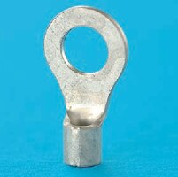

**「一般的に使用されることのないもの」**：図の括弧や記号から工事の種類を読み、図にない工事の工具や材料を選ぶ。この形で 4 問間違えている。

| 写真 | 答え（使わないもの）| 問題 | 図にあるもの |
|---|---|---|---|
|  | プリカナイフ | R7 下 問 49（2 階の工具）| VVF のケーブル工事だけで、管がない |
| 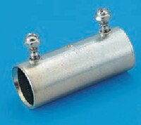 | ねじなし電線管用の金具（止めねじ付き）| R7 下 問 50（材料）| 管は VE だけで、金属管がない |
|  | 合成樹脂管用カッタ | R5 下 午前 問 47（⑰ の工具）| ⑰ は `(E19)` のねじなし電線管 |
| 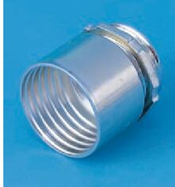 | F2 の管のコネクタ（アウトレットボックスとの組合せ）| R5 下 午前 問 50（材料の組合せ）| E19、PF22、FEP があり、F2 がない |

> 図の括弧を全部拾ってから選ぶ。E がなければねじなし電線管の金具、F2 がなければプリカナイフ、VE がなければ塩ビ管の工具は使わない。

詳しくは [電工二種工具.md](電工二種工具.md)。

## 図記号

**ボックス**（R7 下 問 36、42）

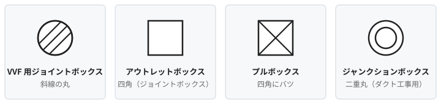

| 写真 | 名前 | 間違えた問題 |
|---|---|---|
| 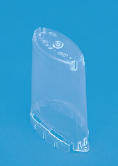 | **VVF 用ジョイントボックス**。透明なカバー状 | R7 下 問 36 |
| 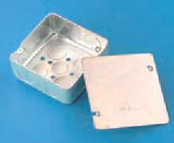 | **アウトレットボックス**。ふた付きの浅い金属の箱で、ノックアウト（丸い打ち抜き）がある | R7 下 問 42 の答え |
| 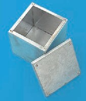 | **プルボックス**。深い金属の箱 | R7 下 問 42 の違う選択肢 |

**そのほかの記号**

| 記号 | 意味 | 間違えた問題 |
|---|---|---|
| RC の傍記 | ルームエアコンの屋内ユニットは **I**、屋外ユニットは O | R8 上 問 36 |
| DL | 埋込器具 | R8 上 問 40 |
| ● に矢印 | 調光器 | R8 上 問 46 |

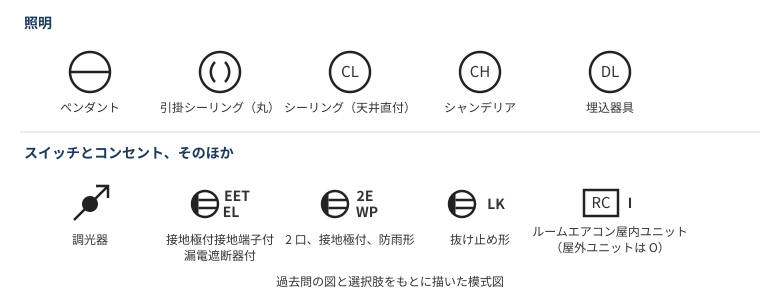

R8 上 問 46 は写真で選ぶ問題で、ほかの選択肢は表示灯の付いたスイッチだった。

| 調光器（答え）| 位置表示灯内蔵（H）| 確認表示灯内蔵（L）|
|---|---|---|
| 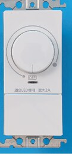 | 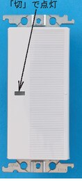 | 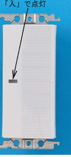 |
| つまみが付いている | 「切」で点灯 | 「入」で点灯 |

**計器の記号**（R7 下 問 27）：答えは「可動鉄片形で、目盛板を鉛直に立てて使う」。可動鉄片形は交流用。

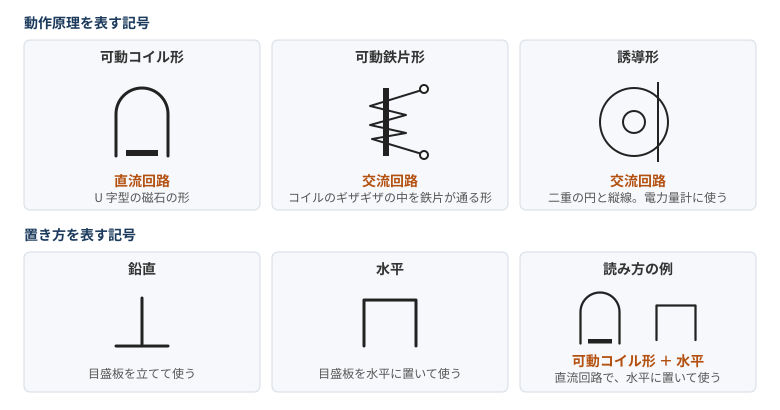

> 斜線の丸は VVF 用、□ はアウトレット、バツはプル。エアコンの屋内は I（Inside）。

詳しくは [電気回路.md](電気回路.md) の「配線図（第二種電気工事士）」「スイッチの種類と図記号」「計器の記号」の章。

## 法令

| 内容 | 覚えること | 間違えた問題 |
|---|---|---|
| 低圧の範囲 | 直流 **750 V** 以下、交流 **600 V** 以下 | R5 下 午前 問 30 |
| 第二種電気工事士でもできない作業 | 自家用電気工作物（500 kW 未満）の低圧部分の電線の接続。第一種か認定電気工事従事者の範囲 | R5 下 午前 問 28 |
| 電気工作物を定義する法律 | **電気事業法**。電気用品安全法ではない | R7 下 問 28 |
| 引込口開閉器を省略できる電路の長さ | **15 m** 以下（住宅から車庫などへ分ける電路）| R5 下 午前 問 39 |

> 低圧は直流 750 V、交流 600 V。第二種は一般用だけで、自家用はできない。

詳しくは [電工二種法令.md](電工二種法令.md)。

## 計算

- **単相 3 線式**（R8 上 問 7）：上下の負荷が同じになると、中性線に電流が流れず、中性線での電圧降下がなくなる。スイッチを閉じる前は 105 − 2 × 0.1 × 30 = 99 V、閉じたあとは約 102 V で、**3 V 上がる**。
- **力率**（R5 下 午前 問 4）：抵抗とリアクタンスの直列なら、力率 = 抵抗の電圧 ÷ 電源電圧 = 90 ÷ 102 ≈ **88 %**。$\sqrt{90^2 + 48^2} = 102$ V で、数値が合っていることを確かめられる。

> 単相 3 線式は、負荷がつり合うと中性線の電圧降下が消える。直列回路の力率は電圧の比。

詳しくは [電気回路.md](電気回路.md) の「過去問で補う内容（令和 8 年度上期）」と「電力（皮相電力・複素電力・有効電力・無効電力）」の章。

## ボックス内の接続と最少電線本数

複線図は描けるようになったので、ここには本数を数えたあとで使う表だけを置く。

| 接続点の線（1.6 mm）| リングスリーブ | 刻印 |
|---|---|---|
| 2 本 | 小 | **○** |
| 3〜4 本 | 小 | 小 |
| 5〜6 本 | 中 | 中 |

| 刻印 ○ | 刻印 小 | 刻印 中 |
|---|---|---|
| 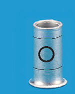 | 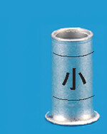 | 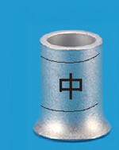 |

- **2.0 mm が混ざるとき**：2.0 mm を 1.6 mm の 2 本分と数え、4 本分以下は小、5〜6 本分は中。
- **差込形コネクタ**：接続点の線の本数と同じ穴の数のものを選ぶ。色は製品によって違う可能性があるので、穴の数で見る。

| 2 本用 | 3 本用 | 4 本用 | 5 本用 |
|---|---|---|---|
| 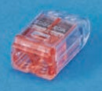 | 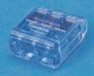 | 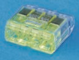 | 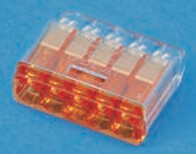 |

間違えた問題の答えは次のとおり。

| 問題 | 答え |
|---|---|
| R8 上 問 47 | 小 4 個。刻印は ○ 3 個、小 1 個 |
| R8 上 問 49 | 2 本用 1 個、5 本用 2 個 |
| R7 下 問 41 | 2 本用 3 個、3 本用 1 個 |
| R7 下 問 45〜47 | ⑮ は 3 芯のケーブル 1 本。⑯ は小 5 個（刻印 ○ 3 個、小 2 個）、⑰ は小 2 個と中 1 個 |
| R7 下 問 37、R5 下 午前 問 31 | 最少電線本数はどちらも 3 本 |

> 刻印が ○ になるのは 1.6 mm × 2 本だけ。

詳しくは [電気回路.md](電気回路.md) の「N と L、ボックス内の結線」の章と、「配線図（第二種電気工事士）」の章の「過去問：隣のボックスへ帰り線が渡る回路（令和 7 年度下期 問 45〜47）」。

## 間違えた問題の一覧

答えの記号は公式の解答による。「内容」と、記号のあとの説明は自分で付けた。

### 令和 8 年度上期

| 問 | 内容 | 答え |
|---|---|---|
| 7 | 単相 3 線式でスイッチを閉じたときの電圧の変化 | ニ：3 V 上がる |
| 31 | 小勢力回路の最大使用電圧 | ニ：60 V |
| 36 | ルームエアコンの屋内ユニットの傍記 | ハ：I |
| 39 | 単相 3 線式の 200 V 回路の絶縁抵抗 | イ：0.1 MΩ |
| 40 | DL の図記号の器具 | ニ：埋込器具 |
| 46 | ● に矢印の器具（写真）| ニ：調光器 |
| 47 | ⑰ のリングスリーブ | ハ：小 4 個（刻印 ○ 3 個、小 1 個）|
| 49 | ⑲ の差込形コネクタ | イ：2 本用 1 個、5 本用 2 個 |

### 令和 7 年度下期

| 問 | 内容 | 答え |
|---|---|---|
| 8 | 合成樹脂管に 2.0 mm を 4 本入れたときの許容電流（係数の記載なし）| ハ：22 A |
| 9 | 50 A の幹線から 7 m の位置に遮断器を置くときの許容電流 | ロ：17.5 A |
| 13 | ねじなし電線管を曲げる工具 | ニ：パイプベンダ |
| 20 | 木造住宅の工事で不適切なもの | ロ：天井裏に CD 管 |
| 23 | 電磁的不平衡を生じない管への入れ方 | イ：回路ごとに、その回路の電線を全部同じ管に入れたもの |
| 24 | 竣工検査の空欄 | イ：無充電状態の回路、測定接地極、回路計 |
| 25 | 漏えい電流で適合する回路 | ハ：0.5 mA の A 回路だけ |
| 27 | 計器の記号の意味 | ニ：可動鉄片形、鉛直 |
| 28 | 法令の記述で誤っているもの | ニ：電気用品安全法が電気工作物を定義している |
| 31 | ① の工事方法 | ハ：VVR のケーブル工事 |
| 33 | 小勢力回路の最大使用電圧 | ニ：60 V |
| 34 | (VE28) の意味 | イ：内径 28 mm の硬質ポリ塩化ビニル電線管 |
| 36 | 斜線の丸の名称 | ハ：VVF 用ジョイントボックス |
| 37 | ⑦ の最少電線本数 | ロ：3 本 |
| 39 | 200 V 回路の絶縁抵抗 | イ：0.1 MΩ |
| 41 | ⑪ の差込形コネクタ | ハ：2 本用 3 個、3 本用 1 個 |
| 42 | □ の写真 | ロ：アウトレットボックス |
| 45 | ⑮ のケーブル | ロ：3 芯 1 本 |
| 46 | ⑯ のリングスリーブ | イ：小 5 個（刻印 ○ 3 個、小 2 個）|
| 47 | ⑰ のリングスリーブ | ニ：小 2 個、中 1 個 |
| 49 | 2 階で使わない工具 | ロ：プリカナイフ |
| 50 | 使わない材料 | ハ：ねじなし電線管用の金具 |

### 令和 5 年度下期（午前）

| 問 | 内容 | 答え |
|---|---|---|
| 4 | 抵抗 90 V、リアクタンス 48 V、電源 102 V のときの力率 | ハ：88 % |
| 8 | 金属管に 2.0 mm を 4 本入れたときの許容電流 | ロ：22 A |
| 9 | 許容電流 42 A の分岐線を置ける長さ | ニ：制限なし |
| 11 | プルボックスの使用目的 | イ：多数の金属管が集まる場所で、電線を引き入れやすくする |
| 13 | ねじなし電線管を曲げる工具 | ニ：パイプベンダ |
| 16 | 写真の材料 | ハ：銅線用裸圧着端子 |
| 18 | 写真の工具（ガストーチ）の用途 | イ：硬質ポリ塩化ビニル電線管の曲げ |
| 21 | 図記号と施工方法の組合せ | ニ：(F2 17) で露出配線 |
| 23 | 硬質ポリ塩化ビニル電線管の支持点間 | ロ：1.5 m |
| 28 | 第二種電気工事士でも従事できない作業 | イ：自家用（500 kW 未満）の低圧部分の電線の接続 |
| 30 | 低圧の範囲 | ハ：直流 750 V 以下、交流 600 V 以下 |
| 31 | ① の最少電線本数 | ロ：3 本 |
| 34 | 小勢力回路の電線の最小直径 | ロ：0.8 mm |
| 38 | (E19) の意味 | イ：外径 19 mm のねじなし電線管 |
| 39 | 引込口開閉器を省略できる長さ | ハ：15 m |
| 47 | ⑰ で使わない工具 | ニ：合成樹脂管用カッタ |
| 50 | 材料の組合せで誤っているもの | ロ：F2 の管のコネクタとアウトレットボックス |

## 確認状況（苦手部分チートシート）

- **答え**：47 問すべて、試験センターの解答で確認した。問題文と選択肢は、問題 PDF の文字と画像で読んだ。
- **説明**：公式の解答には解説がない。説明は自分で付けたか、ノートの章から写したもの。数値や規定の裏付けは、ノートの各章の参考文献にある。
- **ほかの資料で確かめたもの**：R7 下 問 31 の理由（木造の屋側電線路では金属の管などを使えない）と、ボックスの 4 つの図記号の名前は、第二種電気工事士ドットコムの令和 7 年下期の解説で確認した。R5 下 午前 問 4、8、9 の考え方は、TAC の講評と同じだった。
- **プリカナイフの名前**：R7 下 問 49 ロの写真は、R3 下 午前 問 50 ロと同じもの。ふくラボはプリカナイフ、第二種電気工事士ドットコムは合成樹脂管用カッタとしていて、資料によって名前が違う。[電工二種工具.md](電工二種工具.md) に合わせてプリカナイフと書いた。R7 下の 2 階には F2 の管も VE 管もないので、どちらの名前でも答えはロになる。
- **R7 下 問 50 ハの名前**：止めねじが 2 本付いた筒形の金具。第二種電気工事士ドットコムはねじなしボックスコネクタとしているが、見た目はねじなしカップリングに近い。どちらか確かめられなかったので、「ねじなし電線管用の金具」と書いた。
- **R5 下 午前 問 50 ロ**：上の写真は、[電工二種配管.md](電工二種配管.md) の「F2 の管のコネクタ」（R6 下 問 50 ロ）と同じ写真だと、見比べて判断した。
- **公式の答えだけで確認したもの**：小勢力回路の電線 0.8 mm、硬質ポリ塩化ビニル電線管の支持点間 1.5 m、引込口開閉器の 15 m。「電気設備の技術基準の解釈」の本文は読んでいない。引込口開閉器を省略できるほかの条件（使用電圧や遮断器の定格など）は、資料で確認できなかったので書いていない。
- **分け方**：分野の分け方と「2 回以上間違えた内容」は、自分で判断したもの。
- **ボックスの図記号の図**：第二種電気工事士ドットコムの R7 下 問 36 の解説の図と、R7 下の配線図の記号を見て描いた。Windows の Chrome で表示を確かめた。
- **写真の出典の対応**：結線の写真（刻印、差込形コネクタ）がどの回のどの問題のものかは、ノートの「N と L、ボックス内の結線」の章でも回ごとにしか書かれていない。参考文献にも、その章と同じ回を並べた。

## 参考文献（苦手部分チートシート）

過去問の写真は、試験センターの[過去問題の使用に関する留意点](https://www.shiken.or.jp/construction/second/qa/)に従って教育目的で使った。**いずれも切り抜いて縮小し、選択肢の記号（イ、ロなど）を消す改変をした。** このファイルのために新しく切り抜いたのは、R7 下 問 42 のアウトレットボックスとプルボックス、R7 下 問 50 ハの金具、R5 下 午前 問 16 の圧着端子の 4 枚。ほかの写真と図は、ノートの各章で使っているもの。

- 出典：令和 8 年度上期第二種電気工事士試験（問 46、47、48 の写真。間違えた問題の確認）：[問題](https://www.shiken.or.jp/construction/upload/20260524_co_second_q01.pdf)、[解答](https://www.shiken.or.jp/construction/upload/20260524_co_second_a01.pdf)
- 出典：令和 7 年度下期第二種電気工事士試験（問 42、49、50 の写真。間違えた問題の確認）：[問題](https://www.shiken.or.jp/construction/upload/20251026_co_second_q01.pdf)、[解答](https://www.shiken.or.jp/construction/upload/20251026_co_second_a01.pdf)
- 出典：令和 5 年度下期第二種電気工事士試験（午前）（問 16 の写真。間違えた問題の確認）：[問題](https://www.shiken.or.jp/construction/upload/20231029_co_second_q01.pdf)、[解答](https://www.shiken.or.jp/construction/upload/20231029_co_second_a01.pdf)
- 出典：令和 7 年度上期第二種電気工事士試験（問 18、45 の工具の写真。問 48 の結線の写真）：[問題](https://www.shiken.or.jp/construction/upload/20250525_co_second_q01.pdf)、[解答](https://www.shiken.or.jp/construction/upload/20250525_co_second_a01.pdf)
- 出典：令和 6 年度下期第二種電気工事士試験（問 50 のコネクタの写真）：[問題](https://www.shiken.or.jp/construction/upload/20241027_co_second_q01.pdf)、[解答](https://www.shiken.or.jp/construction/upload/20241027_co_second_a01.pdf)
- 出典：令和 6 年度上期第二種電気工事士試験（問 43 の工具の写真。問 46、48 の結線の写真）：[問題](https://www.shiken.or.jp/construction/upload/20240526_co_second_q01.pdf)、[解答](https://www.shiken.or.jp/construction/upload/20240526_co_second_a01.pdf)
- 出典：令和 5 年度上期第二種電気工事士試験（午前）（問 45 の結線の写真）：[問題](https://www.shiken.or.jp/construction/upload/20230528_co_second_q01.pdf)、[解答](https://www.shiken.or.jp/construction/upload/20230528_co_second_a01.pdf)
- 出典：令和 4 年度下期第二種電気工事士試験（午後）（問 43 の VVR の写真）：[問題](https://www.shiken.or.jp/construction/upload/20221030_co_second_q02.pdf)、[解答](https://www.shiken.or.jp/construction/upload/20221030_co_second_a02.pdf)
- 出典：令和 3 年度上期第二種電気工事士試験（午前）（問 42 の PF 管の写真）：[問題](https://www.shiken.or.jp/construction/upload/20210530_co_second_q01.pdf)、[解答](https://www.shiken.or.jp/construction/upload/20210530_co_second_a01.pdf)
- 写真（切り抜いて縮小）：[厚鋼電線管 (G36)](https://commons.wikimedia.org/wiki/File:%E5%8E%9A%E9%8B%BC%E9%9B%BB%E7%B7%9A%E7%AE%A1_%28G36%29.JPG)（ユーリ、CC BY-SA 3.0）、[ねじなし電線管 (E25)](https://commons.wikimedia.org/wiki/File:%E3%81%AD%E3%81%98%E3%81%AA%E3%81%97%E9%9B%BB%E7%B7%9A%E7%AE%A1_%28E25%29.JPG)（ユーリ、CC BY-SA 3.0）、[金属製可とう管](https://commons.wikimedia.org/wiki/File:%E9%87%91%E5%B1%9E%E8%A3%BD%E5%8F%AF%E3%81%A8%E3%81%86%E7%AE%A1.jpg)（Uri、CC BY-SA 3.0）、[Rigid Non-Metallic Conduit 1](https://commons.wikimedia.org/wiki/File:Rigid_Non-Metallic_Conduit_1.jpg)（Anibal Maysonet、CC BY-SA 4.0）
- 令和 3 年度下期第二種電気工事士試験（午前）：[問題](https://www.shiken.or.jp/construction/upload/220211024_co_second_q01.pdf)。問 50 ロの写真を R7 下 問 49 ロと見比べた（写真は使っていない）
- [第二種電気工事士ドットコム 令和 7 年下期 完全解説](https://denkou2-siken.com/pdf/2025_2-kaisetsu.pdf)：R7 下 問 31（木造の屋側電線路）、問 36 と問 42（ボックスの図記号）、問 49、問 50
- [TAC 令和 5 年度下期 試験講評](https://www.tac-school.co.jp/file/tac/kouza_denkikoujisi/2023pdf/23S_denkikoujisi2_hikkikouhyou.pdf)：R5 下 午前 問 4、8、9 の考え方
- [ふくラボ 令和 3 年度下期 午前 問 50](https://denkikouji2nd.fukulabo-e9.com/2021/12/2p-r03s-a50/)：同じ写真をプリカナイフとしている
