# 電工二種工具

「要約のみ」と書いた資料は、検索結果の要約で確認しただけで、ページの本文は読んでいない。

## 工事で使う工具（写真）

「電気工事の作業と使用する工具の組合せ」のような問題に対応するためのまとめ。試験の見た目で覚えられるよう、写真はなるべく過去問のものを使った。出典の「R8 下」は令和 8 年度下期を表す。

### 組合せ問題の解き方

**工具の相手になる材料**を見ると解きやすい。金属板、木、コンクリート、金属管、合成樹脂管、可とう電線管のどれに使う工具なのかで判断する。

令和 8 年度上期 問 13「電気工事の作業と使用する工具の組合せとして、誤っているものは」の答えはニ。

| 選択肢 | 判定 | 理由 |
|---|---|---|
| イ：金属製キャビネットに穴をあける作業とノックアウトパンチャ | 正しい | 金属板の穴あけ |
| ロ：木造天井板に電線管を通す穴をあける作業と羽根ぎり | 正しい | 木材の穴あけ |
| ハ：電線、メッセンジャワイヤ等のたるみを取る作業と張線器 | 正しい | たるみ取りの専用工具 |
| **ニ：薄鋼電線管を切断する作業とプリカナイフ** | **誤り** | プリカナイフは 2 種金属製可とう電線管（プリカチューブ）を切る。薄鋼電線管には金切りのこやパイプカッタを使う |

同じ形の出題は次のとおり。

| 出題 | 問われた内容 | 答え |
|---|---|---|
| R8 下 問 13、R5 上 午前 問 13 | コンクリート壁に金属管を取り付ける材料と工具 | サドル、振動ドリル、カールプラグ、木ねじ |
| R7 下 問 13 | ねじなし電線管の曲げ | パイプベンダ（トーチランプ、ディスクグラインダ、パイプレンチは違う）|
| R7 上 問 13 | 工事の種類と工具 | 金属管工事とパイプベンダ（合成樹脂管工事とリード型ねじ切り器、ライティングダクト工事と合成樹脂管用カッタ、金属線ぴ工事とボルトクリッパは違う）|
| R6 下 問 13 | ノックアウトパンチャの用途 | 金属製キャビネットに穴をあける |
| R6 上 問 13 | 硬質ポリ塩化ビニル電線管の切断と曲げ | 合成樹脂管用カッタ、面取器、トーチランプ |
| R6 上 問 18 | クリックボールの用途 | リーマと組み合わせて、金属管の面取りに使う |
| R8 下 問 44 | 木造部分に配線用の穴をあける工具（写真）| 木工用のドリル |
| R8 下 問 49 | FEP 防護管を切断する工具（写真）| 金切りのこ |

配線図の問題で「一般的に使用されることのないものは」と聞かれたら、図の記号から工事の種類を読み、関係のない工具を選ぶ。

| 図の記号など | 工事 | 使わない工具の例 |
|---|---|---|
| E19、E31 | ねじなし電線管 | リード型ねじ切り器（ねじを切らない）|
| F2 がない | 2 種金属製可とう電線管を使わない | プリカナイフ |
| E や C だけ | 金属管 | 合成樹脂管用カッタ |

### 穴をあける

| 写真 | 工具 | 使い方 | 出典 |
|---|---|---|---|
| 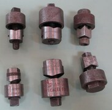 | **ノックアウトパンチャ** | 金属製キャビネットや分電盤に、電線管を通す穴をあける。写真は同じように打ち抜く海外の手動工具で、試験の写真とは見た目が違う可能性がある | Commons |
| 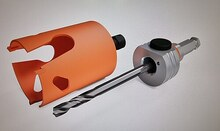 | **ホルソ** | ドリルに付けて、金属板などに丸い穴をあける | Commons |
| 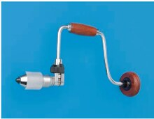 | **クリックボール** | 手で回す工具。先に**リーマ**や**羽根ぎり**を付ける | R6 上 問 18 |
| 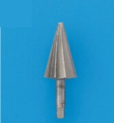 | **リーマ** | クリックボールに付けて、切った**金属管の内側のばり**を取る | R8 下 問 44 ハ |
| 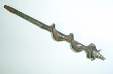 | **羽根ぎり** | クリックボールに付けて、**木材**に穴をあける。鉄板には使わない。写真は海外の同種の工具 | Commons |
| 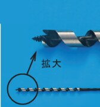 | **木工用のドリル** | **木材**に穴をあける。先端がねじ状 | R8 下 問 44 ニ |
| 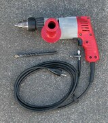 | **振動ドリル** | **コンクリート**に穴をあける。カールプラグを入れる穴に使う | Commons |
| 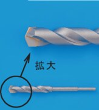 | **ドリルの刃** | 木工用ではない刃の例。先端がねじ状ではない。木造の穴あけの問題では選ばない | R8 下 問 44 イ |

### 切る、被覆をはぐ

| 写真 | 工具 | 使い方 | 出典 |
|---|---|---|---|
| 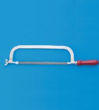 | **金切りのこ** | 金属管や合成樹脂管を切る。FEP 防護管にも使う | R8 下 問 49 ロ |
| 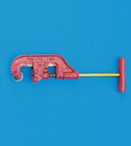 | **パイプカッタ** | 金属管を切る | R8 下 問 49 イ |
| 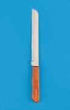 | **プリカナイフ** | **2 種金属製可とう電線管**（プリカチューブ）を切る。薄鋼電線管には使わない | R7 下 問 49 ロ |
| 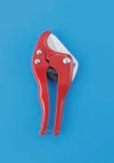 | **合成樹脂管用カッタ** | 合成樹脂管を切る。はさみの形で、金属管には使わない | R6 上 問 43 ロ |
| 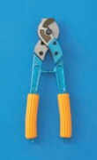 | **ケーブルカッタ** | 太い電線やケーブルを切る | R6 下 問 49 ロ |
| 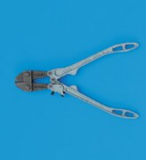 | **ボルトクリッパ** | 太い電線、メッセンジャワイヤ、鉄線を切る。刃が直線状 | R8 下 問 49 ニ |
| 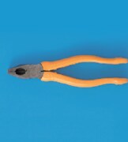 | **ペンチ** | 電線を切ったり、曲げたりする | R8 下 問 49 ハ |
| 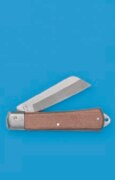 | **電工ナイフ** | 電線の被覆をはぐ。折りたたみ式 | R7 下 問 49 ニ |
| 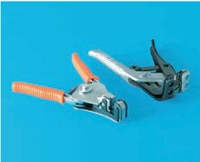 | **ケーブルストリッパ** | VVF ケーブルの外装と絶縁被覆をはぐ | R5 上 午前 問 18 |

### 曲げる、ねじを切る、電線を通す

| 写真 | 工具 | 使い方 | 出典 |
|---|---|---|---|
| 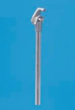 | **パイプベンダ** | **金属管**を曲げる | R7 上 問 45 ニ |
| 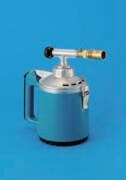 | **トーチランプ** | **硬質ポリ塩化ビニル電線管**を温めて曲げる | R6 上 問 43 ニ |
| 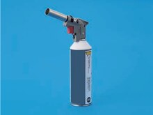 | **ガストーチ** | トーチランプと同じく、硬質ポリ塩化ビニル電線管の曲げ加工に使う | R7 上 問 18 |
| 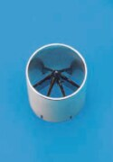 | **面取器** | **合成樹脂管**の切り口の面取りをする | R6 上 問 43 ハ |
| 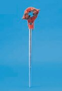 | **リード型ねじ切り器** | 金属管の端にねじを切る。**ねじなし電線管には使わない** | R7 上 問 45 イ |
| 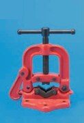 | **パイプバイス** | 切断やねじ切りのときに、金属管を固定する | R7 上 問 45 ロ |
| 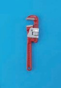 | **パイプレンチ** | 管をつかんで回す。切断や曲げには使わない | R6 上 問 43 イ |
| 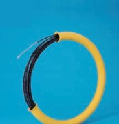 | **呼び線挿入器** | 電線管に電線を通す | R5 下 午前 問 47 ハ |
| 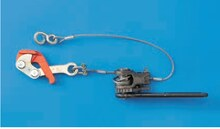 | **張線器** | 架空線やメッセンジャワイヤのたるみを取る | R7 下 問 18 |

### 接続する、確かめる

| 写真 | 工具 | 使い方 | 出典 |
|---|---|---|---|
| 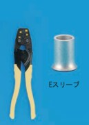 | **圧着ペンチ（黄色の柄）** | リングスリーブ（E 形）を圧着する | R6 上 問 46 イ |
| 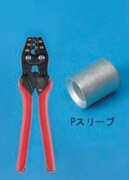 | **圧着ペンチ（赤色の柄）** | P 形スリーブを圧着する。接地線の直線重合せ接続は、この組み合わせが正解 | R6 上 問 46 ニ |
| 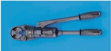 | **手動油圧式圧着器** | 太い電線を油圧で圧着する | R6 下 問 18 |
| 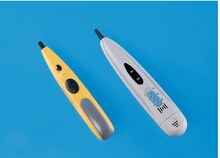 | **低圧検電器** | 低圧の回路が充電されているかを確かめる | R8 下 問 18 |

### 似ている工具の見分け方

| 比べるもの | 見分け方 |
|---|---|
| リーマとホルソ | リーマは円すい形、ホルソは筒形 |
| 合成樹脂管用カッタとパイプカッタ | 合成樹脂管用カッタははさみの形、パイプカッタは管をはさんで回す形 |
| ケーブルカッタとボルトクリッパ | ボルトクリッパは刃が直線状で、柄が長い |
| プリカナイフと電工ナイフ | プリカナイフは木の柄にまっすぐな刃、電工ナイフは折りたたみ式 |
| パイプベンダとパイプレンチ | パイプベンダは先が曲げ型の金属棒、パイプレンチはあごで管をつかむ形 |
| 木工用のドリルとほかのドリルの刃 | 木工用は先端がねじ状 |

### 確認状況（工具）

- **問題文と答え**：試験センターの問題と解答で確認した。公式の解答は記号だけで、解説はない。「理由」や「見分け方」は自分で付けたもの。
- **問題文に名前があるもの**：手動油圧式圧着器（R6 下 問 18）。ほかの写真には名前が書かれていないので、次の方法で対応づけた。
- **解説と照合したもの**：パイプバイス、パイプベンダ、金切りのこ、リード型ねじ切り器は、[ふくラボの解説](https://denkikouji2nd.fukulabo-e9.com/2021/11/2p-r03f-p45/)の名前と、令和 3 年度上期 午後 問 45 の同じ写真で確認した。プリカナイフと呼び線挿入器は、[別の解説](https://denkikouji2nd.fukulabo-e9.com/2021/12/2p-r03s-a50/)の名前と写真で確認した。
- **同じ回の問題文から読み取ったもの**：合成樹脂管用カッタ、面取器、トーチランプは、令和 6 年度上期 問 13 の答えに名前がある。
- **検索結果の要約で確認したもの**：リーマは、同じ構成の選択肢の解説（[令和 2 年度下期 午前 問 47](https://2shudenkikoujishi.kakomonn.com/questions/51810)）の要約で確認した。
- **見た目から自分で判断したもの**：パイプカッタ、ペンチ、ボルトクリッパ、ケーブルカッタ、電工ナイフ、パイプレンチ、ガストーチ、ケーブルストリッパ、低圧検電器、木工用のドリル。用途のうち、ペンチ、ケーブルカッタ、電工ナイフ、パイプレンチは記憶に基づく。
- **圧着ペンチの色**：赤色の柄と P スリーブの組み合わせは R6 上 問 46 の答え。黄色の柄がリングスリーブ用という点は [Panasonic の用語集](https://www2.panasonic.biz/jp/terasu/skill/dictionary/ringsleeve.html)で確認した。
- **過去問の写真が見つからなかったもの**：ノックアウトパンチャ、ホルソ、羽根ぎり、振動ドリル。平成 30 年度以降の公開分を探した範囲で見つからなかったので、Wikimedia Commons の写真を使った。特にノックアウトパンチャの写真は、海外のチャシーパンチで、試験に出る形とは限らない。
- **配線図の記号の表**：解説の例をもとにした一般化で、各回の配線図の記号までは照合していない。
- **Panasonic の工具資料**：検索で見つかった[資格向けの工具一覧](https://sitess-origin.panasonic.co.jp/ew/pewbct/shikaku/denki/dai2/pdf/kogu.pdf)は取得できず、照合に使っていない。

### 覚え方（工具）

> 材料で工具を選ぶ。金属板はノックアウトパンチャかホルソ、木は羽根ぎり、コンクリートは振動ドリル。

> プリカナイフはプリカチューブ専用で、薄鋼電線管は切らない。

> クリックボールにはリーマか羽根ぎりを付ける。リーマは金属管の内側のばり取り。

> 金属管はパイプベンダで曲げ、硬質ポリ塩化ビニル電線管はトーチランプで温めて曲げる。

> E の記号（ねじなし電線管）なら、リード型ねじ切り器は使わない。

> 圧着ペンチは、黄色の柄がリングスリーブ（E 形）、赤色の柄が P 形。

### 参考文献（工具）

過去問の写真は、試験センターの[過去問題の使用に関する留意点](https://www.shiken.or.jp/construction/second/qa/)に従って教育目的で使った。**いずれも切り抜いて縮小し、選択肢の記号（イ、ロなど）を消す改変をした。**

- 出典：令和 8 年度下期第二種電気工事士試験（問 13、18、44、49）：[問題](https://www.shiken.or.jp/construction/upload/20261025_co_second_q01.pdf)、[解答](https://www.shiken.or.jp/construction/upload/20261025_co_second_a01.pdf)
- 出典：令和 8 年度上期第二種電気工事士試験（問 13）：[問題](https://www.shiken.or.jp/construction/upload/20260524_co_second_q01.pdf)、[解答](https://www.shiken.or.jp/construction/upload/20260524_co_second_a01.pdf)
- 出典：令和 7 年度下期第二種電気工事士試験（問 13、18、49）：[問題](https://www.shiken.or.jp/construction/upload/20251026_co_second_q01.pdf)、[解答](https://www.shiken.or.jp/construction/upload/20251026_co_second_a01.pdf)
- 出典：令和 7 年度上期第二種電気工事士試験（問 13、18、45）：[問題](https://www.shiken.or.jp/construction/upload/20250525_co_second_q01.pdf)、[解答](https://www.shiken.or.jp/construction/upload/20250525_co_second_a01.pdf)
- 出典：令和 6 年度下期第二種電気工事士試験（問 13、18、49）：[問題](https://www.shiken.or.jp/construction/upload/20241027_co_second_q01.pdf)、[解答](https://www.shiken.or.jp/construction/upload/20241027_co_second_a01.pdf)
- 出典：令和 6 年度上期第二種電気工事士試験（問 13、18、43、46）：[問題](https://www.shiken.or.jp/construction/upload/20240526_co_second_q01.pdf)、[解答](https://www.shiken.or.jp/construction/upload/20240526_co_second_a01.pdf)
- 出典：令和 5 年度下期第二種電気工事士試験（午前）（問 47）：[問題](https://www.shiken.or.jp/construction/upload/20231029_co_second_q01.pdf)、[解答](https://www.shiken.or.jp/construction/upload/20231029_co_second_a01.pdf)
- 出典：令和 5 年度上期第二種電気工事士試験（午前）（問 13、18）：[問題](https://www.shiken.or.jp/construction/upload/20230528_co_second_q01.pdf)、[解答](https://www.shiken.or.jp/construction/upload/20230528_co_second_a01.pdf)
- 名前の照合：[令和 3 年度上期 第二種電気工事士試験（午後）問題](https://www.shiken.or.jp/construction/upload/20210530_co_second_q02.pdf)（問 45。写真は使っていない）
- 写真（縮小して使用）：[Chassis punches round and square](https://commons.wikimedia.org/wiki/File:Chassis_punches_round_and_square.jpg)（Enl public、CC BY-SA 3.0）、[TCT Tungsten Carbide Hole saw with arbor](https://commons.wikimedia.org/wiki/File:TCT_Tungsten_Carbide_Hole_saw_with_arbor.jpg)（Edenblijker、CC BY-SA 4.0）、[Auger brace bit](https://commons.wikimedia.org/wiki/File:Auger_brace_bit.jpg)（Luigizanasi、CC BY-SA 2.0 ca）、[Hammer drill-1](https://commons.wikimedia.org/wiki/File:Hammer_drill-1.jpg)（Shakespeare、CC BY-SA 3.0）
- [ふくラボ 電気工事の作業と使用する工具（令和 2 年度下期 午前 問 13）](https://denkikouji2nd.fukulabo-e9.com/2021/11/2p-r02s-a13/)：ノックアウトパンチャ、羽根ぎり、張線器、プリカナイフの用途
- [ふくラボ 電気工事の種類と使用工具（令和 3 年度上期 午前 問 13）](https://denkikouji2nd.fukulabo-e9.com/2021/11/2p-r03f-a13/)：リード型ねじ切り器、合成樹脂管用カッタ、パイプベンダ、ボルトクリッパの用途
- [ふくラボ 電線管工事で使用する工具・器具（令和 3 年度上期 午後 問 45）](https://denkikouji2nd.fukulabo-e9.com/2021/11/2p-r03f-p45/)：パイプバイス、パイプベンダ、金切りのこ、リード型ねじ切り器
- [ふくラボ 配線作業の工具（令和 3 年度下期 午前 問 50）](https://denkikouji2nd.fukulabo-e9.com/2021/12/2p-r03s-a50/)：呼び線挿入器、プリカナイフ、木工ドリルビット
- [TAC の一問一答 電線管工事で使う工具器具（9）](https://www.tac-school.co.jp/kouza_denkikoujisi/denkikoujisi_quiz/denkikoujisi_quiz_036.html)：硬質塩化ビニル電線管の金切りのこと面取器
- [過去問ドットコム 令和 2 年度下期 午前 問 47](https://2shudenkikoujishi.kakomonn.com/questions/51810)：リーマの用途（要約のみ）
- [Panasonic 用語集 ホルソ](https://www2.panasonic.biz/jp/terasu/skill/dictionary/holecutter.html)：ホルソの種類と用途（要約のみ）
