# 電工二種配管

「要約のみ」と書いた資料は、検索結果の要約で確認しただけで、ページの本文は読んでいない。※ の付いた項目は、出典と照合できていない内容（「確認状況」を参照）。

## 配管の種類と使う場所（写真）

配線図の `(E19)` のような表記から管の種類を読む問題と、場所に合う管を選ぶ問題に対応するためのまとめ。施工のルールは [電気回路.md](電気回路.md) の「金属管工事」「電線管の比較（金属管と合成樹脂管）」の章にある。写真はなるべく過去問のものを使った。出題の「R7 下」は令和 7 年度下期を表す。

### 種類の一覧（写真）

| 写真 | 図の表記 | 名前 | 見分け方 | 使う場所 |
|---|---|---|---|---|
| 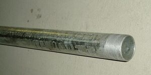 | 数字だけ（`(16)`）| **厚鋼電線管** | 鋼の管で、いちばん肉厚。端にねじを切る | **屋外**の露出配管 |
| 写真なし | 数字だけ（`(19)`）※ | **薄鋼電線管** | 厚鋼より肉薄 | **屋内**の天井や壁。耐候性が低いので屋外には向かない |
| 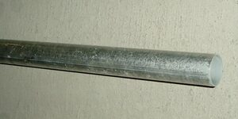 | `E`（`(E19)`）| **ねじなし電線管** | いちばん肉薄。名前のとおりねじがなく、止めねじで留める | **屋内** |
| 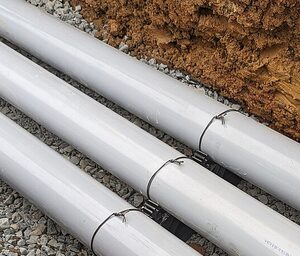 | `VE`（`(VE28)`）| **硬質ポリ塩化ビニル電線管** | 灰色で硬い。写真は海外の同種の管 | **湿気の多い場所**、化学工場、屋外。高温の場所には向かない |
| 写真なし | `HIVE` | **耐衝撃性硬質ポリ塩化ビニル電線管** | VE 管の耐衝撃性を高めたもの | **衝撃**が心配な場所、寒冷地 |
| 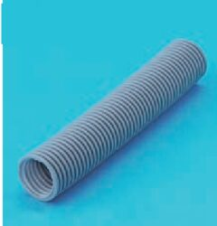 | `PF`（`(PF16)`）| **合成樹脂製可とう電線管（PF 管）** | 柔らかい波付き。クリーム系やグレー系。自己消火性が**ある** | 屋内外のいろいろな場所 |
| 写真なし | `CD` | **合成樹脂製可とう電線管（CD 管）** | 柔らかい波付き。オレンジ色など派手な色。自己消火性が**ない** | **コンクリートに埋め込む** |
| 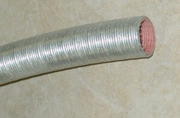 | `F2`（`(F2 17)`）| **2 種金属製可とう電線管** | 金属の蛇腹で、手で曲げられる | **振動する電動機**への接続、エキスパンションジョイント |
| 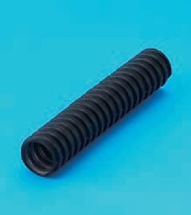 | `FEP` | **波付硬質合成樹脂管** | 硬い波付き。写真は問題文に名前がない ※ | **地中** |

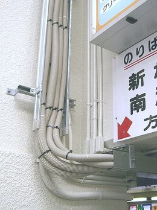

工事の例。資料の説明は「電線管工事（PF 管、金属管）」。クリーム色の波付きが PF 管で、銀色のまっすぐな管が金属管だと、見た目から判断した。

### 場所から選ぶ

| 場所や条件 | 選ぶ管 |
|---|---|
| 屋外の露出 | 厚鋼。VE 管や PF 管も使える |
| 屋内 | 薄鋼、ねじなし |
| 湿気の多い場所 | VE 管（R7 下 問 20 ハは正しい選択肢）|
| 湿気の多い場所の可とう電線管 | 2 種。**1 種は不適切**（R7 下 問 21 イ）|
| 強い衝撃、寒冷地 | HIVE 管 |
| 高温の場所 | VE 管は避ける |
| コンクリートに埋め込む | CD 管（PF 管も使える）|
| 木造の床下、壁の中、天井裏 | PF 管。**CD 管は不適切**（R8 上 問 21、R7 下 問 20 ロ）|
| 電動機につなぐ | 2 種金属製可とう電線管（R6 下の配線図の ⑳）|
| 地中 | FEP（R8 下 問 49）|
| 可燃性ガス、爆燃性粉じんのある場所 | 金属管。合成樹脂管工事と 2 種金属製可とう電線管の工事はできない |

### 図の表記の読み方

`IV1.6×3(E19)` なら、括弧の中が管の種類と太さ。表記の意味は、公式の問題で直接問われている。

| 図の表記 | 読み方 | 公式の問題 |
|---|---|---|
| `(16)` | 厚鋼電線管 | H29 下 問 19 イ（ロが誤りの問題で、イは正しい選択肢）|
| `(E19)` | **外径** 19 mm のねじなし電線管 | R5 下 午前 問 38 イ |
| `(VE28)` | **内径** 28 mm の硬質ポリ塩化ビニル電線管 | R6 上 問 35 ハ |
| `(PF16)`、`(PF22)` | **内径** 16 mm、22 mm の合成樹脂製可とう電線管 | R4 上 午後 問 35 ニ、R4 下 午後 問 38 ニ |
| `(F2 17)` | 2 種金属製可とう電線管 | H29 下 問 19 ニ、R4 上 午前 問 21 ニ、R5 下 午前 問 21 ニ |
| `HIVE` | 耐衝撃性硬質ポリ塩化ビニル電線管 | R5 下 午後 問 40 ロ |
| `FEP` | 波付硬質合成樹脂管 | R4 下 午前 問 38 ハ |

- **間違いの選択肢**：`(E19)` を厚鋼電線管や硬質塩化ビニル電線管と組み合わせた選択肢は誤り（R4 上 午前 問 21 イ、H29 下 問 19 ロ）。
- **線の種類**：図記号と施工方法の組み合わせの問題では、線も見る。H29 下 問 19 では、実線が天井隠ぺい、破線が露出。
- **`HIVP`**：R4 下 午前 問 38 の選択肢にある。`HIVE` と似ているが、電線管の表記としては確認できていない。
- **`G` と `C`**：Panasonic の用語集は、図面の表記を厚鋼は G 管、薄鋼は C 管としている。文字を取り出せる令和 4 年度以降の 14 回の問題には、`(G16)` や `(C19)` の形はなかった。

### 一緒に出る材料（写真）

今回見た回では、管そのものより、管をつなぐ材料の写真のほうが多かった。

| 写真 | 材料 | 使い方 | 出題 |
|---|---|---|---|
| 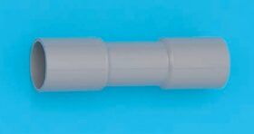 | **TS カップリング** | **VE 管どうし**をつなぐ | R5 下 午後 問 16 イ |
| 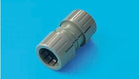 | **PF 管のカップリング** | **PF 管どうし**をつなぐ | R5 上 午後 問 16 イ |
| 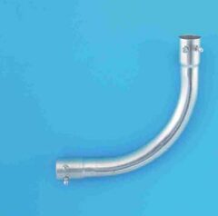 | **ノーマルベンド** | 金属管の曲がる部分に使う | R2 下 午後 問 16 ロ |
| 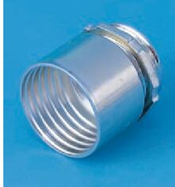 | **F2 の管のコネクタ** | 2 種金属製可とう電線管を電動機につなぐ。内側がらせん状 | R6 下 問 50 ロ |

管を切る工具は [電工二種工具.md](電工二種工具.md) にある。2 種金属製可とう電線管はプリカナイフ、FEP は金切りのこ（R8 下 問 49 ロ）。

### 確認状況（配管）

- **公式の解答**：問題と解答で確認した。公式の解答は記号だけで、解説はない。表の「読み方」は問題の選択肢の文で、「見分け方」と「使う場所」は下の資料と [電気回路.md](電気回路.md) の内容による。
- **写真がないもの**：薄鋼電線管、HIVE 管、CD 管。平成 29 年度から令和 8 年度までの全 26 回の 8、12、13 ページを縮小した画像で探した範囲と、Wikimedia Commons の検索で見つからなかった。
- **写真の名前**：PF 管はふくラボの解説、厚鋼電線管、ねじなし電線管、2 種金属製可とう電線管は Commons の説明による。VE 管の写真は海外の Rigid Non-Metallic Conduit で、日本の VE 管そのものではない。
- **FEP の写真 ※**：R3 下 午後 問 47 ハの写真で、問題文に名前はない。トラフや標識シートと並ぶ選択肢であることと形から、FEP と判断した。
- **`(19)` が薄鋼電線管 ※**：資料で確認できていない。数字だけの表記で確認できたのは `(16)` だけで、JIS C 0303 の管類の記号の表（表 2）は中身を取得できなかった。
- **電気回路.md との違い**：「電線と配管の書き方」の表は厚鋼電線管を `G` としている。これは Panasonic の用語集の図面の表記と合うが、試験の図で確認できた形は `(16)`。
- **使う場所**：メーカーと解説サイトの説明で、条文や内線規程とは照合していない。「場所から選ぶ」の表はこれらと [電気回路.md](電気回路.md) の内容を整理したもの。R8 上 問 21 は電気回路.md の記載で、今回は開き直していない。
- **F2 の管のコネクタ**：名前は問題文になく、用途は R6 下 問 50 の問題文と答えによる。図の ⑳ が `(F2 30)` で電動機につながることは、配線図で確認した。
- **PF 管のカップリング、TS カップリング**：問題文にある用途は「合成樹脂製可とう電線管相互を接続」「硬質ポリ塩化ビニル電線管相互を接続」。TS カップリングの名前はふくラボの解説による。

### 覚え方（配管）

> 鋼の管は、厚鋼が屋外、薄鋼とねじなしが屋内。ねじなしは E で、端にねじがない。

> 図の E19 は外径、VE と PF は内径。

> VE は灰色で、湿気に強く熱に弱い。衝撃に強くしたのが HIVE。

> 波付きで柔らかいのは PF と CD。PF は自己消火性があってどこでも使える。CD はオレンジでコンクリートの中だけ。

> F2 は電動機につなぐ金属の蛇腹。FEP は地中。

### 参考文献（配管）

過去問の写真は、試験センターの[過去問題の使用に関する留意点](https://www.shiken.or.jp/construction/second/qa/)に従って教育目的で使った。**いずれも切り抜いて縮小する改変をした。** 選択肢の記号は切り抜きの範囲から外し、PF 管の写真だけは記号を背景の色で塗って消した。

- 出典：令和 6 年度下期第二種電気工事士試験（問 50。コネクタの写真と配線図の確認）：[問題](https://www.shiken.or.jp/construction/upload/20241027_co_second_q01.pdf)、[解答](https://www.shiken.or.jp/construction/upload/20241027_co_second_a01.pdf)
- 出典：令和 5 年度下期第二種電気工事士試験（午後）（問 16。カップリングの写真。問 40）：[問題](https://www.shiken.or.jp/construction/upload/20231029_co_second_q02.pdf)、[解答](https://www.shiken.or.jp/construction/upload/20231029_co_second_a02.pdf)
- 出典：令和 5 年度上期第二種電気工事士試験（午後）（問 16。カップリングの写真）：[問題](https://www.shiken.or.jp/construction/upload/20230528_co_second_q02.pdf)、[解答](https://www.shiken.or.jp/construction/upload/20230528_co_second_a02.pdf)
- 出典：令和 3 年度下期第二種電気工事士試験（午後）（問 47。黒い波付きの管の写真）：[問題](https://www.shiken.or.jp/construction/upload/220211024_co_second_q02.pdf)、[解答](https://www.shiken.or.jp/construction/upload/220211024_co_second_a02.pdf)
- 出典：令和 3 年度上期第二種電気工事士試験（午前）（問 42。PF 管の写真）：[問題](https://www.shiken.or.jp/construction/upload/20210530_co_second_q01.pdf)、[解答](https://www.shiken.or.jp/construction/upload/20210530_co_second_a01.pdf)
- 出典：令和 2 年度下期第二種電気工事士試験（午後）（問 16。ノーマルベンドの写真）：[問題](https://www.shiken.or.jp/construction/upload/20201004_co_second_q02.pdf)、[解答](https://www.shiken.or.jp/construction/upload/20201004_co_second_a02.pdf)
- 問題の確認のみ（写真は使っていない）：令和 8 年度下期（問 49）[問題](https://www.shiken.or.jp/construction/upload/20261025_co_second_q01.pdf)、[解答](https://www.shiken.or.jp/construction/upload/20261025_co_second_a01.pdf)、令和 7 年度下期（問 20、21）[問題](https://www.shiken.or.jp/construction/upload/20251026_co_second_q01.pdf)、[解答](https://www.shiken.or.jp/construction/upload/20251026_co_second_a01.pdf)、令和 6 年度上期（問 35）[問題](https://www.shiken.or.jp/construction/upload/20240526_co_second_q01.pdf)、[解答](https://www.shiken.or.jp/construction/upload/20240526_co_second_a01.pdf)、令和 5 年度下期 午前（問 21、38）[問題](https://www.shiken.or.jp/construction/upload/20231029_co_second_q01.pdf)、[解答](https://www.shiken.or.jp/construction/upload/20231029_co_second_a01.pdf)、令和 4 年度下期 午前（問 38）[問題](https://www.shiken.or.jp/construction/upload/20221030_co_second_q01.pdf)、[解答](https://www.shiken.or.jp/construction/upload/20221030_co_second_a01.pdf)、令和 4 年度下期 午後（問 38）[問題](https://www.shiken.or.jp/construction/upload/20221030_co_second_q02.pdf)、[解答](https://www.shiken.or.jp/construction/upload/20221030_co_second_a02.pdf)、令和 4 年度上期 午前（問 21）[問題](https://www.shiken.or.jp/construction/upload/20220529_co_second_q01.pdf)、[解答](https://www.shiken.or.jp/construction/upload/20220529_co_second_a01.pdf)、令和 4 年度上期 午後（問 35）[問題](https://www.shiken.or.jp/construction/upload/20220529_co_second_q02.pdf)、[解答](https://www.shiken.or.jp/construction/upload/20220529_co_second_a02.pdf)、平成 29 年度下期（問 19）[問題](https://www.shiken.or.jp/construction/upload/20170930_co_second_q01.pdf)、[解答](https://www.shiken.or.jp/construction/upload/20170930_co_second_a01.pdf)
- 写真（切り抜いて縮小）：[厚鋼電線管 (G36)](https://commons.wikimedia.org/wiki/File:%E5%8E%9A%E9%8B%BC%E9%9B%BB%E7%B7%9A%E7%AE%A1_%28G36%29.JPG)（ユーリ、CC BY-SA 3.0）、[ねじなし電線管 (E25)](https://commons.wikimedia.org/wiki/File:%E3%81%AD%E3%81%98%E3%81%AA%E3%81%97%E9%9B%BB%E7%B7%9A%E7%AE%A1_%28E25%29.JPG)（ユーリ、CC BY-SA 3.0）、[金属製可とう管](https://commons.wikimedia.org/wiki/File:%E9%87%91%E5%B1%9E%E8%A3%BD%E5%8F%AF%E3%81%A8%E3%81%86%E7%AE%A1.jpg)（Uri、CC BY-SA 3.0）、[Rigid Non-Metallic Conduit 1](https://commons.wikimedia.org/wiki/File:Rigid_Non-Metallic_Conduit_1.jpg)（Anibal Maysonet、CC BY-SA 4.0）
- 写真（縮小のみ）：[Densenkan kouzi](https://commons.wikimedia.org/wiki/File:Densenkan_kouzi.jpg)（Cide、CC BY-SA 3.0）
- [Panasonic 用語集 金属管](https://www2.panasonic.biz/jp/terasu/skill/dictionary/metaltube.html)：G 管、C 管、E 管の表記と、屋外、屋内の用途
- [Panasonic 用語集 薄鋼電線管](https://www2.panasonic.biz/jp/terasu/skill/dictionary/usukou.html)：C 管の表記、屋内の用途、屋外に向かないこと
- [Panasonic 用語集 2 種金属製可とう電線管](https://www2.panasonic.biz/jp/terasu/skill/dictionary/plica.html)：蛇腹の構造、電動機への接続、エキスパンションジョイント、施工できる場所
- [Panasonic 用語集 CD 管](https://www2.panasonic.biz/jp/terasu/skill/dictionary/cdkan.html)：PF 管と CD 管の色、自己消火性、使う場所
- [Panasonic 用語集 HIVE 管](https://www2.panasonic.biz/jp/terasu/skill/dictionary/biepai.html)：VE 管より耐衝撃性を高めたこと
- [硬質塩化ビニル電線管（VE 管）の施工ルール](https://www.tenisyoku.com/media/electrician/dainishu-denki-kojishi/1969)：VE 管の色、湿気の多い場所と化学工場、高温の場所、寒冷地の HIVE 管
- [未来工業 ミラレックス F](https://pr.www.ipros.com/mirai/product/detail/2000857281)：FEP が地中埋設専用の波付硬質合成樹脂管であること、JIS C 3653
- [ふくラボ 令和 3 年度上期 午前 問 42](https://denkikouji2nd.fukulabo-e9.com/2021/11/2p-r03f-a42/)：PF 管と TS カップリングの名前
- [JIS C 0303:2000](https://kikakurui.com/c0/C0303-2000-01.html)：管類の種類を表 2 の記号で記入すること。表 2 の中身は確認できていない
