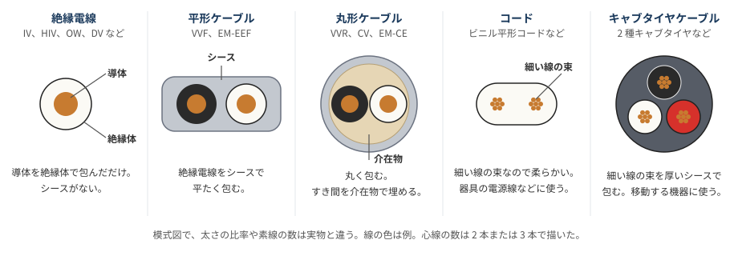
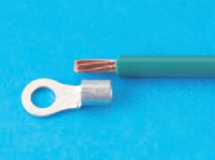
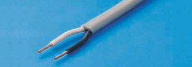
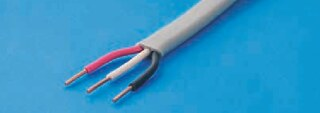
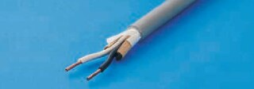
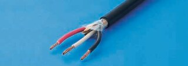
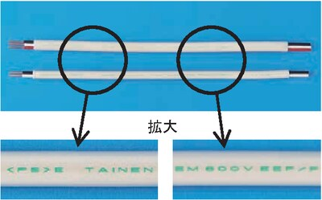
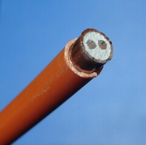
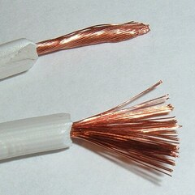

# 電工二種電線

「要約のみ」と書いた資料は、検索結果の要約で確認しただけで、ページの本文は読んでいない。※ の付いた項目は、出典と照合できていない記憶ベースの内容（「確認状況」を参照）。

## 電線・ケーブル・コードの種類（写真）

電線の名称、最高許容温度、使える場所を聞く問題に対応するためのまとめ。許容電流の計算（令和 7 年度下期 問 8 など）は、[電気回路.md の「電線の許容電流」](電気回路.md#L831)にある。写真はなるべく過去問のものを使った。出典の「R7 下」は令和 7 年度下期を表す。

### まず種類を分ける

| 分類 | 見分け方 | 記号の例 |
|---|---|---|
| **絶縁電線** | シースがない | IV、HIV、OW、DV、EM-IE、EM-IC |
| **ケーブル** | シースで包んである | VVF、VVR、CV、EM-EEF、EM-CE、MI |
| **コード** | 細い線の束で柔らかい | VFF、VCTF、ゴムコード |
| **キャブタイヤケーブル** | 細い線の束を厚いシースで包む | 2 種キャブタイヤケーブル |

### 記号の読み方

ケーブルの記号は「絶縁体、シース、形」の順に並ぶ。絶縁電線の多くは I で始まり、次の文字が絶縁体を表す。

| 文字 | 意味 |
|---|---|
| **V** | ビニル |
| **E** | ポリエチレン |
| **C** | 架橋ポリエチレン |
| **F / R** | 平形 / 丸形 |
| **EM** | エコマテリアル。環境に配慮した電線で、燃やしても有害なハロゲン系ガスが出ない |
| **H** | 耐熱 ※（HIV の H）|

| 記号 | 分解 | 名称 |
|---|---|---|
| VVF | V（絶縁体）+ V（シース）+ F（平形）| 600V **ビニル**絶縁**ビニル**シースケーブル**平形** |
| VVR | V + V + R（丸形）| 600V **ビニル**絶縁**ビニル**シースケーブル**丸形** |
| CV | C（絶縁体）+ V（シース）| 600V **架橋ポリエチレン**絶縁**ビニル**シースケーブル |
| EM-EEF | EM + E + E + F | 600V **ポリエチレン**絶縁耐燃性**ポリエチレン**シースケーブル**平形** |
| EM-CE | EM + C + E | 600V **架橋ポリエチレン**絶縁耐燃性**ポリエチレン**シースケーブル |
| EM-IE | EM + I + E | 600V 耐燃性**ポリエチレン**絶縁電線 |
| EM-IC | EM + I + C | 600V 耐燃性**架橋ポリエチレン**絶縁電線 |

最後の 4 つは名前が似ていて、R6 下 問 34、R7 下 問 35、R8 下 問 38 では選択肢にそろって出た。次の順に見ると区別できる。

1. **「シース」があるか**：あればケーブル（EEF、CE）、なければ絶縁電線（IE、IC）。
2. **「架橋」があるか**：あれば C（CE、IC）、なければ E（EEF、IE）。
3. **「平形」があるか**：あれば F（EEF）。

### 絶縁電線

| 写真 | 記号 | 名称 | 最高許容温度 | 覚えること |
|---|---|---|---|---|
|  | **IV** | 600V ビニル絶縁電線 | 60℃ | 基本の絶縁電線。写真は H29 上 問 43 の接地線で、シースのない見た目の例（種類の名前は問題文にない）|
| 写真なし | **HIV** | 600V 二種ビニル絶縁電線 | 75℃ | IV より耐熱性が高く、許容電流も大きい |
| 写真なし | **OW** | 屋外用ビニル絶縁電線 | 60℃ ※ | 電柱の間の架空配電線。屋内配線には使えない |
| 写真なし | **DV** | 引込用ビニル絶縁電線 | 60℃ ※ | 主に架空引込線に使う |
| 写真なし | **EM-IE** | 600V 耐燃性ポリエチレン絶縁電線 | 75℃ | HIV の代わりに使われる |
| 写真なし | **EM-IC** | 600V 耐燃性架橋ポリエチレン絶縁電線 | 90℃ ※ | 架橋ポリエチレンの絶縁電線 |

### ケーブル

| 写真 | 記号 | 名称 | 最高許容温度 | 覚えること |
|---|---|---|---|---|
|  | **VVF**（2 心）| 600V ビニル絶縁ビニルシースケーブル平形 | 60℃ | 灰色で平たい。心線は黒と白 |
|  | **VVF**（3 心）| 同じ | 60℃ | 心線は黒、白、赤。隣のボックスへ帰り線を渡すときに出てくる |
|  | **VVR** | 600V ビニル絶縁ビニルシースケーブル丸形 | 60℃ | 灰色で丸い。シースをはぐと介在物が見える |
|  | **CV** | 600V 架橋ポリエチレン絶縁ビニルシースケーブル | 90℃ | 写真は黒いシースの丸形。地中に直接埋める配線に使える |
|  | **EM-EEF** | 600V ポリエチレン絶縁耐燃性ポリエチレンシースケーブル平形 | 75℃ | 表面に「EM 600V EEF/F」と印字がある。焼却時に有害なハロゲン系ガスが出ない |
| 写真なし | **EM-CE** | 600V 架橋ポリエチレン絶縁耐燃性ポリエチレンシースケーブル | 90℃ ※ | 図面には EM-CE5.5 のように書かれる |
|  | **MI** | 無機絶縁ケーブル | 数字は省略 | 選択肢の中で耐熱性が最も高い。写真は海外製品で、断面の白い部分が無機物の絶縁体 |

VVF、VVR、CV の写真は R4 下 午後 問 43 で、同じ問題に 4 本が並んで出た。この問題の答えは VVF の 2 心（心線数が最少のもの）で、ほかの 3 本の名前は問題文にない。

### コード

| 写真 | 記号 | 名称 | 最高許容温度 | 覚えること |
|---|---|---|---|---|
|  | **VFF** | ビニル平形コード | 60℃ | 小型の機器の配線と電源に使う。**電熱器具には使えない**。写真は海外のランプ線で、形が近い例 |
| 写真なし | **VCTF** | ビニルキャブタイヤ丸形コード | 60℃ | 小型の機器の配線と電源コードに使う |
| 写真なし | | ゴムコード | | 電熱器具に使える。太さで使える消費電力が決まる |
| 写真なし | | ゴム絶縁丸打コード | | R5 下 午前 問 37 の選択肢に名前が出た |
| 写真なし | | 2 種キャブタイヤケーブル | | 造営材の側面に沿わせるとき、支持点間は 1 m 以下 |

### 最高許容温度

**シースではなく、絶縁体の材料で決まる。** CV はシースがビニルでも、絶縁体が架橋ポリエチレンなので 90℃。

| 温度 | 絶縁体の材料 | 記号 |
|---|---|---|
| **60℃** | ビニル | IV、VVF、VVR、VFF、VCTF、OW ※、DV ※ |
| **75℃** | ポリエチレン、耐熱性のビニル | EM-EEF、EM-IE、HIV |
| **90℃** | 架橋ポリエチレン | CV、EM-CE ※、EM-IC ※ |

MI ケーブルは、R5 下 午前 問 12 と R8 下 問 12 で「耐熱性が最も優れている」ものとして答えになった。

### 過去問での聞かれ方

| 出題 | 聞かれたこと | 答え |
|---|---|---|
| R4 上 午前 問 12、R7 下 問 12 | EM-EEF の最高許容温度 | 75℃ |
| R4 上 午後 問 12、R6 下 問 12 | CV の最高許容温度 | 90℃ |
| R6 上 問 12 | IV の最高許容温度 | 60℃ |
| R4 下 午前 問 12、R5 上 午前 問 12 | 最高許容温度が最も高いもの（CV、HIV、VVR、IV）| CV |
| R5 下 午前 問 12、R8 下 問 12 | 耐熱性が最も優れているもの（HIV、IV、MI、VV）| MI ケーブル |
| R3 上 午前 問 16、R4 下 午前 問 16、R6 下 問 16、R8 下 問 16 | 写真の材料の名称 | EM-EEF |
| R5 上 午前 問 16、R5 下 午後 問 12 | EM-EEF の特徴で誤っているもの | 「焼却時に有害なハロゲン系ガスが発生する」 |
| R6 下 問 34、R7 下 問 35 | 図の電線の名称 | 600V 架橋ポリエチレン絶縁耐燃性ポリエチレンシースケーブル（EM-CE）|
| R8 下 問 38 | 図記号の名称 | 600V ポリエチレン絶縁耐燃性ポリエチレンシースケーブル平形（EM-EEF）|
| R7 上 問 32 | EM 電線で、図の部分に使えない記号（EM-EEF、EM-CE、EM-EE、EM-IE）| EM-IE（シースのない絶縁電線）|
| R4 上 午前 問 11 | 地中に直接埋める配線に使えるもの（CV、OW、DV、IV）| CV |
| R5 下 午前 問 37 | 図の部分に使えるもの（ゴム絶縁丸打コード、DV、CV、OW）| CV |
| R4 下 午後 問 12、R5 上 午後 問 12 | ビニルコードが使える器具（扇風機、こたつ、こんろ、トースター）| 扇風機（熱を出さない）|
| R8 上 問 12 | 0.75 mm² のゴムコードで使える最大の電熱器具 | 600 W（7 A × 100 V = 700 W まで）|
| R7 上 問 12 | 1.25 mm² のゴムコードで使える最大の電熱器具 | 1000 W（12 A × 100 V = 1200 W まで）|
| R5 下 午後 問 20、R8 下 問 20 | 工事の方法で不適切なもの | キャブタイヤケーブルの支持点間 1.5 m（1 m 以下にする）|
| R5 上 午前 問 18 | ケーブルストリッパの用途 | VVF の外装や絶縁被覆をはぎ取る（VVR、CV、VFF の選択肢は誤り）|

コードの許容電流の値は、[電気回路.md の「コードの許容電流」](電気回路.md#L885)にある。

### 確認状況（電線）

- **問題文と答え**：試験センターの問題と解答で確認した。公式の解答は記号だけで、解説はない。
- **温度**：IV、CV、EM-EEF は過去問の答えで、HIV は[メーカーの資料](https://www.wirecable-sales.com/pdf/1538.pdf)で、EM-IE は[別の資料](https://www.wirecable-sales.com/pdf/447.pdf)で、VFF と VCTF は[古河電工メタルケーブルの表](https://www.furukawa-mc.jp/products/cable/clist/clist04.html)で確認した。VV の 60℃ は、EM-EEF が PVC ケーブルより 15℃ 高い 75℃ という [Panasonic の用語集](https://www2.panasonic.biz/jp/terasu/skill/dictionary/em-eef.html)の説明からの読み取り。R5 上 午前 問 16 でも「VV より最高許容温度が高い」は正しい記述として扱われている。
- **未照合（※）**：OW と DV の 60℃、EM-IC の 90℃、H が耐熱を表すことは記憶に基づく。EM-CE の 90℃ は、絶縁体が CV と同じ架橋ポリエチレン（[仕様書](https://www.sds-kaeruya.com/download/SF-0027_EM_600V_CE_F.pdf)）であることからの判断で、数字そのものは資料で確認できていない。
- **写真の対応**：EM-EEF は問題文の選択肢と答えで確認した。VVF は R3 下 午後 問 46 の解説（[ふくラボ](https://denkikouji2nd.fukulabo-e9.com/2021/12/2p-r03s-p46/)）で確認した。VVR と CV は、問題文に名前がなく、丸形、灰色、介在物、黒いシース、より線の見た目から自分で判断した。CV のシースが常に黒いとは確認していない。
- **過去問にない写真**：平成 29 年度以降の公開分のうち、写真が多いページを一覧で確認したが、見つからなかった。MI とランプ線は Wikimedia Commons の写真で、どちらも海外の製品。ランプ線は VFF そのものではなく、形が近い例として使った。ほかの種類は使える写真が見つからなかったので「写真なし」とし、メーカーの写真は転載していない。古い回は写真のページだけを見ており、文字では検索できていない。
- **模式図と記号の読み方**：名称と記号の対応から自分で整理した。VVF の心線の色は[メーカーの仕様書](https://www.sds-kaeruya.com/download/SF-0039_VVF.pdf)と写真で確認した。OW の用途は [Panasonic の用語集](https://www2.panasonic.biz/jp/terasu/skill/dictionary/outdoor.html)、DV の用途は[タツタ電線の仕様書](https://www.tatsuta.co.jp/assets/pdf/products/electrical-cable/electric/power/dv.pdf)による。キャブタイヤが移動する機器に使われるという説明は記憶に基づく。MI の断面の説明は、「無機絶縁」という名前と写真からの読み取り。
- **問 32 の理由**：R7 上 問 32 の「シースのない絶縁電線」は自分で補った説明で、答えの記号だけを確認している。R5 下 午前 問 37 の ⑦ が図のどの部分かは確認していない。
- **ゴムコードの区分**：電熱器具に使える点は、R4 下 午後 問 12、R7 上 問 12、R8 上 問 12 からの読み取り。規程の原文とは照合していない。

### 覚え方（電線）

> シースがなければ絶縁電線、あればケーブル、細い線の束で柔らかければコード。

> 記号は V がビニル、E がポリエチレン、C が架橋ポリエチレン、F が平形、R が丸形。

> 最高許容温度は絶縁体で決まる。ビニル 60、ポリエチレン 75、架橋 90。HIV だけビニルでも 75。

> 耐熱性の一番は MI。地中に直接埋めるなら CV。

> ビニルコードは電熱器具に使えない。電熱器具はゴムコード。

### 参考文献（電線）

過去問の写真は、試験センターの[過去問題の使用に関する留意点](https://www.shiken.or.jp/construction/second/qa/)に従って教育目的で使った。**いずれも切り抜いて縮小し、選択肢の記号（イ、ロなど）を消す改変をした。**

- 出典：令和 8 年度下期第二種電気工事士試験（問 12、16、20、38）：[問題](https://www.shiken.or.jp/construction/upload/20261025_co_second_q01.pdf)、[解答](https://www.shiken.or.jp/construction/upload/20261025_co_second_a01.pdf)
- 出典：令和 8 年度上期第二種電気工事士試験（問 12）：[問題](https://www.shiken.or.jp/construction/upload/20260524_co_second_q01.pdf)、[解答](https://www.shiken.or.jp/construction/upload/20260524_co_second_a01.pdf)
- 出典：令和 7 年度下期第二種電気工事士試験（問 8、12、35）：[問題](https://www.shiken.or.jp/construction/upload/20251026_co_second_q01.pdf)、[解答](https://www.shiken.or.jp/construction/upload/20251026_co_second_a01.pdf)
- 出典：令和 7 年度上期第二種電気工事士試験（問 12、32）：[問題](https://www.shiken.or.jp/construction/upload/20250525_co_second_q01.pdf)、[解答](https://www.shiken.or.jp/construction/upload/20250525_co_second_a01.pdf)
- 出典：令和 6 年度下期第二種電気工事士試験（問 12、16、34）：[問題](https://www.shiken.or.jp/construction/upload/20241027_co_second_q01.pdf)、[解答](https://www.shiken.or.jp/construction/upload/20241027_co_second_a01.pdf)
- 出典：令和 6 年度上期第二種電気工事士試験（問 12）：[問題](https://www.shiken.or.jp/construction/upload/20240526_co_second_q01.pdf)、[解答](https://www.shiken.or.jp/construction/upload/20240526_co_second_a01.pdf)
- 出典：令和 5 年度下期第二種電気工事士試験（午前）（問 12、37）：[問題](https://www.shiken.or.jp/construction/upload/20231029_co_second_q01.pdf)、[解答](https://www.shiken.or.jp/construction/upload/20231029_co_second_a01.pdf)
- 出典：令和 5 年度下期第二種電気工事士試験（午後）（問 12、20）：[問題](https://www.shiken.or.jp/construction/upload/20231029_co_second_q02.pdf)、[解答](https://www.shiken.or.jp/construction/upload/20231029_co_second_a02.pdf)
- 出典：令和 5 年度上期第二種電気工事士試験（午前）（問 12、16、18）：[問題](https://www.shiken.or.jp/construction/upload/20230528_co_second_q01.pdf)、[解答](https://www.shiken.or.jp/construction/upload/20230528_co_second_a01.pdf)
- 出典：令和 5 年度上期第二種電気工事士試験（午後）（問 12）：[問題](https://www.shiken.or.jp/construction/upload/20230528_co_second_q02.pdf)、[解答](https://www.shiken.or.jp/construction/upload/20230528_co_second_a02.pdf)
- 出典：令和 4 年度下期第二種電気工事士試験（午前）（問 12、16。EM-EEF の写真）：[問題](https://www.shiken.or.jp/construction/upload/20221030_co_second_q01.pdf)、[解答](https://www.shiken.or.jp/construction/upload/20221030_co_second_a01.pdf)
- 出典：令和 4 年度下期第二種電気工事士試験（午後）（問 12、43。VVF、VVR、CV の写真）：[問題](https://www.shiken.or.jp/construction/upload/20221030_co_second_q02.pdf)、[解答](https://www.shiken.or.jp/construction/upload/20221030_co_second_a02.pdf)
- 出典：令和 4 年度上期第二種電気工事士試験（午前）（問 11、12）：[問題](https://www.shiken.or.jp/construction/upload/20220529_co_second_q01.pdf)、[解答](https://www.shiken.or.jp/construction/upload/20220529_co_second_a01.pdf)
- 出典：令和 4 年度上期第二種電気工事士試験（午後）（問 12）：[問題](https://www.shiken.or.jp/construction/upload/20220529_co_second_q02.pdf)、[解答](https://www.shiken.or.jp/construction/upload/20220529_co_second_a02.pdf)
- 出典：令和 3 年度上期第二種電気工事士試験（午前）（問 16）：[問題](https://www.shiken.or.jp/construction/upload/20210530_co_second_q01.pdf)、[解答](https://www.shiken.or.jp/construction/upload/20210530_co_second_a01.pdf)
- 出典：平成 29 年度上期第二種電気工事士試験（問 43。接地線の写真）：[問題](https://www.shiken.or.jp/construction/upload/20170604_co_second_q01.pdf)、[解答](https://www.shiken.or.jp/construction/upload/20170604_co_second_a01.pdf)
- 写真（縮小して使用）：[MICCCable](https://commons.wikimedia.org/wiki/File:MICCCable.jpg)（Alistair1978、CC BY-SA 2.5）、[Stranded lamp wire](https://commons.wikimedia.org/wiki/File:Stranded_lamp_wire.jpg)（Scott Ehardt、パブリックドメイン）
- [Panasonic 電線・ケーブルの種類](https://www2.panasonic.biz/jp/basics/electric/electricity/cable-type/)：IV、VV、CV の用途
- [Panasonic 用語集 EM-EEF](https://www2.panasonic.biz/jp/terasu/skill/dictionary/em-eef.html)：EM の意味、ハロゲンガス、許容温度 75℃
- [Panasonic 用語集 屋外用ビニル絶縁電線](https://www2.panasonic.biz/jp/terasu/skill/dictionary/outdoor.html)：OW の用途と、屋内配線に使えないこと
- [VVF の仕様書 SF-0039](https://www.sds-kaeruya.com/download/SF-0039_VVF.pdf)：VVF の構造と線心の色
- [EM-EEF の仕様書 SF-0041](https://www.sds-kaeruya.com/download/SF-0041_EEFF.pdf)、[EM-CE の仕様書 SF-0027](https://www.sds-kaeruya.com/download/SF-0027_EM_600V_CE_F.pdf)、[EM-IE の仕様書 SF-0034](https://www.sds-kaeruya.com/download/SF-0034_EM_IE_F.pdf)：名称と構造
- メーカー資料（[IV、HIV](https://www.wirecable-sales.com/pdf/1538.pdf)、[EM-IE](https://www.wirecable-sales.com/pdf/447.pdf)）：導体最高許容温度、EM-IE が HIV の代替であること
- [タツタ電線 DV の仕様書](https://www.tatsuta.co.jp/assets/pdf/products/electrical-cable/electric/power/dv.pdf)：名称と架空引込線の用途
- 古河電工メタルケーブル（[コードの許容電流](https://www.furukawa-mc.jp/products/cable/clist/clist04.html)、[VFF](https://www.furukawa-mc.jp/products/cable/code/vff.html)、[VCTF](https://www.furukawa-mc.jp/products/cable/code/vctf_vctfk.html)）：コードの最高許容温度、構造、用途
- [ふくラボ 令和 3 年度下期 午後 問 46](https://denkikouji2nd.fukulabo-e9.com/2021/12/2p-r03s-p46/)：VVF と心線数の考え方
