# 電気回路メモ

各章の末尾に参考文献を載せている。「要約のみ」と書いた資料は、検索結果の要約で確認しただけで、ページの本文は読んでいない。

## 電力（皮相電力・複素電力・有効電力・無効電力）

### よくある混乱

「皮相電力は消費電力と無効電力をベクトル合成したものだからベクトル」と説明されることが多いが、
「皮相電力を求めよ」という問題の答えはスカラー値（VA）になる。
これはベクトル本体とそのノルムを呼び分けていないことが原因。

### 正しい用語の使い分け

| 名称 | 記号 | 定義 | 種類 | 単位 |
|---|---|---|---|---|
| 複素電力 | $\dot{S}$ | $P + jQ = \dot{V}\overline{\dot{I}}$ | 複素数（ベクトル） | VA |
| 皮相電力 | $S$ | $\lvert\dot{S}\rvert = \sqrt{P^2+Q^2} = VI$ | スカラー（ノルム） | VA |
| 有効電力 | $P$ | $VI\cos\varphi = \mathrm{Re}(\dot{S})$ | スカラー（実部） | W |
| 無効電力 | $Q$ | $VI\sin\varphi = \mathrm{Im}(\dot{S})$ | スカラー（虚部） | var |

- ベクトル合成したもの = **複素電力** $\dot{S}$
- そのノルム = **皮相電力** $S$
- JIS / IEC でも complex power と apparent power は区別されている

### 複素電力の定義の注意点

$$\dot{S} = \dot{V}\,\overline{\dot{I}}$$

電流側の **共役** を取るのがポイント（こうしないと無効電力の符号が逆になる）。

- 誘導性負荷（コイル）: $Q > 0$
- 容量性負荷（コンデンサ）: $Q < 0$

なぜ符号が逆になるかというと、$\dot{I} = \dot{V}/\dot{Z}$ なので電流の位相はインピーダンスの位相と逆向きになる（L: $\dot{Z}$ は $+90°$ だが $\dot{I}$ は $-90°$ 遅れ／C: $\dot{Z}$ は $-90°$ だが $\dot{I}$ は $+90°$ 進み）。
$\dot{S}=\dot{V}\dot{I}$ のままだと電流側の位相が虚部に出てしまい誘導性で $Q<0$ になる。共役を取ることで $\dot{Z}$ 側（直感に近い方）と符号が揃うという辻褄合わせ。

### すべては $\dot{Z}$ の位相で決まる

$\dot{I}=\dot{V}/\dot{Z}$ を代入すると：

$$\dot{S} = \dot{V}\,\overline{\dot{I}} = \dot{V}\cdot\overline{\left(\dfrac{\dot{V}}{\dot{Z}}\right)} = \dfrac{\lvert\dot{V}\rvert^2}{\overline{\dot{Z}}} = \dfrac{\lvert\dot{V}\rvert^2}{\lvert\dot{Z}\rvert^2}\cdot\dot{Z}$$

つまり $\arg(\dot{S}) = \arg(\dot{Z}) = \varphi$（力率角）。**$\dot{S}$ の位相は $\dot{Z}$ の位相そのもの**。

| 素子 | $\arg(\dot{Z})$ | $\arg(\dot{I})$（$\dot{V}$ 基準） | $\arg(\dot{S})$ | $Q$ |
|---|---|---|---|---|
| R | $0$ | $0$ | $0$ | $0$ |
| L | $+90°$ | $-90°$ | $+90°$ | $+$ |
| C | $-90°$ | $+90°$ | $-90°$ | $-$ |

電流の位相は $\dot{Z}$ と逆向きで紛らわしいが、$\dot{S}$ は $\dot{Z}$ と同じ向き。これが「共役を取る」ご利益の正体。電流（駆動条件依存の従属変数）ではなく、インピーダンス（素子固有の不変量）を主役に据えると見通しが良い。

### 実回路の位相は $\pm\pi/2$ ではなく中間の角度

「コイル → $-90°$ 遅れ／コンデンサ → $+90°$ 進み」は**素子単体の極端なケース**で、RLC が混在する実回路では中間の角度になる。

例: $\dot{Z} = 12 + 16j$ の回路
- $\arg(\dot{Z}) = \arctan(16/12) = \arctan(4/3) \approx 53.13°$
- $\arg(\dot{I}) = -\arg(\dot{Z}) \approx -53.13°$（$\pi/2$ ではない）

| 量 | 値 |
|---|---|
| $\lvert\dot{Z}\rvert$ | $\sqrt{12^2+16^2} = 20$ |
| 力率 $\cos\varphi$ | $12/20 = 0.6$ |
| $\sin\varphi$ | $16/20 = 0.8$ |

問題で「力率 0.6 / 0.8」が頻出するのは、3-4-5 の整数比直角三角形で計算しやすくしているため。

**まとめ:**
- 純 R: $\arg(\dot{Z}) = 0$ → 電流 同相
- 純 L: $\arg(\dot{Z}) = +90°$ → 電流 $-90°$（最大遅れ）
- 純 C: $\arg(\dot{Z}) = -90°$ → 電流 $+90°$（最大進み）
- RLC 混在: $-90° < \arg(\dot{Z}) < +90°$ の中間値

### 電力三角形

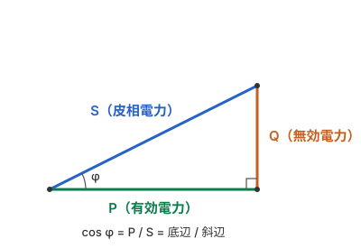

- 斜辺の長さ = 皮相電力 $S$
- 底辺 = 有効電力 $P$
- 高さ = 無効電力 $Q$
- 力率 $\cos\varphi = P/S$

### $S, P, Q$ の次元はすべて J/s

$\mathrm{V\cdot A} = \mathrm{(J/C)(C/s)} = \mathrm{J/s} = \mathrm{W}$ なので、VA・W・var の次元はすべて同じ。単位名を分けるのは次元が違うからではなく、量の意味が違うことを示すため（トルクの N·m とエネルギーの J が同じ次元でも別の量として扱うのと似ている）。

$v=\sqrt{2}V\cos\omega t,\ i=\sqrt{2}I\cos(\omega t-\varphi)$ として瞬時電力を計算すると、3 つとも同じ式の中に現れる。

$$p(t) = P(1+\cos 2\omega t) + Q\sin 2\omega t = P + S\cos(2\omega t-\varphi)$$

| 量 | 式の中での役割 | 意味 |
|---|---|---|
| 有効電力 $P$（W） | $p(t)$ の**平均値** | 実際に消費され続ける分 |
| 無効電力 $Q$（var） | 平均ゼロの往復項の**振幅** | 電源と L・C の間を行き来するだけで、1 周期の正味はゼロ |
| 皮相電力 $S$（VA） | 平均 $P$ のまわりの揺れの**振幅** | 電圧と電流の大きさだけで決まる $VI$。変圧器などの容量はこれで表す |

- **足し算できない**：$S \neq P+Q$ で、正しくは $S^2=P^2+Q^2$。1 kW と 1 kvar を足しても 2 にはならない。
- **電力量になるのは $P$ だけ**：時間で積分して正味のエネルギー（Wh）として残るのは $P$ だけで、$Q$ の項は 1 周期で打ち消し合う。

### 直列／並列での力率の見え方

力率 $\cos\varphi$ を掛けると、**有効電力に寄与する（基準量と同相の）成分**が取り出せる。有効電力の式 $P = VI\cos\varphi$ 自体は直列・並列どちらでも同じで、変わるのは「力率を掛ける相手が電圧か電流か」だけ。

| | 共通な量 | 分解される量 | $\cos\varphi$ を掛けて得る同相成分 | 有効電力 |
|---|---|---|---|---|
| 直列回路 | 電流 $I$ | 電圧 $V$ | $V\cos\varphi = V_R$（R にかかる電圧）| $P = I\,(V\cos\varphi)$ |
| 並列回路 | 電圧 $V$ | 電流 $I$ | $I\cos\varphi = I_R$（R を流れる電流）| $P = V\,(I\cos\varphi)$ |

- **直列**：全素子に同じ $I$ が流れ、電圧がベクトルで分圧される。電圧を $V\cos\varphi$（同相＝有効）と $V\sin\varphi$（直交＝無効）に分解。
- **並列**：全素子に同じ $V$ がかかり、電流がベクトルで分流される。電流を $I\cos\varphi$（同相）と $I\sin\varphi$（直交）に分解。

> 用語注意：有効電力は「**有効**電力」（W）。「実効」は実効値（RMS）に使う別語なので混同しない。

### 力率角 $\varphi$ はどの三角形でも同じ

- 直列は **インピーダンス三角形** $\dot{Z}=R+jX$ が土台。$I$ を掛けると **電圧三角形** $V_R=IR,\ V_X=IX,\ V=IZ$。
- 並列は **アドミタンス三角形** $\dot{Y}=G+jB$ が土台。$V$ を掛けると **電流三角形** $I_R=VG,\ I_B=VB,\ I=VY$。
- さらに共通量（直列なら $I$、並列なら $V$）を掛けると、どちらも上の **電力三角形** $P,Q,S$ に相似拡大する。

$$\cos\varphi = \frac{P}{S} = \frac{R}{Z} = \frac{G}{Y} = \frac{V_R}{V} = \frac{I_R}{I}$$

すべて同じ角度 $\varphi$ を指している、というのがポイント。

### 覚え方

> 「皮相電力」と言われたら $\sqrt{P^2+Q^2}$ のスカラー、
> ベクトルとして扱いたいときは「複素電力」と呼ぶ。

> 直列は電圧を、並列は電流を、力率で「同相（有効）」と「直交（無効）」に分ける。

### 参考文献（電力）

- [三菱電機 FA の解説](https://www.mitsubishielectric.co.jp/fa/ssl/learn/el/eln/course/fa_0131/cha_1/01050001.html)：有効電力は瞬時電力の 1 周期の平均、無効電力の単位 var（要約のみ）
- [KEK の資料](https://research.kek.jp/people/ykamiya/circuit/preparation.pdf)：瞬時電力の 2 倍周波数の成分、複素電力の絶対値・実部・虚部（要約のみ）
- [京都大学 OCW の資料](https://ocw.kyoto-u.ac.jp/wp-content/uploads/2007/04/2007_shizengensyoutosuugaku_7.pdf)：無効電力は電源と負荷の間を行き来するエネルギー（要約のみ）
- [Wikibooks 電気回路理論／電力回路](https://ja.wikibooks.org/wiki/%E9%9B%BB%E6%B0%97%E5%9B%9E%E8%B7%AF%E7%90%86%E8%AB%96/%E9%9B%BB%E5%8A%9B%E5%9B%9E%E8%B7%AF)：皮相電力と単位 VA（要約のみ）

**未照合**：「JIS / IEC でも区別されている」という記述、$\dot{Z}$ の位相の説明、直列／並列での力率の見え方は、上の資料と個別に照合していない。本文の式の展開は手元の計算。

## 三相交流（Δ / Y と √3）

### 用語の区別

- **線電流** $I_l$：外部へ出ていく線（電線）を流れる電流
- **相電流** $I_p$：各相の素子（巻線・負荷）そのものを流れる電流
- **線間電圧** $V_l$：線と線の間の電圧
- **相電圧** $V_p$：各相の素子にかかる電圧

「線間電流」という語は無い。線を流れるのは **線電流**。

### Δ と Y で √3 が出る場所が入れ替わる

| 結線 | 電圧 | 電流 | 線の本数 |
|---|---|---|---|
| **Δ（デルタ）** | $V_l = V_p$ | $I_l = \sqrt{3}\,I_p$ | 3本（中性線なし）|
| **Y（スター）** | $V_l = \sqrt{3}\,V_p$ | $I_l = I_p$ | 3本 or 4本（中性線を引けば三相四線式）|

### √3 の正体：120° 差ベクトルの「差」

Y でも Δ でも、√3 は **大きさの等しい 120° ずれた 2 ベクトルの差**から出る。

$$|\dot{A} - \dot{B}| = 2A\sin\frac{120°}{2} = 2A\sin 60° = 2A\cdot\frac{\sqrt{3}}{2} = \sqrt{3}\,A$$

- **Δ の線電流**：節点で KCL より相電流 2 本の差 → $I_l = \sqrt{3}\,I_p$
- **Y の線間電圧**：相電圧 2 本の差 → $V_l = \sqrt{3}\,V_p$

### デルタ（三相三線式）の電流イメージ

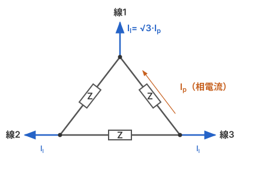

- **相電流** $I_p$ = 三角形の「辺」を回る電流
- **線電流** $I_l$ = 「頂点」から線へ出る電流 = $\sqrt{3}\,I_p$

辺を回る $I_p$ と、頂点から外へ出る $I_l$ を分けて見ると、KCL で差を取る構図が見える。

### 三相電力が $\sqrt{3}\,V_l I_l\cos\varphi$ になる理由

総電力は「1 相あたり × 3 相」：

$$P = 3\,V_p I_p\cos\varphi$$

これを測定しやすい線量（$V_l, I_l$）に変換する。

- **Δ**: $V_p = V_l,\ I_p = I_l/\sqrt{3}$ → $P = 3\cdot V_l\cdot\dfrac{I_l}{\sqrt{3}}\cos\varphi = \sqrt{3}\,V_l I_l\cos\varphi$
- **Y**: $V_p = V_l/\sqrt{3},\ I_p = I_l$ → $P = 3\cdot\dfrac{V_l}{\sqrt{3}}\cdot I_l\cos\varphi = \sqrt{3}\,V_l I_l\cos\varphi$

どちらも同じ。皮相電力は $S = \sqrt{3}\,V_l I_l$（VA）。

係数が √3 になるのは：

$$\underbrace{3}_{\text{3相}}\times\underbrace{\frac{1}{\sqrt{3}}}_{\text{線⇔相の変換1回}} = \sqrt{3}$$

線電圧と線電流は「同じ相の対」ではないので、素直な $3 V_p I_p$ から変換を 1 回挟むと √3 に化ける。

### 電線路の電力損失は √3 倍ではなく 3 倍

三相三線式で、各線の抵抗が $r$、線電流が $I_l$ のとき：

$$P_{\text{損失}} = 3I_l^2 r$$

各線の抵抗には $I_l$ がそのまま流れるので、1 本あたりの損失は $I_l^2 r$。平均電力はスカラーなので 3 本分を単純に足すだけで、線どうしの位相差（120°）は効かない。

瞬時値で計算しても同じ：

$$r(i_a^2+i_b^2+i_c^2) = 2I_l^2 r\left\{\cos^2\theta+\cos^2(\theta-120°)+\cos^2(\theta-240°)\right\} = 2I_l^2 r\cdot\frac{3}{2} = 3I_l^2 r$$

120° のずれは合計の脈動を打ち消すだけで、損失の大きさには影響しない。

√3 が出るのは、120° ずれた 2 つのベクトルの差を取るときや、その関係で線間電圧に換算するとき。

| 量 | 式 | 係数の理由 |
|---|---|---|
| 電力損失 | $3I_l^2 r$ | 抵抗ごとの損失をスカラーで足すだけ |
| 電圧降下（近似式、$x$ は線路のリアクタンス） | $\sqrt{3}\,I_l(r\cos\varphi+x\sin\varphi)$ | 線間電圧は相電圧 2 本のベクトル差なので、線間電圧で見ると 1 相分の √3 倍 |
| 三相電力 | $\sqrt{3}\,V_l I_l\cos\varphi$ | もとは $3V_pI_p\cos\varphi$ で、線間の量に書き換えると $3/\sqrt{3}=\sqrt{3}$ |

電力はもともと「1 相分の 3 倍」で、√3 は線間電圧と線電流で書き換えたときに現れる。電力損失の式は線電流だけで書けるので √3 が出ない。

位相が効くのは次のところ：

- **同じ素子の電圧と電流の位相差**：消費電力は一般に $VI\cos\varphi$ で、位相差に左右される。抵抗では電圧と電流が同相で $\cos\varphi=1$ なので、$I^2 r$ の形に位相が出てこないだけ。
- **負荷の力率**：電流の大きさを通じて損失に効く。同じ電力 $P$ を送るなら $I_l = P/(\sqrt{3}V_l\cos\varphi)$ なので、力率が下がるほど損失が増える。

$$P_{\text{損失}} = \frac{rP^2}{V_l^2\cos^2\varphi}$$

> 注意：Δ 負荷で相電流 $I_p$ が与えられた問題では、先に線電流へ換算する。$I_l=\sqrt{3}I_p$ なので、損失は $3(\sqrt{3}I_p)^2 r = 9I_p^2 r$。

### 実効値で計算すると位相が消える理由

実効値はもともと $i^2$ を 1 周期で平均して作る値なので、$I^2 r$ の計算には位相が残らない。瞬時値を $i=\sqrt{2}I\sin(\omega t+\theta)$ とすると、抵抗 $r$ の平均電力は：

$$\frac{1}{T}\int_0^T r\,i^2\,dt = r\cdot 2I^2\cdot\frac{1}{2} = I^2 r$$

$\sin^2$ の 1 周期平均は $\theta$ によらず $1/2$ なので、$\theta$ が消える。

ただし、実効値なら常に位相が不要というわけではない。実効値が持っているのは大きさだけで、次の場面では位相が別に必要。

- **電流や電圧の足し引き**：Δ の線電流は相電流 2 本の差。実効値がどちらも $I_p$ でも、結果が $\sqrt{3}I_p$ になるのは 120° ずれているからで、同相なら差は 0。
- **電圧と電流の積**：有効電力 $VI\cos\varphi$ は、$V,I$ が実効値でも位相差 $\varphi$ がないと求まらない。

$i^2$ の平均だけで決まる抵抗の損失は実効値だけで計算でき、足し引きや $V$ と $I$ の積には位相も必要。

> 用語注意：問題文の $I\sin\theta$ は瞬時値ではなく、実効値 $I$ のうちの**無効分**を指すことがほとんど。瞬時値なら、普通は $\sqrt{2}I\sin(\omega t+\theta)$ のように時間 $t$ を含む形で書かれる。

### 覚え方（三相）

> Δ は電流が √3 倍、Y は電圧が √3 倍。どちらも「120° 差の 2 本を引く」から √3。
> 電力は結線によらず $P = \sqrt{3}\,V_l I_l\cos\varphi$（3 相 ÷ √3 の変換 = √3）。

> 電力損失は 3 倍（$3I_l^2 r$）、電圧降下は √3 倍。損失は線電流だけで書けるので √3 が出ない。

### 参考文献（三相）

- 岐阜大学の資料（[その 1](https://www1.gifu-u.ac.jp/~ishikawa/gnct/Elec/3phase1.pdf)、[その 2](https://www1.gifu-u.ac.jp/~ishikawa/gnct/Elec/3phase2.pdf)）、大阪公立大学高専の講義資料（[第 25 回](https://www2-kawakami.ct.osakafu-u.ac.jp/omu-content/uploads/sites/1161/Lecture_Data/Electric_Circuit_I/01_Lecture/25_lecture_electric_circuit_I.pdf)、[第 27 回](https://www2-kawakami.ct.osakafu-u.ac.jp/omu-content/uploads/sites/1161/Lecture_Data/Electric_Circuit_I/01_Lecture/27_lecture_electric_circuit_I.pdf)）：Δ 結線と Y 結線の √3、三相電力（要約のみ）
- [電験王の解説](https://denken-ou.com/denryokuh28-13/)：単相 2 線式の電圧降下 $2I(R\cos\theta+X\sin\theta)$
- [電圧降下の計算ツールの解説](https://tools.devcomma.com/ja/calculators/voltage-drop)：係数は単相 2 線式が 2、三相 3 線式が √3（要約のみ）

**未照合**：$3I_l^2 r$ は抵抗 1 本分の損失を 3 本分足して導いたもので、上の資料とは照合できていない。損失を電力と力率で表した式は手元の計算。「線間電流という語は無い」は記憶に基づく。

## 絶縁抵抗と接地抵抗

### 絶縁抵抗はどこの抵抗か

絶縁抵抗は、**電線の導体と、電流が流れてはいけない相手との間**の抵抗。測る場所は次の 2 か所。

1. **電線と電線の間（線間）**：被覆を挟んだ、隣の電線との間
2. **電線と大地の間（対地間）**：被覆や機器の絶縁を挟んだ、大地との間

抵抗器のような部品があるわけではなく、被覆などの絶縁物がどれだけ電流を通さないかを表す値。絶縁物が傷んだり湿ったりするとこの値が下がり、漏電や短絡の原因になる。

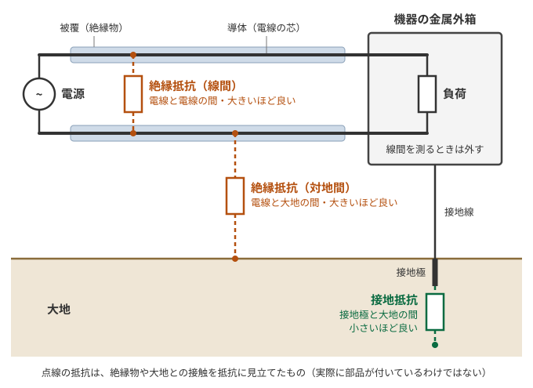

### 接地抵抗との違い

| | 接地抵抗 | 絶縁抵抗 |
|---|---|---|
| 場所 | 接地極と大地の間 | 線間、電線と大地の間 |
| 役割 | 漏れた電流を大地へ逃がす | そもそも電流を漏らさない |
| 望ましい値 | **小さい**ほど良い | **大きい**ほど良い |
| 値の桁 | Ω | MΩ |
| 測定器 | 接地抵抗計 | 絶縁抵抗計（メガー） |

### 測るときのイメージ

電源を切った電路に、絶縁抵抗計で直流の電圧をかけ、漏れる電流の少なさを抵抗値として読む。

線間を測るときは、電球などの負荷を外す。つないだままだと、絶縁物ではなく負荷の抵抗を測ってしまうため。

### 基準値（低圧）

開閉器や過電流遮断器で区切った電路ごとに、次の値以上が必要（[電気設備に関する技術基準を定める省令 第 58 条](https://laws.e-gov.go.jp/law/409M50000400052)）。

| 電路の電圧 | 絶縁抵抗 | 例 |
|---|---|---|
| 使用電圧 300 V 以下、対地電圧 150 V 以下 | 0.1 MΩ 以上 | 単相 100 V、単相 3 線式の 200 V |
| 使用電圧 300 V 以下、上記以外 | 0.2 MΩ 以上 | 三相 200 V |
| 使用電圧 300 V 超 | 0.4 MΩ 以上 | 三相 400 V |

100 V ÷ 0.1 MΩ = 1 mA なので、基準ぎりぎりでも漏れる電流は 1 mA 程度。

**基準は対地電圧で判断する。** 単相 3 線式 100/200 V の「200 V」の回路は、対地電圧が 100 V なので **0.1 MΩ 以上**でよい。「200 V だから 0.2 MΩ」としない。

絶縁抵抗の測定が難しいとき（分岐回路を停電できないときなど）は、使用電圧をかけた状態で、クランプ形電流計で漏えい電流を測る。**1 mA 以下**なら絶縁性能があると判断できる。

### 絶縁抵抗の測定手順

絶縁抵抗計（メガー）の **L 端子は電線側、E 端子は接地側**につなぐ。測り方は 2 通りあり、**負荷の扱いが逆**になる。

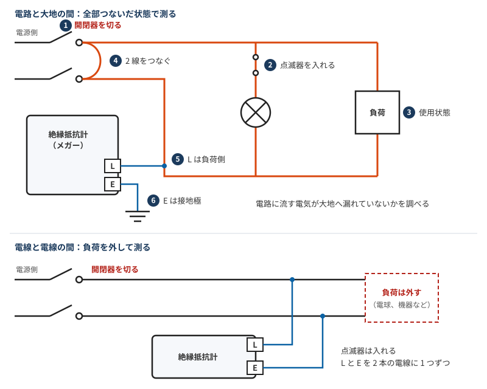

| 手順 | 電路と大地の間 | 電線と電線の間 |
|---|---|---|
| 開閉器 | **切る** | **切る** |
| 点滅器 | **入れる** | **入れる** |
| 負荷 | **つないだまま**（使用状態）| **外す**（電球を取り外し、機器は使用していない状態にする）|
| L 端子 | 負荷側の電線 | 電線の 1 本 |
| E 端子 | 接地極 | もう 1 本の電線 |

理由は、測りたい場所を考えるとわかる。

- **電路と大地の間**：電路全体が大地へ漏れていないかを見たいので、全部つながった状態にする。点滅器を入れて負荷もつなぐと、負荷の先まで一度に調べられる。
- **電線と電線の間**：負荷をつないだままだと、負荷を通って電流が流れてしまい、絶縁物の抵抗が測れない。だから負荷を外す。

開閉器を切るのは、どちらも電源を切り離すため。

### 接地の問題に絶縁抵抗が出てくる理由

絶縁が「電流を漏らさない」ための第一の対策で、接地は絶縁が効かなくなったときの備え。だからセットで問題に出てくる。

- **漏電は絶縁破壊のときだけではない**：劣化や湿気で絶縁抵抗が下がるだけでも起きる。
- **接地の目的は漏電対策だけではない**：機器の接地（C 種・D 種）は主に漏電時の感電や火災を防ぐためのもので、変圧器の B 種接地は高圧と低圧の混触に備えるもの。

漏れた電流は「電線 → 絶縁物 → 金属外箱 → 接地線 → 大地 → B 種接地 → 電源」と一周するので、絶縁抵抗 $R_i$ と接地抵抗は直列になる。

$$I = \frac{V}{R_B + R_i + R_D},\qquad V_{\text{外箱}} = I R_D$$

$V=100\ \mathrm{V}$、B 種接地 $R_B=10\ \Omega$、機器の接地 $R_D=100\ \Omega$ の場合：

| 状態 | $R_i$ | 漏れ電流 $I$ | 外箱の対地電圧 |
|---|---|---|---|
| 絶縁が基準ぎりぎり | 0.1 MΩ | 約 1 mA | 約 0.1 V |
| 絶縁破壊（完全地絡） | ほぼ 0 Ω | 約 0.91 A | 約 91 V |

絶縁が保たれていれば $R_i$ が圧倒的に大きいので、電流も外箱の電圧もごくわずか。絶縁が破れると $R_i$ が消え、接地抵抗の値で電流と外箱の電圧が決まる。問題で接地抵抗の計算が始まるのはこの状況。

この例では外箱に 91 V も残るので、接地だけでは感電を防ぎきれない。ただ、0.91 A という大きな電流が流れるので、漏電遮断器（家庭用なら一般に 30 mA で動作）がすぐに検知して回路を切れる。接地は電圧を下げるだけでなく、遮断器を確実に動かすための経路にもなっている。

### 接地工事の種類

接地工事は A 種から D 種の 4 種類。**電工二種で主に問われるのは、低圧機器の金属製外箱などに施す C 種と D 種**で、分かれ目は **300 V**。

| 種類 | 対象 | 接地抵抗値 | 接地線の太さ |
|---|---|---|---|
| A 種 | 高圧・特別高圧の機器の鉄台や金属製外箱など | 10 Ω 以下 | 直径 2.6 mm 以上 |
| B 種 | 高圧・特別高圧と低圧を結合する変圧器の低圧側の中性点など | 150 ÷ 1 線地絡電流（A）以下 | 直径 4 mm 以上 |
| **C 種** | **300 V を超える**低圧の機器の鉄台や金属製外箱など | **10 Ω 以下** | **直径 1.6 mm 以上** |
| **D 種** | **300 V 以下**の低圧の機器の鉄台や金属製外箱など | **100 Ω 以下** | **直径 1.6 mm 以上** |

C 種と D 種は、地絡時に **0.5 秒以内**に自動で遮断する装置（漏電遮断器など）を付けると、どちらも **500 Ω 以下**に緩和される。

| 機器の例 | 判定の理由 | 接地工事 |
|---|---|---|
| 単相 100 V、三相 200 V の機器 | 300 V 以下 | D 種（100 Ω 以下）|
| 三相 400 V の機器 | 300 V を超える | C 種（10 Ω 以下）|
| 三相 200 V の機器に 0.5 秒以内の漏電遮断器 | D 種の緩和 | D 種（500 Ω 以下）|
| 三相 400 V の機器に 0.5 秒以内の漏電遮断器 | C 種の緩和 | C 種（500 Ω 以下）|

500 Ω には計算の根拠があり、漏電遮断器の感度を 100 mA 以下と考えて、外箱の電圧（接触電圧）を 50 V 以下に抑える値とされている。

$$0.1\ \mathrm{A} \times 500\ \Omega = 50\ \mathrm{V}$$

移動して使う機器では、多心コードやキャブタイヤケーブルの 1 心を接地線に使う場合、0.75 mm² 以上でよい。

### 接地工事を省略できる条件

機械器具について、次の 5 つのどれかに当てはまれば省略できる。★ は[動画](https://www.youtube.com/watch?v=66CxzSHFUIs)で星印が付いていた項目で、この単元は出題頻度が高いとされている。

| | 省略できる条件 | 細かい条件 |
|---|---|---|
| ① ★ | 対地電圧 150 V 以下の機器を、**乾燥した場所**に施設する | 交流の場合。直流は使用電圧 300 V 以下 |
| ② ★ | 低圧の機器を、**乾燥した木製の床**など絶縁性のものの上で使う | **コンクリートの床は不可** |
| ③ | 電気用品安全法の**二重絶縁構造**の機器 | |
| ④ | 電源側に**絶縁変圧器**を施設し、負荷側の電路を接地しない | 二次側の線間電圧 300 V 以下、容量 3 kV·A 以下 |
| ⑤ | 水気のある場所以外の機器の電路に、電気用品安全法の適用を受ける**漏電遮断器**を施設する | 定格感度電流 15 mA 以下、動作時間 0.1 秒以下の電流動作型 |

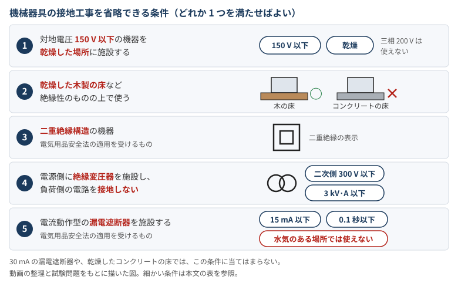

金属管については、D 種接地工事を次の場合に省略できる。

| 省略できる条件 | 細かい条件 |
|---|---|
| **乾燥した場所**で、長さが **4 m 以下** | |
| **対地電圧 150 V 以下**で、長さが **8 m 以下** | 乾燥した場所に施設するか、簡易接触防護措置を施す |

間違えやすい点：

- **水気のある場所**：15 mA・0.1 秒の漏電遮断器を付けても省略できない。
- **乾燥したコンクリートの床**：絶縁性のものには当たらないので、木の床の条件は使えない。
- **30 mA の漏電遮断器**：感度が 15 mA より鈍いので、この条件では省略できない。省略できるとしたら、別の条件を満たす場合。
- **三相 200 V**：対地電圧が 200 V なので、「150 V 以下」の条件は使えない。
- **単相 3 線式 100/200 V**：対地電圧は 100 V なので、「150 V 以下」の条件を使える。

例として、簡易接触防護措置を施した乾燥した場所での判定（令和 2 年度下期 午前 問 22 を整理したもの）：

| 対象 | 判定 | 理由 |
|---|---|---|
| 三相 200 V、長さ 5 m の金属管 | **省略できない** | 4 m を超え、対地電圧も 150 V を超える |
| 単相 100 V、長さ 5 m の金属管 | 省略できる | 対地電圧 150 V 以下で 8 m 以下 |
| 単相 100 V の電動機の鉄台 | 省略できる | 対地電圧 150 V 以下で乾燥した場所 |

### 過去問：D 種接地工事の判定（令和 8 年度上期 問 22）

「機械器具の金属製外箱に施す D 種接地工事に関する記述で、不適切なものは」の答えはニ。

| 選択肢 | 判定 | 使う知識 |
|---|---|---|
| イ：一次側 200 V、二次側 100 V、3 kV·A の絶縁変圧器（二次側非接地）の二次側に電動丸のこぎりをつなぎ、接地しない | 適切 | 省略の条件 4。二次側 300 V 以下、3 kV·A 以下で、負荷側を接地していない |
| ロ：三相 200 V、0.75 kW の電動機の接地線に直径 1.6 mm の IV 線を使う | 適切 | D 種の接地線は直径 1.6 mm 以上 |
| ハ：単相 100 V の移動式の電気ドリル（二重絶縁ではない）の接地線に、多心コードの 0.75 mm² の 1 心を使う | 適切 | 移動して使う機器は 0.75 mm² 以上でよい |
| **ニ：単相 100 V、0.4 kW の電動機を水気のある場所に置き、15 mA、0.1 秒の電流動作型漏電遮断器を付けて接地を省略する** | **不適切** | 省略の条件 5 は**水気のある場所では使えない** |

### 接地抵抗の測定

漏電のときに電流が大地へ流れやすいほど安全なので、接地抵抗は**小さいほうが望ましい**。

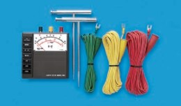

接地抵抗計（アーステスタ）で測る。端子は **E、P、C** の 3 つで、**E、P、C の順に、ほぼ一直線に**並べる。補助接地極を S(P)、H(C) と書く問題もあり、S が P（電圧用）、H が C（電流用）に当たる。

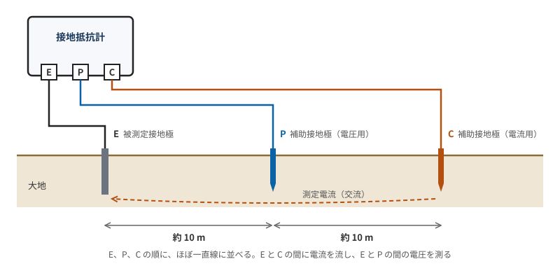

| 端子 | つなぐ先 | 役割 |
|---|---|---|
| **E** | 被測定接地極 | 測りたい接地極。合否を判定するのはこの抵抗 |
| **P** | 補助接地極 | **電圧用** |
| **C** | 補助接地極 | **電流用** |

間隔は、**それぞれ 10 m 程度**離す（動画の説明）。

原理は電位降下法で、E と C の間に電流を流し、E と P の間の電圧を測って、オームの法則で求める。

$$R = \frac{V}{I}$$

測定電流には交流を使う。直流だと、大地と電極の間に分極作用が起きて、正確に測りにくくなるため。

補助接地極の抵抗は、接地工事の適否の判定には使わない。測定値は、「接地工事の種類」の表の値と比べる。

| 例 | 上限 | 判定 |
|---|---|---|
| C 種、測定値 420 Ω、0.4 秒で自動遮断 | 500 Ω | 適合 |
| C 種、測定値 420 Ω、自動遮断なし | 10 Ω | **不適合** |
| D 種、測定値 300 Ω、0.3 秒で自動遮断 | 500 Ω | 適合 |

### 接地抵抗計の測定手順

令和 8 年度上期 問 26 で、電池式の接地抵抗計による精密測定（3 極法）の手順の空欄を埋める問題が出た。

1. 補助接地極が適切な位置に配置されていることを確認する。
2. 接地抵抗計の電池が有効であることを確認する。
3. 接地極の**地電圧**が許容値以下であることを確認する。
4. 測定ボタンを押して、接地抵抗値を読む。

空欄は 3 の「地電圧」で、答えはイ。地電流、地抵抗、地容量は違う。接地極に電圧がかかっていると正しく測れないので、先に確認する（この理由は記憶に基づき、資料では確認していない）。

接地抵抗計は、ほかの回にも次の形で出ている。

| 出題 | 問われた内容 | 答え |
|---|---|---|
| 令和 8 年度下期 問 26 | 補助接地極の配置（図）| E、S(P)、H(C) の順に一直線で、10 m ずつ離す |
| 令和 7 年度下期 問 26 | 補助接地極の配置 | 被測定接地極を端にして、一直線上に順次 10 m 程度離す |
| 令和 7 年度上期 問 26 | 誤っている記述 | 「端子間を開放して測定し、指示計の零点の調整をする」 |

令和 7 年度上期 問 26 では、電池の確認と地電圧の確認は正しい記述として出ている。

### 参考：コンクリートの床がダメな理由（推定）

> 規定の理由を明記した資料は見つかっていない。ここは覚えやすくするための**推定**で、試験には「乾燥した木の床は省略できる、コンクリートの床は乾燥していても省略できない」という結論だけで足りる。

機器の外箱に漏電しているときに人が触ると、電流は「外箱 → 人 → 床 → 大地」と流れる。床の抵抗が高ければこの電流は小さくなるので、木の床の条件は床の抵抗を当てにしていると考えられる。

「コンクリートは水分を含みやすいから」と説明されることがあるが、水の量だけなら木のほうが多く含みそう。

| 材料 | 含水の目安 |
|---|---|
| 木材 | 空気中に置くと、質量比で約 15 %（12〜19 %）|
| コンクリート | 打設時の水の量でも、質量比で 6〜9 % 程度（検索結果の要約にあった値で、出典のページは特定できていない。乾いた状態の値は未確認で、単純には比べられない）|

木の床の条件も「乾燥した」木製の床なので、湿った木が当てにならない点は同じ。コンクリートだけ乾燥していてもダメなのは、次の要因が重なっているからだと考えられる。

| 要因 | 関わり方 |
|---|---|
| 含んだ水が電気を通す | コンクリートは完全に乾燥していれば絶縁物だが、水分を含むと、細孔の水に溶けたイオンが電気を運ぶ |
| 鉄筋 | 金属なので、人から大地までの経路を短くする |
| 地面とのつながり | 土の中の鉄筋コンクリートは、湿った状態で大地に広く接している |

鉄筋だけでは説明しきれない。鉄筋は表面に出ていないので、人と鉄筋の間のコンクリートの層が十分に絶縁するなら電流はほとんど流れない。また、確認した解説は鉄筋の有無を区別していない。

### 覚え方（絶縁抵抗）

> 接地抵抗は「逃がす」ので小さいほど良く、絶縁抵抗は「漏らさない」ので大きいほど良い。
> 「0.1 MΩ」は「100 V で漏れ電流 1 mA」と結びつけると大きさの感覚がつかみやすい。

> 絶縁が第一の対策で、接地は絶縁が効かなくなったときの備え。絶縁抵抗と接地抵抗は漏れ電流の経路で直列になる。

> 300 V を超えると C 種で 10 Ω 以下、300 V 以下は D 種で 100 Ω 以下。0.5 秒以内に遮断すればどちらも 500 Ω 以下。接地線はどちらも 1.6 mm 以上。

> 省略の語呂合わせ：「乾燥イチゴを摘む兄ちゃんが、0.1 秒でお漏らし。切ない。」（乾燥した場所、150 V / 15 mA、二重絶縁、0.1 秒の漏電遮断器、接地工事の省略）。金属管は「キンカン 4 個、イチゴは 8 個」（乾燥した場所で 4 m 以下、150 V 以下で 8 m 以下）。

> 語呂合わせにない絶縁変圧器の条件は、二次側 300 V 以下、3 kV·A 以下、負荷側を接地しない。

> 接地抵抗の測定は E、P、C の順に一直線で、それぞれ 10 m 程度離す。P が電圧用、C が電流用。

> 絶縁抵抗の測定は、開閉器を切り、点滅器を入れるのはどちらも同じ。負荷は、大地との間ならつなぎ、電線相互間なら外す。

> 絶縁抵抗の基準は対地電圧で見る。単相 3 線式の 200 V は対地電圧 100 V なので 0.1 MΩ。

### 参考文献（絶縁抵抗と接地抵抗）

- [電気設備に関する技術基準を定める省令 第 58 条](https://laws.e-gov.go.jp/law/409M50000400052)：測る場所（電線相互間、電路と大地の間）と基準値。条文は [e-Gov の API](https://laws.e-gov.go.jp/api/1/lawdata/409M50000400052) の要約で確認した
- [Panasonic 用語集 絶縁抵抗計](https://www2.panasonic.biz/jp/terasu/skill/dictionary/insulation.html)：対地間や線間を直流電圧で測る
- [農林水産省の工事資料](https://www.maff.go.jp/j/nousin/seko/kyotu_siyosyo/kikaisisin/attach/pdf/denkisetsubi_koutei-22.pdf)：接地工事の目的（漏電、高低圧の混触）と種類（要約のみ）
- [資源エネルギー庁の施工資料](https://www.enecho.meti.go.jp/category/saving_and_new/attaka_eco/reference/pdf/sekou-hoshu/sekou-hoshu_4.pdf)：D 種接地は 100 Ω（0.5 秒以内に遮断する装置があれば 500 Ω）（要約のみ）
- Panasonic 用語集（[B 種接地](https://www2.panasonic.biz/jp/terasu/skill/dictionary/Btypegrounding.html)、[D 種接地](https://www2.panasonic.biz/jp/terasu/skill/dictionary/classdgrounding.html)）（要約のみ）
- [TAC の電験の問題](https://www.tac-school.co.jp/file/tac/kouza_denken/2025pdf/R6S_level_H12.pdf)：完全地絡時の金属製外箱の対地電位という、同じ構図の問題（要約のみ）
- [接地工事の種類と接地抵抗値（電技解釈第 17 条）](https://eleking.net/k21/k21c/k21c-earth.html)：A 種から D 種の対象、接地抵抗値、接地線の太さ。本文に文字化けがあり、読み取れた範囲で確認した
- [第二種電工試験の虎 工事の施工方法 3｜HOZAN](https://www.hozan.co.jp/corp/denko2/pg/1method3/)：C 種と D 種の対象と抵抗値、D 種と金属管の省略条件
- [接地工事省略の憶え方](https://dokugaku.info/2016/04/denatusyubetu-2denkou-hikki-settikouzisyouryaku.html)：省略条件と語呂合わせ
- [ふくラボ D 種接地工事を省略できる条件（令和 2 年度下期 午前 問 22）](https://denkikouji2nd.fukulabo-e9.com/2021/11/2p-r02s-a22/)：省略の判定例
- [A 種・C 種・D 種接地の目的と抵抗値](https://denki-plantengineer.com/setchi-koji-acd)：三相 200 V は D 種、三相 400 V は C 種
- [接地工事の違いと、抵抗値 10 Ω・100 Ω・500 Ω の理由](https://denzaisearch.com/guide/grounding-earthing/)：500 Ω の計算の根拠
- TAC の一問一答（[接地工事の省略 1](https://www.tac-school.co.jp/kouza_denkikoujisi/denkikoujisi_quiz/denkikoujisi_quiz_058.html)、[接地工事の省略 2](https://www.tac-school.co.jp/kouza_denkikoujisi/denkikoujisi_quiz/denkikoujisi_quiz_065.html)）：30 mA の漏電遮断器があっても、別の条件で省略できる問題の例
- [ガミデンキちゃんねる「電気工事の工事方法まとめ｜暗記ポイントを理解【Part1】」](https://www.youtube.com/watch?v=66CxzSHFUIs)：機械器具の接地工事を省略できる 5 条件（画面 1 枚のみ確認）
- [ガミデンキちゃんねる「【第二種電気工事士】実物あり。問11~30の暗記問題に苦戦していませんか？｜R8年上期完全解説シリーズ」](https://www.youtube.com/watch?v=1c209dc0HaU)：省略できる 5 条件の整理と、水気のある場所の扱い。図はこの整理を参考に描き直した。接地抵抗は小さいほうが望ましいという説明（画面 3 枚のみ確認）
- [令和 8 年度上期 第二種電気工事士 学科試験 問題](https://www.shiken.or.jp/construction/upload/20260524_co_second_q01.pdf)、[解答](https://www.shiken.or.jp/construction/upload/20260524_co_second_a01.pdf)｜電気技術者試験センター：問 22 の選択肢と答え、問 26 の測定手順
- 接地抵抗計の出題｜電気技術者試験センター：令和 8 年度下期 問 26（[問題](https://www.shiken.or.jp/construction/upload/20261025_co_second_q01.pdf)、[解答](https://www.shiken.or.jp/construction/upload/20261025_co_second_a01.pdf)）、令和 7 年度下期 問 26（[問題](https://www.shiken.or.jp/construction/upload/20251026_co_second_q01.pdf)、[解答](https://www.shiken.or.jp/construction/upload/20251026_co_second_a01.pdf)）、令和 7 年度上期 問 26（[問題](https://www.shiken.or.jp/construction/upload/20250525_co_second_q01.pdf)、[解答](https://www.shiken.or.jp/construction/upload/20250525_co_second_a01.pdf)）
- 出典：令和 6 年度下期第二種電気工事士試験（問 41）：[問題](https://www.shiken.or.jp/construction/upload/20241027_co_second_q01.pdf)、[解答](https://www.shiken.or.jp/construction/upload/20241027_co_second_a01.pdf)。接地抵抗計の写真は切り抜いて縮小し、選択肢の記号を消す改変をした
- [ガミデンキちゃんねる「電気工事の測定と検査まとめ｜絶縁抵抗の測定方法【Part3】」](https://www.youtube.com/watch?v=4nkNfE55Qww)：2 通りの測定手順と基準値（画面 4 枚のみ確認）
- [絶縁抵抗測定と接地抵抗測定の方法](https://e-sysnet.com/%E7%B5%B6%E7%B8%81%E6%8A%B5%E6%8A%97%E6%B8%AC%E5%AE%9A%E3%81%A8%E6%8E%A5%E5%9C%B0%E6%8A%B5%E6%8A%97%E6%B8%AC%E5%AE%9A%E3%81%AE%E6%96%B9%E6%B3%95/)：2 通りの測定手順、漏えい電流の 1 mA
- [絶縁抵抗計による絶縁抵抗の測定方法と絶縁抵抗値｜eleking](https://eleking.net/k21/k21h/k21h-insulation.html)：測定方法（要約のみ）
- [ガミデンキちゃんねる「電気工事の測定と検査まとめ｜クランプメーターと接地抵抗【Part2】」](https://www.youtube.com/watch?v=Kw2Rxtf2ezU)：接地抵抗の測定方法（画面 1 枚のみ確認）
- [竣工検査と測定の解説](https://denkikoujishi-roadmap.com/82/)：端子の役割、配置、判定の例
- [接地抵抗の測定方法｜共立電気計器](https://www.kew-ltd.co.jp/support/glossary/detail/24/)：電位降下法（要約のみ）
- [接地抵抗計ガイドブック｜共立電気計器](https://www.kew-ltd.co.jp/tech-library/knowledge/guidebook/earth/)：測定の原理（要約のみ）
- [接地抵抗測定に必要な機器と測定手順](https://electric-facilities.jp/denki7/se/011.html)：補助接地極の配置と誤差（要約のみ）
- [接地抵抗計｜Wikipedia](https://ja.wikipedia.org/wiki/%E6%8E%A5%E5%9C%B0%E6%8A%B5%E6%8A%97%E8%A8%88)：測定の仕組み（要約のみ）
- [コンクリートの含水率と電気抵抗率の研究（日本コンクリート工学会）](https://www.data.jci-net.or.jp/data_pdf/29/029-01-1187.pdf)：完全に乾燥していれば絶縁物で、水分を含むと電気を通す（要約のみ）
- [鉄筋を接地電極として使う研究（日本大学）](https://www.cit.nihon-u.ac.jp/kouendata/No.39/2_denki/2-035.pdf)：土の中の鉄筋コンクリートは湿潤状態で大地に広く接する（要約のみ）
- [セメント系材料の細孔溶液の分析（JoVE）](https://www.jove.com/ja/v/58432/expression-cementitious-pore-solution-analysis-its-chemical)：細孔溶液のイオン濃度と電気抵抗率（要約のみ）
- [コンクリートの含水率に関する報告（GBRC）](https://www.gbrc.or.jp/assets/documents/gbrc/GBRC190_13.pdf)：含水率の定義と測定（要約のみ）
- 木材の平衡含水率（[三重県林業研究所](https://www.pref.mie.lg.jp/ringi/hp/000237699.htm)、[森林総合研究所](https://www.ffpri.affrc.go.jp/thk/research/publication/ffpri/research_result_collection/documents/p28-29_1.pdf)）（要約のみ）

**絶縁抵抗の測定手順について**：2 通りの手順は[動画](https://www.youtube.com/watch?v=4nkNfE55Qww)の画面 4 枚と[解説サイト](https://e-sysnet.com/%E7%B5%B6%E7%B8%81%E6%8A%B5%E6%8A%97%E6%B8%AC%E5%AE%9A%E3%81%A8%E6%8E%A5%E5%9C%B0%E6%8A%B5%E6%8A%97%E6%B8%AC%E5%AE%9A%E3%81%AE%E6%96%B9%E6%B3%95/)で確認し、漏えい電流の 1 mA はこの解説サイトで確認した。図は、これらをもとに描いた模式図。「手順の理由」の説明は自分の整理。単相 3 線式の 200 V が 0.1 MΩ であることは[解説サイト](https://denkikoujishi-roadmap.com/82/)で確認した。動画の表は「100 V 回路は 0.1 MΩ、200 V 回路は 0.2 MΩ」で、「対地電圧であることに注意」と添えられている。

**未照合**：電圧の例（三相 200 V など）、接地抵抗計との比較、漏電遮断器の 30 mA は記憶に基づく。直列の式と数値の比較表は手元の計算。

**接地工事について**：抵抗値、太さ、省略条件は解説サイトで確認したもので、解釈の原文とは照合していない。「電工二種で主に C 種と D 種が問われる」は聞いた話として書いたもので、出題の統計は確認していない。機器の例の表と、「30 mA では 15 mA の条件を使えない」という説明は、規定から判断したもの。絶縁変圧器の条件は動画の画面だけで確認した。動画は機械器具の条件を「接地工事」と書き、解説サイトには「D 種接地工事」と書くものがあるので、C 種にも当てはまるかは解釈第 29 条の原文で確認が必要（経済産業省の資料はツールで開けなかった）。接触防護措置による C 種から D 種への緩和は、本文を確認した資料で裏付けが取れなかったので入れていない。

**接地抵抗の測定について**：E、P、C の順、一直線、10 m 程度は[動画](https://www.youtube.com/watch?v=Kw2Rxtf2ezU)の画面 1 枚で確認した。図は、この画面を参考に描いた模式図。間隔の説明は資料によって違い、「5〜10 m」「10 m 以上」と書くものや、[解説サイト](https://denkikoujishi-roadmap.com/82/)のように「固定して覚えず、計器の取扱説明書に従う」とするものがある。試験では問題文に従い、実際の測定では取扱説明書に従う。原理と交流を使う理由は検索結果の要約で確認したもので、本文は読んでいない。判定の例は解説サイトのもので、過去問そのものではない。動画の残りの部分（クランプメータなど）は確認できていない。

## 配線図（第二種電気工事士）

学科試験では例年 50 問中 20 問が配線図。多くは単線図を複線図に直せば解ける。

※ の付いた項目は、出典と照合できていない記憶ベースの内容（最後の「確認状況」を参照）。

### 図を読む順番 ※

1. **注意書き**：使う電線の種類や、省略している内容が書かれている。
2. **分電盤の結線図**：回路の番号と電圧（100 V / 200 V）を確認する。器具の横の数字はこの回路番号。
3. **線と傍記**：施工場所と電線の種類を読み取る。
4. **器具の記号**：何がどこに付くかを読み取る。
5. **イ・ロ・ハの文字**：同じ文字のスイッチと照明が連動する。

### 記号は「基本の形 + 傍記」で覚える

傍記は記号の横に添える文字。基本の形は少なく、種類は文字で区別する。

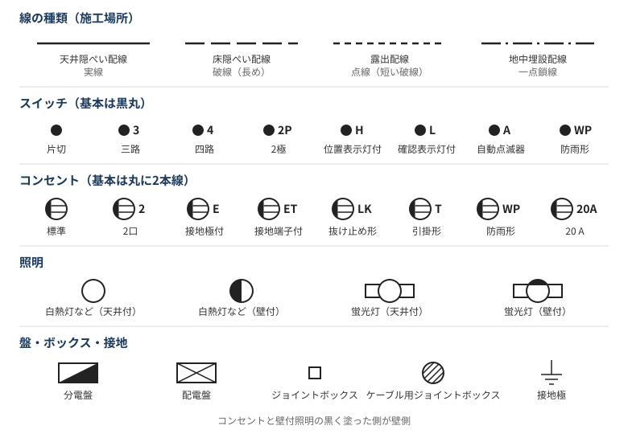

スイッチの傍記：

| 傍記 | 意味 |
|---|---|
| なし | 片切スイッチ |
| 3 / 4 | 三路 / 四路スイッチ |
| 2P | 2 極スイッチ |
| H | 位置表示灯付（OFF のとき点灯し、暗い場所でも位置がわかる）|
| L | 確認表示灯付（ON のとき点灯し、換気扇などの動作がわかる）|
| A | 自動点滅器（明るさで自動的に点滅）|
| R | リモコンスイッチ |
| D | 遅延スイッチ |
| T | タイマ付スイッチ |
| WP | 防雨形 |

そのほかの傍記と写真は「スイッチの種類と図記号」の章にまとめた。

コンセントの傍記（なければ標準の 1 口・125 V・15 A・接地極なし）：

| 傍記 | 意味 |
|---|---|
| 2 / 3 | 2 口 / 3 口 |
| E | 接地極付 |
| ET | 接地端子付 |
| EET | 接地極付接地端子付 |
| EL | 漏電遮断器付 |
| LK | 抜け止め形 |
| T | 引掛形 |
| WP | 防雨形 |
| H | 医用 |
| EX | 防爆形 |
| 3P | 三相用 |
| 20A / 250V | 定格電流 / 定格電圧 |

刃受の形と写真は「コンセントの種類と形」の章にまとめた。

文字で表す機器：

| 記号 | 意味 |
|---|---|
| 丸の中に CL / CH / DL | シーリング / シャンデリア / 埋込器具（ダウンライト）|
| B | 配線用遮断器 |
| E | 漏電遮断器（過電流保護なし）|
| BE | 漏電遮断器（過負荷保護付）|
| S | 開閉器 ※ |
| Wh | 電力量計 ※ |
| RC | ルームエアコン（屋内ユニットは I、屋外ユニットは O）|

### 電線と配管の書き方

- `VVF1.6-2C`：VVF ケーブル、太さ 1.6 mm、2 芯
- `VVF1.6-3C`：同じ太さで 3 芯。1.6 は太さで、本数は C の前の数字。色は 2 芯が黒・白、3 芯が黒・白・赤（緑が入る製品もある）、4 芯が黒・白・赤・緑
- `IV1.6×3(E19)`：IV 線、太さ 1.6 mm を 3 本、ねじなし電線管 19 mm に通す

| 配管の表記 | 種類 |
|---|---|
| 数字のみ（例：`(19)`）| 薄鋼電線管 ※ |
| `G` | 厚鋼電線管 |
| `E` | ねじなし電線管 |
| `VE` | 硬質ポリ塩化ビニル電線管 |
| `HIVE` | 耐衝撃性硬質ポリ塩化ビニル電線管 |
| `PF` | 合成樹脂製可とう電線管 |
| `F2` | 2 種金属製可とう電線管 ※ |
| `FEP` | 波付硬質合成樹脂管（主に地中用）※ |

### 単線図と複線図

試験の図は単線図で、機器の配置と配線のルートはわかるが、どの線がどこにつながるかは書かれていない。それを 1 本ずつ描き起こしたものが複線図。

複線図の 3 ルール：

1. **接地側（白）**：電源から、照明とコンセントへ直接つなぐ。スイッチには通さない。
2. **非接地側（黒）**：電源から、スイッチとコンセントへつなぐ。
3. **帰り線**：スイッチから、そのスイッチで操作する照明へつなぐ。

線どうしの接続は、すべてジョイントボックスの中で行う。N と L の意味、接続材の選び方と写真は「N と L、ボックス内の結線」の章にまとめた。

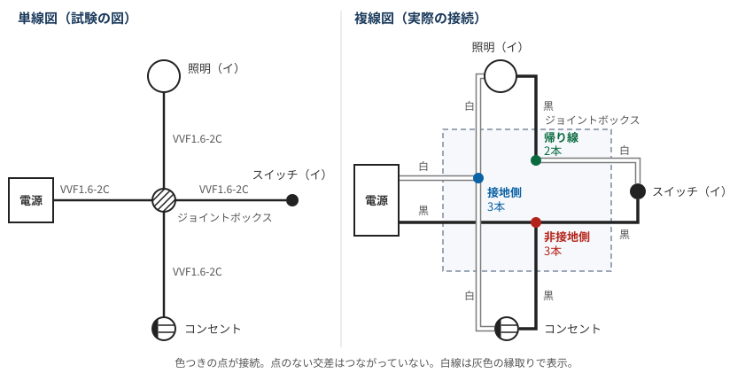

電線がすべて 2 芯（黒・白）で 1.6 mm の場合、ジョイントボックス内の接続は次の 3 か所：

| 接続点 | つなぐ線 | 本数 | 差込形コネクタ | リングスリーブ（刻印）|
|---|---|---|---|---|
| 接地側 | 電源の白、照明の白、コンセントの白 | 3 本 | 3 本用 | 小スリーブ（小）|
| 非接地側 | 電源の黒、スイッチの黒、コンセントの黒 | 3 本 | 3 本用 | 小スリーブ（小）|
| 帰り線 | スイッチの白、照明の黒 | 2 本 | 2 本用 | 小スリーブ（○）|

- **帰り線の色**：スイッチへ行くケーブルは黒・白の 2 本で、黒を電源側に使うので、残った白が帰り線になる。照明側は白を接地側に使うので、黒が帰り線。
- **最少電線本数**：ジョイントボックスから各機器までは、どの区間も 2 本。
- **コネクタとスリーブ**：試験の「コネクタの種類と個数」「スリーブの種類と刻印」は、この表がそのまま答えになる。

### 複線図の描き方（4 ステップ）

[動画](https://www.youtube.com/watch?v=xAHLZKbc5HM)で「勝利の 4step」として紹介されていた手順。上の 3 ルールを、描く順番に並べたものになっている。

| | 手順 | 内容 |
|---|---|---|
| ① | **図記号を書く** | 電源の L と N、ジョイントボックス、ランプ類、コンセント、スイッチを、単線図と同じ配置で書く |
| ② | **N 側（白線）をランプ類とコンセントにつなぐ** | スイッチには行かない |
| ③ | **L 側（黒線）をスイッチとコンセントにつなぐ** | ランプ類には直接行かない |
| ④ | **対応するスイッチとランプ類をつなぐ** | イのスイッチとイのランプ類のように、同じ記号どうしをつなぐ |

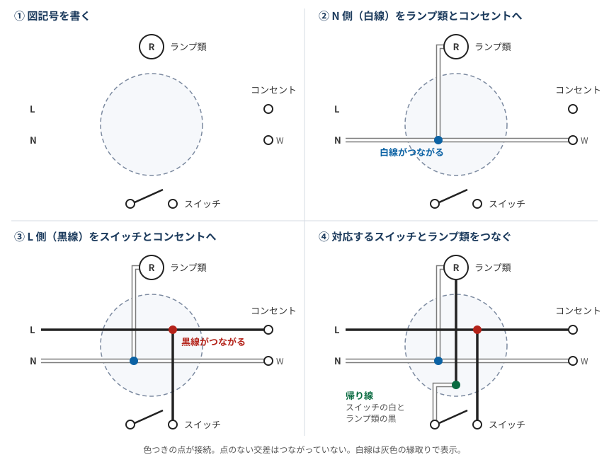

動画では、手順はこれだけで、あとは次の 3 つを理解すればよいとまとめていた。

- **どれがランプ類に入るか**：動画の一覧では、ランプレセプタクル、引掛シーリング（丸型、角型）、蛍光灯、屋外灯、シャンデリア、天井付換気扇、壁付換気扇、白熱灯、ペンダント。**換気扇もランプ類と同じ扱い**。
- **三路スイッチと四路スイッチ**：動作は次の節、複線図での本数は「スイッチの種類と図記号」の章にまとめた。
- **パイロットランプの点灯方法**：「スイッチの種類と図記号」の章にまとめた。

### 複線図の例：ジョイントボックスが 2 つある回路

動画の要点整理の画面にあった回路を描き直したもの。寸法は省いた。

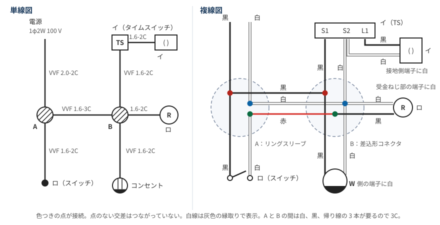

4 ステップを当てはめると、次のようになる。

| 手順 | この回路でつなぐもの |
|---|---|
| ② 白線 | 電源 → A → B → ランプレセプタクル（R）、コンセント、タイムスイッチの S2。引掛シーリングの白は S2 からつなぐ |
| ③ 黒線 | 電源 → A → スイッチロ。A → B → コンセント、タイムスイッチの S1 |
| ④ 対応するもの | スイッチロ → A → B → R（ロどうし）。タイムスイッチの L1 → 引掛シーリング（イどうし）|

A と B の中の接続は、次のとおり。

| 箱 | 接続点 | つなぐ線 | 線の太さと本数 | 接続材 |
|---|---|---|---|---|
| A | 接地側 | 電源の白、B への白 | 2.0 mm × 1、1.6 mm × 1 | 小スリーブ（小）|
| A | 非接地側 | 電源の黒、スイッチの黒、B への黒 | 2.0 mm × 1、1.6 mm × 2 | 小スリーブ（小）|
| A | 帰り線 | スイッチの白、B への赤 | 1.6 mm × 2 | 小スリーブ（○）|
| B | 接地側 | A からの白、タイムスイッチの白、R の白、コンセントの白 | 4 本 | 4 本用の差込形コネクタ |
| B | 非接地側 | A からの黒、タイムスイッチの黒、コンセントの黒 | 3 本 | 3 本用の差込形コネクタ |
| B | 帰り線 | A からの赤、R の黒 | 2 本 | 2 本用の差込形コネクタ |

この例でわかること：

- **3C になる理由**：A と B の間には白、黒、帰り線の 3 本が必要。3 本目の色は赤。
- **タイムスイッチ（TS）**：S1 に黒、S2 に白をつなぎ、L1 から負荷へ出す。
- **白線を入れる端子**：引掛シーリングは**接地側端子**、ランプレセプタクルは**受金ねじ部の端子**、コンセントは **W 側の端子**。
- **電源が 2.0 mm の場合**：A の接続には 2.0 mm の線が混ざるので、1.6 mm だけの場合とはスリーブの選び方が変わる。

### 過去問：隣のボックスへ帰り線が渡る回路（令和 7 年度下期 問 45〜47）

[問題](https://www.shiken.or.jp/construction/upload/20251026_co_second_q01.pdf)（図は 15 ページ、問 45 は 12 ページ、問 46 と問 47 は 13 ページ）、[解答](https://www.shiken.or.jp/construction/upload/20251026_co_second_a01.pdf)

| 問 | 聞かれること | 答え |
|---|---|---|
| 問 45 | ⑮ の配線に必要なケーブル（心線数は最少）| ロ（3 芯 1 本）|
| 問 46 | ⑯ の中のリングスリーブの種類、個数、刻印 | イ（小 5 個。刻印は ○ 3 個、小 2 個）|
| 問 47 | ⑰ の中のリングスリーブの種類と最少個数 | ニ（小 2 個、中 1 個）|

電源（ⓒ）は ⑰ に入り、スイッチ ク、ケ、コの線は ⑯ に来る。コはスイッチ 1 個で DL と CL の 2 灯を同時に点けるので、スイッチと CL が別のボックスに分かれる。

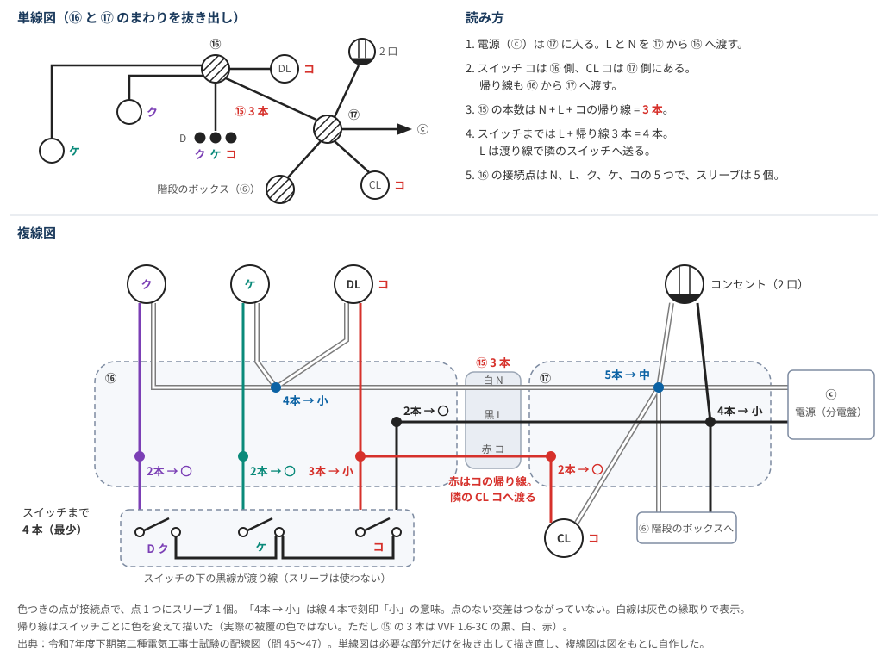

ボックスの間の本数は、電源側のボックスから見て次の 3 つを確かめれば決まる。

| 確かめること | ⑯ の場合 | 必要な線 |
|---|---|---|
| 向こうにランプ類があるか | ク、ケ、DL コがある | N |
| 向こうにスイッチがあるか | ク、ケ、コがある | L |
| スイッチとランプ類が別のボックスに分かれた記号があるか | コだけ（スイッチは ⑯、CL は ⑰）| コの帰り線 |

⑮ は 3 本なので、VVF1.6-3C を 1 本通せば済む（問 45 ロ）。クとケは ⑯ の中で完結するので、⑮ には出てこない。

| 箱 | 接続点 | つなぐ線 | 本数 | スリーブ（刻印）|
|---|---|---|---|---|
| ⑯ | N | ⑰ から、ク、ケ、DL コ | 4 本 | 小（小）|
| ⑯ | L | ⑰ から、スイッチ | 2 本 | 小（○）|
| ⑯ | クの帰り線 | スイッチ ク、ランプ ク | 2 本 | 小（○）|
| ⑯ | ケの帰り線 | スイッチ ケ、ランプ ケ | 2 本 | 小（○）|
| ⑯ | コの帰り線 | スイッチ コ、DL コ、⑰ へ | 3 本 | 小（小）|
| ⑰ | N | ⓒ、⑯、CL コ、コンセント、階段のボックス | 5 本 | 中（中）|
| ⑰ | L | ⓒ、⑯、コンセント、階段のボックス | 4 本 | 小（小）|
| ⑰ | コの帰り線 | ⑯、CL コ | 2 本 | 小（○）|

この例でわかること：

- **問 45 と問 46 はつながっている**：⑮ に赤が通るので、⑯ のコの接続点は 3 本で刻印「小」になる。⑮ を 2 本と数えると刻印「○」になり、問 46 のどの選択肢とも合わない。
- **スイッチまでの 4 本**：L 1 本と帰り線 3 本。L はスイッチの間を渡り線で送るので、スリーブは要らない。三路スイッチの渡り線とは別のもの。
- **遅延スイッチ（D）**：クのスイッチは遅延スイッチだが、N はつながず、普通のスイッチと同じ扱いになる。

### 三路スイッチ

1 つの照明を 2 か所から ON/OFF するスイッチ。階段の上下や廊下の両端で使う。

端子は 0・1・3 の 3 つで、共通端子の 0 を 1 か 3 のどちらかへ切り替える。回路を切る位置はなく、必ずどちらかにつながっている。2 個の三路スイッチの 1 番どうし、3 番どうしを 2 本の渡り線でつなぐ。

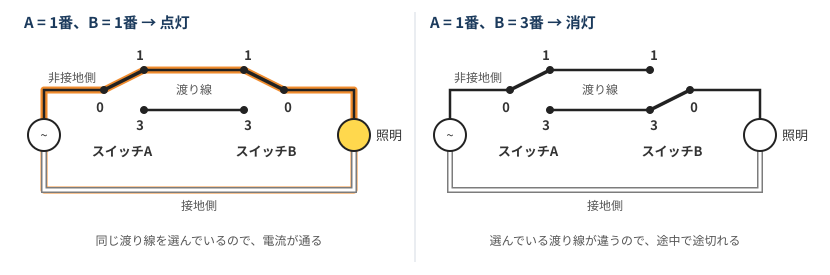

| スイッチ A | スイッチ B | 電流 | 照明 |
|---|---|---|---|
| 1 側 | 1 側 | 通る | 点灯 |
| 1 側 | 3 側 | 通らない | 消灯 |
| 3 側 | 1 側 | 通らない | 消灯 |
| 3 側 | 3 側 | 通る | 点灯 |

どちらのスイッチを切り替えても必ず状態が反転するので、相手の位置に関係なく操作できる。論理回路でいうと XNOR。

3 か所以上から操作するときは、両端の三路スイッチの間に **四路スイッチ**を入れる。四路スイッチは 2 本の渡り線を「まっすぐ」と「たすき掛け」で入れ替えるもので、$N$ か所なら三路 2 個と四路 $N-2$ 個で構成する。

### 練習問題

ジョイントボックスに、電源、照明 1 灯、三路スイッチ 2 個をつなぐ。

1. ジョイントボックスから電源、照明、各三路スイッチまでの最少電線本数は、それぞれ何本か。
2. ジョイントボックス内の接続点はいくつで、それぞれ何本の線をつなぐか。

### 確認状況

- **形と名称**：図のスイッチ、コンセント、照明、盤、ジョイントボックス、接地極は、[Panasonic の配線図記号](https://www2.panasonic.biz/jp/basics/electric/electricity/symbols/switches-outlets/)（[電灯](https://www2.panasonic.biz/jp/basics/electric/electricity/symbols/lighting-fixtures/)、[盤](https://www2.panasonic.biz/jp/basics/electric/electricity/symbols/panelboard/)、[配管・配線](https://www2.panasonic.biz/jp/basics/electric/electricity/symbols/conduits-cables/)）と照合した。これは公共建築の標準図からの抜粋なので、試験が準拠する JIS C 0303 と細部が違う可能性がある。
- **線の種類**：天井・床・露出は上記のページで確認した。地中埋設は Panasonic のページになく、[解説サイト](https://denki.ftani.com/symbol/203/)の「鎖線」と、検索結果の別の解説の「一点鎖線」で確認しただけ。
- **未照合（※）**：「塗った側が壁側」という説明を含め、記憶に基づく内容。参考書の図記号一覧で確認すること。
- **複線図の 4 ステップ**：[動画](https://www.youtube.com/watch?v=xAHLZKbc5HM)の説明欄の章立てと、公開されているプレビュー画像（低解像度）で、手順の見出しとランプ類の一覧を読み取った。音声の説明は確認していない。
- **複線図の例**：回路、線の色、端子の注記は、動画の要点整理の画面 1 枚で確認した。「4 ステップの当てはめ」と「箱の中の接続」の表は、この画面の図から自分で整理したもので、スリーブの刻印は [Panasonic の用語集](https://www2.panasonic.biz/jp/terasu/skill/dictionary/crimpingmark.html)で確認した。画面の図に「( )」とある器具は、記号から引掛シーリング（角）と読み取った。
- **そのほかの未照合**：簡単な回路の複線図の図で、スイッチ側とランプ類側に割り当てた帰り線の色は、資料と照合できていない。四路スイッチの「まっすぐ」「たすき掛け」は、令和 8 年度上期の問 50 の接点図と一致する。「50 問中 20 問」は同じ試験で確認した。
- **令和 7 年度下期 問 45〜47**：問題、図、答えは試験センターの PDF で確認した。公式の解答は記号だけで解説はないので、複線図、接続の表、本数の決め方は図から自分で整理したもの。本数とスリーブの数は 3 問の答えと一致する。⑰ から階段のボックスまでの 2 本は、階段のボックスの複線図までは描かず、問 47 の答えと一致することだけを確認した。遅延スイッチに N をつながないことは、問 48 ロの接点図と問 46 の答えからの読み取り。スイッチの間の渡り線は、資料と照合していない。
- **ケーブルの芯数と色**：1.6 mm の 2 芯、3 芯、4 芯と色は[メーカーの仕様書](https://www.sds-kaeruya.com/download/SF-0039_VVF.pdf)で確認した。3 芯の黒・白・赤は問 45 の写真とも一致する。

### 覚え方（配線図）

> 接地側（白）はスイッチを通さず負荷へ直接、非接地側（黒）はスイッチとコンセントへ。スイッチから照明へは帰り線。
> 三路スイッチは「同じ渡り線を選ぶと点灯」。

> 複線図は 4 ステップ。図記号を書く、白はランプ類とコンセント、黒はスイッチとコンセント、最後に同じ記号のスイッチとランプ類をつなぐ。

> 同じ記号のスイッチとランプ類が別のボックスに分かれたら、ボックスの間に帰り線が 1 本増える。

### 参考文献（配線図）

- 出典：令和 7 年度下期第二種電気工事士試験（問 45〜48）：[問題](https://www.shiken.or.jp/construction/upload/20251026_co_second_q01.pdf)、[解答](https://www.shiken.or.jp/construction/upload/20251026_co_second_a01.pdf)。単線図は配線図の必要な部分だけを抜き出して描き直し、複線図は図をもとに自作した
- [600V ビニル絶縁ビニルシースケーブル平形（VVF）仕様書 SF-0039](https://www.sds-kaeruya.com/download/SF-0039_VVF.pdf)：導体径 1.6 mm の 2 芯、3 芯、4 芯と線心の色

- [ガミデンキちゃんねる「【第二種電気工事士】複線図化の手順は”ガミデンキ流、勝利の４step”で完了。｜複線図解説」](https://www.youtube.com/watch?v=xAHLZKbc5HM)：4 ステップ、ランプ類の一覧、ジョイントボックスが 2 つある回路の例（画面 1 枚と章立て、プレビュー画像のみ確認）
- Panasonic の配線図記号（[スイッチ・コンセント](https://www2.panasonic.biz/jp/basics/electric/electricity/symbols/switches-outlets/)、[電灯](https://www2.panasonic.biz/jp/basics/electric/electricity/symbols/lighting-fixtures/)、[盤](https://www2.panasonic.biz/jp/basics/electric/electricity/symbols/panelboard/)、[配管・配線](https://www2.panasonic.biz/jp/basics/electric/electricity/symbols/conduits-cables/)）：図の形と名称の照合元
- [配線図記号の覚え方の解説](https://denki.ftani.com/symbol/203/)：線の種類（実線、破線、点線、鎖線）
- [Panasonic 用語集 三路スイッチ](https://www2.panasonic.biz/jp/terasu/skill/dictionary/threewayswitch.html)：用途、0・1・3 の端子、1 番どうしと 3 番どうしの結線、四路スイッチ
- [Panasonic 用語集 圧着マーク](https://www2.panasonic.biz/jp/terasu/skill/dictionary/crimpingmark.html)：リングスリーブの刻印と電線の太さ・本数
- [『2023 年版 第二種電気工事士試験 完全攻略 技能試験編』](https://gihyo.jp/book/2023/978-4-297-13242-2)：単線図から複線図への描き方の章がある書籍。未読で、紹介ページのみ確認

## 電線の許容電流

### 許容電流とは

絶縁物を傷めずに流し続けられる最大の電流。電流が流れると $I^2R$ の熱が出るので、**絶縁物が耐えられる温度**で上限が決まる。IV 線の場合、この温度は 60℃。

細い電線ほど抵抗が大きく発熱しやすいので、許容電流は小さくなる。

### 基本の値（IV 線、周囲温度 30℃ 以下）

| 単線 | 許容電流 | より線 | 許容電流 |
|---|---|---|---|
| 1.6 mm | 27 A | 2 mm² | 27 A |
| 2.0 mm | 35 A | 3.5 mm² | 37 A |
| 2.6 mm | 48 A | 5.5 mm² | 49 A |
| 3.2 mm | 62 A | 8 mm² | 61 A |

### 電流減少係数

電線を管の中やケーブルにまとめたときに、許容電流を減らすために掛ける係数。まとめた電線は熱を逃がしにくいので、単体のときと同じ電流は流せない。

| 同じ管に入れる電線の本数 | 係数 |
|---|---|
| 3 本以下 | 0.70 |
| 4 本 | 0.63 |
| 5〜6 本 | 0.56 |
| 7〜15 本 | 0.49 |
| 16〜40 本 | 0.43 |
| 41〜60 本 | 0.39 |
| 61 本以上 | 0.34 |

本数が増えるほど熱がこもるので、係数は小さくなる。電線が 1〜2 本でも、管に入れれば 0.70 を掛ける。

### 計算のしかた

$$\text{許容電流} = \text{基本の値} \times \text{電流減少係数}$$

小数点以下は四捨五入ではなく **7 捨 8 入**する。小数第 1 位が 7 以下なら切り捨て、8 以上なら切り上げ。

- **2.0 mm を 5 本**：35 × 0.56 = 19.6 → **19 A**（四捨五入の 20 A にしない）
- **2.6 mm を 5 本**：48 × 0.56 = 26.88 → **27 A**

### 計算結果の早見表

| 太さ | 3 本以下 | 4 本 | 5〜6 本 | 7〜15 本 |
|---|---|---|---|---|
| 1.6 mm | 19 A | 17 A | 15 A | 13 A |
| 2.0 mm | 24 A | 22 A | 19 A | 17 A |
| 2.6 mm | 33 A | 30 A | 27 A | 23 A |
| 5.5 mm² | 34 A | 31 A | 27 A | 24 A |
| 8 mm² | 42 A | 38 A | 34 A | 30 A |

VV ケーブル（3 心以下）の値は「3 本以下」の列と同じ。

### コードの許容電流

コード（周囲温度 30℃ 以下、絶縁物の最高許容温度 60℃ のもの）は電線とは別の表で、この値をそのまま使う。

| 公称断面積 | 許容電流 |
|---|---|
| 0.75 mm² | 7 A |
| 1.25 mm² | 12 A |
| 2.0 mm² | 17 A |
| 3.5 mm² | 23 A |
| 5.5 mm² | 35 A |

- **電線と混同しない**：同じ 2 mm² でも、IV 線は 27 A、コードは 17 A。
- **耐熱品**：絶縁物の耐熱性が高いコードは、許容電流もこの表より大きい。
- **ビニルコードとゴムコード**：熱を発する電気器具（白熱電球やこたつなど）にビニルコードは使えず、ゴムコードを使う。使えるコードの太さは 0.75 mm² 以上。

### 確認状況（許容電流）

- **出典で確認**：基本の値、早見表、7 捨 8 入は [Panasonic の解説](https://www2.panasonic.biz/jp/basics/electric/electricity/cable-type/)（内線規程 2016 の抜粋）で、係数は[メーカーの資料](https://www.wirecable-sales.com/pdf/158.pdf)で確認した。早見表の値は上の計算とも一致する。
- **載せなかった値**：取得した表の 3.2 mm（4 本など）と 16 本以上の欄には計算と合わないものがあった。読み取りの誤りの可能性もあるので、早見表には入れていない。
- **試験での扱い**：過去問の解説は確認できていない。問題文に係数や端数処理の指定があれば、それに従う。
- **コード**：許容電流は[古河電工メタルケーブル](https://www.furukawa-mc.jp/products/cable/clist/clist04.html)と[関東電気保安協会](https://www.kdh.or.jp/safe/document/knowledge/cable05.html)で確認した。ビニルコードとゴムコードの使い分けと 0.75 mm² 以上は、[個人の試験対策サイト](https://birukanri.site/denkikouji2ndclass/denkou2-common/)の記載で、規程の原文とは照合していない。「表の値をそのまま使う」は記憶に基づく。

### 覚え方（許容電流）

> 許容電流は絶縁物の温度で決まり、まとめると熱がこもるので減らす。計算は「基本の値 × 係数」で、端数は 7 捨 8 入。
> まず 1.6 mm の 19 A、2.0 mm の 24 A を覚える。

> コードは 0.75 mm² が 7 A、1.25 mm² が 12 A、2.0 mm² が 17 A。0.75 の「7」、1.25 の「12」と数字がそのまま入っている。

### 参考文献（許容電流）

- [Panasonic 電線・ケーブルの種類](https://www2.panasonic.biz/jp/basics/electric/electricity/cable-type/)：内線規程 2016 の抜粋。電線の許容電流、早見表、7 捨 8 入
- メーカー資料（[その 1](https://www.wirecable-sales.com/pdf/158.pdf)、[その 2](https://nonprod.docs.rs-online.com/f58c/0900766b8109cce0.pdf)）：電流減少係数（要約のみ）
- [古河電工メタルケーブル コードの許容電流](https://www.furukawa-mc.jp/products/cable/clist/clist04.html)（要約のみ）
- [関東電気保安協会 コード類の許容電流](https://www.kdh.or.jp/safe/document/knowledge/cable05.html)（要約のみ）
- [2 種電工の試験対策サイト](https://birukanri.site/denkikouji2ndclass/denkou2-common/)：ビニルコードとゴムコードの使い分け（要約のみ）
- [デンキペンギンの解説](https://note.com/denki_penguin/n/n0860716b87f2)：コードの許容電流の覚え方（要約のみ）

## 分岐回路の過電流遮断器

過大な電流から電線を守るために、幹線から枝分かれした回路に置く遮断器。試験でよく問われるのは、電線とコンセントの組み合わせ、遮断器を置く位置、動作時間の 3 つ。

### 定格と電線・コンセントの組み合わせ

| 過電流遮断器の定格 | 電線の太さ（銅線）| つなげるコンセント |
|---|---|---|
| 15 A | 1.6 mm 以上 | 15 A 以下 |
| 20 A（配線用遮断器）| 1.6 mm 以上 | 20 A 以下 |
| 20 A（ヒューズ）| 2.0 mm 以上 | 20 A |
| 30 A | 2.6 mm（5.5 mm²）以上 | 20 A 以上 30 A 以下 |
| 40 A | 8 mm² 以上 | 30 A 以上 40 A 以下 |
| 50 A | 14 mm² 以上 | 40 A 以上 50 A 以下 |

30 A 以上の回路では、コンセントに**下限**もある。たとえば、30 A の回路に 15 A のコンセントはつなげない。

| 例 | 判定 | 理由 |
|---|---|---|
| 20 A 配線用遮断器 + 1.6 mm + 15 A コンセント | ○ | すべて条件内 |
| 30 A + 2.6 mm + 20 A コンセント | ○ | すべて条件内 |
| 30 A + 2.0 mm + 20 A コンセント | × | 電線が細い |
| 30 A + 2.6 mm + 15 A コンセント | × | コンセントの定格が小さい |

VVF 1.6 mm の許容電流は 19 A だが、この表では 20 A の配線用遮断器と組み合わせられる。許容電流の計算結果とは別に、この組み合わせとして覚える。

### 遮断器の定格に対する電線の太さの見方

試験でよく問われるのは **30 A に対して 2.6 mm（5.5 mm²）以上**という組み合わせ。ここでの定格は、そのコンセントがつながる分岐回路の遮断器の定格で、幹線側の $I_B$ とは別物。

細すぎてダメな例：

- 20 A のヒューズに 1.6 mm
- 30 A に 2.0 mm
- 40 A に 5.5 mm²
- 50 A に 8 mm²

許容電流（3 本以下の値）と比べると、太さの理由が見えてくる。

| 遮断器の定格 | 必要な太さ | その許容電流 | 1 段細い電線の許容電流 |
|---|---|---|---|
| 20 A（ヒューズ）| 2.0 mm | 24 A | 1.6 mm は 19 A で足りない |
| 30 A | 2.6 mm | 33 A | **2.0 mm は 24 A で足りない** |
| 40 A | 8 mm² | 42 A | 5.5 mm² は 34 A で足りない |
| 50 A | 14 mm² | 61 A | 8 mm² は 42 A で足りない |

つまり、**定格以上の許容電流がある最も細い電線**が基準になっている。例外は 20 A の配線用遮断器で、1.6 mm（19 A）でも認められる。

遮断器、電線、コンセントの組み合わせから不適切なものを選ぶ問題は、次の順に確認する。

1. **電線**：定格に対して太さが足りているか。太いぶんには問題ない。
2. **コンセント**：定格が上限と下限の範囲に入っているか。

上の例に加えて、次の組み合わせも判定できる。

| 組み合わせ | 判定 | 理由 |
|---|---|---|
| 30 A + 5.5 mm² + 30 A コンセント | ○ | 5.5 mm² は 2.6 mm 相当 |
| 20 A 配線用遮断器 + 2.0 mm + 15 A コンセント | ○ | 電線は太いぶんには問題なし |

### コンセントに下限と上限がある理由

この表の定格は、幹線側の $I_B$ ではなく、**そのコンセントがつながる分岐回路の遮断器**の定格。遮断器が 30 A の回路で考える。

| 項目 | 15 A のコンセント（小さすぎ）| 40 A のコンセント（大きすぎ）|
|---|---|---|
| 問題の中身 | 遮断器がコンセントを守れない | コンセントの定格どおりに使うと回路が耐えられない |
| 危ない部品 | コンセント | 電線 |

**下限：15 A のコンセントがダメな理由**

15 A までしか使わないなら問題は起きないが、差し込む機器を規定で制限することはできない。電源タップなどで機器を増やして 25 A 流れても、定格の 30 A 以下なので遮断器は切れず、コンセントには定格の約 1.7 倍が流れ続ける。

遮断器は 37.5 A（1.25 倍）流れても、切れるまで最大 60 分かかることがある。15 A のコンセントにとっては 2.5 倍の電流。

**上限：40 A のコンセントがダメな理由**

回路が流せない電流を、コンセントが「使える」と見せてしまう。VV ケーブル 2.6 mm（許容電流 33 A）の回路で 40 A の機器を使うと、遮断器の定格の約 1.33 倍なのですぐには切れず、許容電流を超える電流が切れるまで電線に流れる。使っていればいずれ遮断器が切れるので、定格どおりには使い続けられない。

**認められている範囲**

| 遮断器の定格 | 使える最小のコンセント | 遮断器との差 |
|---|---|---|
| 20 A（配線用遮断器）| 15 A | 約 1.33 倍 |
| 30 A | 20 A | 1.5 倍 |
| 30 A（**不可の例**）| 15 A | **2 倍** |
| 40 A | 30 A | 約 1.33 倍 |
| 50 A | 40 A | 1.25 倍 |

認められた組み合わせの差は 1.5 倍以内で、不可の例では 2 倍まで開く。40 A の回路に 20 A のコンセントをつなぐ場合も同じく 2 倍。

### 遮断器を置く位置

原則は、幹線との分岐点から **3 m 以下**。分岐線の許容電流が大きければ、もっと離せる。$I_B$ は**幹線側の過電流遮断器の定格電流**で、分岐回路の遮断器の定格ではない。

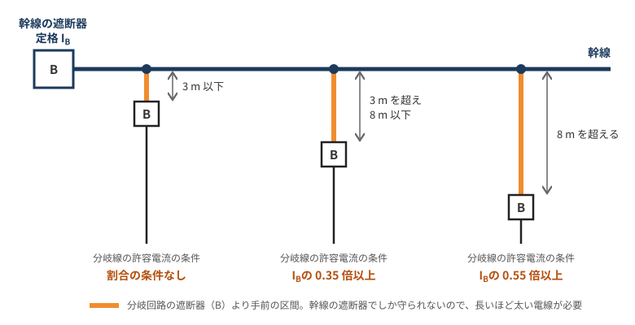

| 分岐点からの距離 | 係数 | 分岐線の許容電流の条件 |
|---|---|---|
| 3 m 以下 | なし | 割合の条件なし |
| 3 m を超え 8 m 以下 | 0.35 | $I_{\text{分岐}} \ge 0.35\,I_B$ |
| 8 m を超える | 0.55 | $I_{\text{分岐}} \ge 0.55\,I_B$ |

0.55 を使うのは 8 m を**超える**場合で、ちょうど 8 m なら 0.35 で済む。条件を満たす電線はそれより近い位置にも置けるので、$0.55\,I_B$ 以上の電線なら距離の制限はない。

遮断器より手前の分岐線は、幹線側の遮断器でしか守られない。その区間が長いほど太い電線が求められる。

問題の解き方は 2 パターン。

**距離から、必要な許容電流を求める（$I_B = 60$ A の場合）**

- **距離 5 m**：$60 \times 0.35 = 21$ A 以上
- **距離 10 m**：$60 \times 0.55 = 33$ A 以上

**許容電流から、置ける距離を求める（$I_B = 100$ A の場合）**

許容電流を $I_B$ で割って割合を出し、55 % 以上なら距離の制限なし、35 % 以上なら 8 m 以下、それ未満なら 3 m 以下と判定する。

- **許容電流 34 A**：34 % なので 3 m 以下
- **許容電流 40 A**：40 % なので 8 m 以下
- **許容電流 61 A**：61 % なので距離の制限なし

### 幹線の遮断器 $I_B$ の決め方

$I_M$ は電動機の定格電流の合計、$I_H$ はそれ以外の機器の定格電流の合計、$I_W$ は幹線の許容電流。

| 求めるもの | 条件 | 式 |
|---|---|---|
| 幹線の許容電流 $I_W$ | $I_M \le I_H$ | $I_W \ge I_M + I_H$ |
| 幹線の許容電流 $I_W$ | $I_M > I_H$ かつ $I_M \le 50$ A | $I_W \ge 1.25\,I_M + I_H$ |
| 幹線の許容電流 $I_W$ | $I_M > I_H$ かつ $I_M > 50$ A | $I_W \ge 1.1\,I_M + I_H$ |
| 幹線の遮断器 $I_B$ | 電動機なし | $I_B \le I_W$ |
| 幹線の遮断器 $I_B$ | 電動機あり | $3I_M + I_H$ と $2.5I_W$ の**小さいほう**以下 |

通しの例として、$I_M = 20$ A、$I_H = 10$ A で、許容電流 40 A の幹線を選んだ場合：

1. **幹線の確認**：$1.25 \times 20 + 10 = 35$ A なので、40 A の幹線で足りる。
2. **$I_B$ の上限**：$3 \times 20 + 10 = 70$ A と $2.5 \times 40 = 100$ A の小さいほうで、**70 A**。
3. **$I_B = 70$ A のときの分岐線**：距離 5 m なら $0.35 \times 70 = 24.5$ A 以上、距離 10 m なら $0.55 \times 70 = 38.5$ A 以上。

幹線から分かれる細い幹線の規定（解釈第 148 条）にも同じ 3 m・8 m が出てくるが、こちらは遮断器を省略できるかどうかの話なので別物。

### 動作時間

| 種類（定格）| 動作してはいけない電流 | 定格の 1.25 倍 / 1.6 倍 | 定格の 2 倍 |
|---|---|---|---|
| 配線用遮断器（30 A 以下）| 1 倍 | 1.25 倍で 60 分以内 | 2 分以内 |
| 配線用遮断器（30 A 超 50 A 以下）| 1 倍 | 1.25 倍で 60 分以内 | 4 分以内 |
| ヒューズ（30 A 以下）| 1.1 倍 | 1.6 倍で 60 分以内 | 2 分以内 |

たとえば、定格 30 A の配線用遮断器に 60 A が流れると、定格の 2 倍なので 2 分以内に動作する。

配線用遮断器で覚えるポイント：

- **1.25 倍は定格に関係なく 60 分以内**。
- **違いが出るのは 2 倍のときだけ**。30 A 以下は 2 分、30 A を超えると 4 分。
- **30 A は「30 A 以下」の側**。ちょうど 30 A は 2 分のほうに入る。
- **「以内」は上限の時間**。その時間までには動作する、という意味。

問題では電流の値だけが書かれていることがあるので、まず定格の何倍かを計算する。

| 定格 | 流れた電流 | 倍率 | 動作時間 |
|---|---|---|---|
| 20 A | 25 A | 1.25 倍 | 60 分以内 |
| 20 A | 40 A | 2 倍 | 2 分以内 |
| 30 A | 37.5 A | 1.25 倍 | 60 分以内 |
| 30 A | 60 A | 2 倍 | 2 分以内 |
| 40 A | 50 A | 1.25 倍 | 60 分以内 |
| 40 A | 80 A | 2 倍 | **4 分以内** |
| 50 A | 100 A | 2 倍 | **4 分以内** |

ヒューズ（30 A 以下）は倍率が違うので、問題文が配線用遮断器かヒューズかを確認する。60 分以内に動作するのは、配線用遮断器が 1.25 倍、ヒューズが 1.6 倍。

### 配線用遮断器の極と素子（2P1E と 2P2E）

- **極（P）**：同時に開閉する線の数
- **素子（E）**：過電流を検出する部分の数

たとえば 2P1E は 2 極 1 素子で、2 本とも開閉するが、過電流を検出するのは片側だけ。2P2E は 2 極 2 素子で、両側で検出する。

| 回路 | 2 極 1 素子（2P1E）| 2 極 2 素子（2P2E）|
|---|---|---|
| 単相 2 線式 100 V | ○ | ○ |
| 単相 3 線式 100 V | ○ | ○ |
| 単相 3 線式 200 V | **×** | ○ |

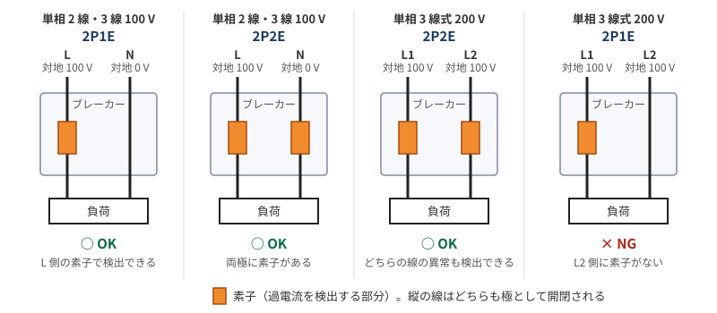

理由は、**電線の対地電圧**で考えるとわかる。

- **100 V の回路**：使う線は、対地電圧 100 V の非接地側と、対地電圧 0 V の中性線。素子は非接地側にあれば足りるので、2P1E でよい。
- **200 V の回路**：使う線は L1 と L2 で、どちらも対地電圧 100 V の非接地側。どちらの線で過電流や地絡が起きても遮断できるように、両方に素子が必要。

2P2E は 100 V の回路にも使える。2P1E を使うときは、素子のない側に中性線をつなぐ。

### 遮断器とブレーカーの用語

| 用語 | 意味 |
|---|---|
| 過電流遮断器 | 過大な電流を遮断するものの総称で、配線用遮断器とヒューズの両方を含む |
| 配線用遮断器 | いわゆるブレーカー。動作しても繰り返し使える |
| ヒューズ | 中の金属が溶けて回路を切る。切れたら交換する |
| 漏電遮断器 | 漏電を検知して回路を切るブレーカー |

### 配線用遮断器と漏電遮断器の違い

いちばんの違いは、**配線用遮断器は電流の流れすぎを、漏電遮断器は電流の漏れを検出して回路を切る**こと。

| 項目 | 配線用遮断器 | 漏電遮断器 |
|---|---|---|
| 検出するもの | 過電流（過負荷、短絡）| 漏電（地絡）|
| 主に防ぐもの | 電線や機器の過熱 | 感電や漏電火災 |
| 検出のしかた | 流れる電流の大きさを見る | 零相変流器で、行きと帰りの電流の差を見る |
| 図記号 | B | E（過電流保護なし）、BE（過電流保護付）|
| テストボタン | なし | あり |

- **配線用遮断器は漏電を検出しない**：定格より小さい電流が漏れているだけなら切れない。
- **漏電遮断器（E）は過電流を検出しない**：漏れがなければ、大きな電流が流れても切れない。
- **BE は両方を検出する**：過負荷保護付の漏電遮断器。
- **テストボタン**：人工的に漏電に近い状態を作って、遮断器が動作するかを確かめる。

扱う電流の大きさも桁が違う。配線用遮断器は 20 A や 30 A、住宅用の漏電遮断器は多くが 30 mA（遮断は 0.1 秒以内）で、30 A に対して 30 mA は 1000 分の 1。

### 家の分電盤との対応

一般家庭にも、幹線側と分岐側の両方のブレーカーがある。どちらも分電盤に内蔵されている。

| 試験の図 | 分電盤 | ほかの呼び方 |
|---|---|---|
| 幹線の遮断器（$I_B$）| 主幹ブレーカー | 主開閉器、メインブレーカー |
| 幹線 | 主幹バー | 母線、メインバー、ブスバー |
| 分岐回路の遮断器 | 分岐ブレーカー | 分岐開閉器、ブランチブレーカー、コンパクトブレーカー、安全ブレーカー |
| 分岐回路の遮断器より先の線 | 分岐ブレーカーから部屋やコンセントへ行く電線 | |

- **主幹ブレーカー**：分電盤の最初に付くブレーカー。住宅用では漏電ブレーカーが使われる。
- **分岐ブレーカー**：コンセント、照明、エアコンなどの回路を、部屋別や用途別に分けて保護する。
- **リミッター（アンペアブレーカー）**：契約電流を超えると遮断する。電力会社が供給するもので、回路の保護用の遮断器とは役割が違う。

主幹と分岐は同じ箱の中にあり、間は数十センチ程度なので、「3 m 以下」を自動的に満たす。家庭で 0.35 や 0.55 の条件が話題にならないのはこのため。

距離の条件が効いてくるのは、分岐のブレーカーが幹線から離れた場所にある工場やビル。たとえば工場で、天井を通る太い幹線から機械へ線を分けて、ブレーカーを機械のそばに置く場合、そこまでの電線は幹線側のブレーカーでしか守られない。

### ブレーカーがこの構成になる理由

**主幹の BE が家全体の漏電と過電流を見て、各回路の B がそれぞれの回路の過電流を見る。**

- **漏電は主幹でまとめて見る**：行きと帰りの電流の差を見るので、主幹に 1 個あれば、その先の全回路の漏電を検出できる。
- **過電流は回路ごとに見る**：回路ごとに電線の太さやコンセントが違うので、それぞれの定格で守る。1 つの回路の過負荷で家全体が止まるのも防げる。

その代わり、どこか 1 か所で漏電すると、主幹が切れて家全体が停電する。

試験の分電盤の図は、たとえば次のように読む（[ガミデンキちゃんねるの動画](https://www.youtube.com/watch?v=ph23ig2SQb4)で扱われていた問 44 の図を参考に、例として描いた）。

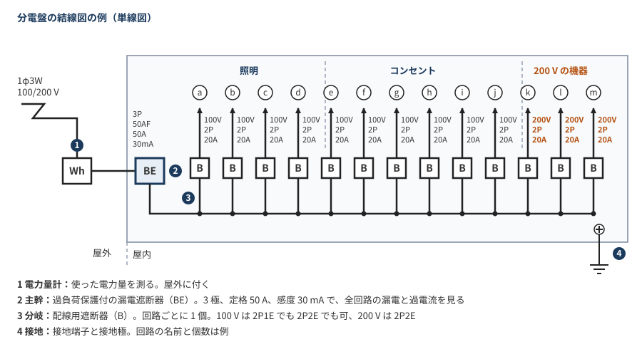

| 図の表記 | 意味 |
|---|---|
| 1φ3W 100/200V | 単相 3 線式で、100 V と 200 V を使う |
| Wh | 電力量計 |
| BE 3P 50AF 50A 30mA | 主幹。過負荷保護付の漏電遮断器で、3 極、定格 50 A、感度 30 mA |
| B 2P 20A（100 V、200 V）| 分岐ブレーカー。回路ごとに 1 個 |

主幹が 3P なのは、単相 3 線式の 3 本（L1、N、L2）をすべて開閉するため。

### 写真問題の見分け方

分電盤の図の記号を指して、写真から機器を選ぶ問題では、ラベルの次の 3 点を見る。

1. **名称**：「漏電」とあれば、記号 B の答えにはならない。
2. **極と素子**：200 V の回路なら 2P2E。
3. **定格電圧**：200 V の回路なら、200 V が含まれているものを選ぶ。

例として、記号 B、200 V 2P 20A の回路を指す問題の選択肢：

| ラベルの読み | 判定 | 理由 |
|---|---|---|
| 安全ブレーカ、2P 1E、AC100V | × | 素子が 1 つなので 200 V に使えない |
| 小形漏電ブレーカ | × | 漏電遮断器で、記号 B ではない |
| **2P2E、AC100/200V** | **○** | 配線用遮断器で、200 V に使える |
| 小形漏電ブレーカ | × | 漏電遮断器で、記号 B ではない |

### 確認状況（分岐回路）

- **組み合わせの表**：複数の解説サイト（[denken.joho.info](https://denken.joho.info/dai2shu-denki-kojishi/thickness-outlet-mccb-wire/)、[ふくラボ](https://denkikouji2nd.fukulabo-e9.com/2022/03/branchcircuit-breaker-wire-outlet/)など）で一致した。[規定の表を載せたページ](https://eleking.net/k21/k21w-allowcurrent/k21w-outlet.html)は文字化けしていて、コンセントの定格の欄しか読み取れなかった。
- **位置と動作時間**：[デンキペンギン](https://note.com/denki_penguin/n/n2da57dcb74c9)、[分岐回路の施設の解説](https://eleking.net/k21/k21w-allowcurrent/k21w-branchcircuit.html)、[動作時間の解説](https://eleking.net/k21/k21w-allowcurrent/k21w-breaker.html)、[日本電気技術者協会](https://www.jeea.or.jp/course/contents/11104/)で確認した。条文の原文とは照合していない。
- **$I_B$ と係数の式**：[分岐回路と幹線の設計の解説](https://denkikoujishi-roadmap.com/74/)、[ふくラボ](https://denkikouji2nd.fukulabo-e9.com/2022/02/trunkline-breaker/)、[HARITA の設計室](https://harita2021.com/%E9%9B%BB%E6%B0%97%E8%A8%AD%E8%A8%88%E3%81%AE%E8%A7%A3%E8%AA%AC%EF%BD%9C%E5%B1%8B%E5%86%85%E5%B9%B9%E7%B7%9A%E3%81%AE%E8%A8%AD%E8%A8%88%E3%81%AB%E3%81%A4%E3%81%84%E3%81%A6%E8%A9%B3%E3%81%97%E3%81%8F/)で確認した。距離と係数は[ガミデンキちゃんねるの動画](https://www.youtube.com/watch?v=ph23ig2SQb4)の図（画面 1 枚のみ確認）とも一致する。条文の原文とは照合していない。
- **省略した規定**：需要率や力率による修正の規定があるようだが、具体的な数値を確認できなかったので入れていない。
- **例の判定**：組み合わせの判定は上の表から判断したもの。計算例のうち $I_B = 60$ A の例と通しの例の $I_B$ は解説サイトのもので、それ以外は同じ式で計算した。どれも過去問そのものではない。
- **家の分電盤**：主幹、分岐、主幹バー、リミッターは [Panasonic の解説](https://www2.panasonic.biz/jp/basics/electric/breakers/residential-panelboard-construction/)で確認した。距離が数十センチというのは手元の分電盤を見た感覚で、「距離の条件が効くのは工場やビル」という説明と工場の例は記憶に基づく。配線用遮断器やヒューズの説明のうち、繰り返し使える、溶けて切れるという部分も記憶に基づく。
- **コンセントの下限と上限の理由**：規定の範囲と「30 A の回路に 15 A のコンセントは接続できない」は解説サイトで確認した。理由を明記した資料は見つからず、下限と上限の理由は規定とノートの数値からの推定。「差が 1.5 倍以内」という見方は表から計算したもので、規定の基準ではない。なぜ 1 段下までなら認められるのかは確認できていない。
- **電線の太さの見方**：太さの表は解説サイトで確認したもので、条文の原文とは照合していない。「定格以上の許容電流がある最も細い電線」という対応は表を見比べて気づいたもので、規定の説明ではない。判定の例は表から作ったもの。
- **動作時間の計算例**：配線用遮断器の表は動画の画面とも一致する。計算の例は表から作ったもので、過去問そのものではない。ヒューズの値は動画の画面になく、解説サイトだけで確認した。
- **極と素子**：回路ごとの可否は動画の画面と解説サイトで確認し、100 V に 2P1E、200 V に 2P2E が一般的という点は [Panasonic の解説](https://www2.panasonic.biz/jp/basics/electric/breakers/residential-panelboard-construction/)とも一致する。理由は解説サイトの説明で、規格や条文の原文とは照合していない。
- **配線用遮断器と漏電遮断器の違い**：解説サイトで確認したもので、条文や規格の原文とは照合していない。「行きと帰りの差を見る」は零相変流器の仕組みを補足した説明で、記憶に基づく。
- **ブレーカーがこの構成になる理由**：「1 か所の漏電で全体が切れる」「回路ごとの過負荷で全体が止まるのを防げる」は、構成から考えた説明で、資料とは照合していない。
- **問 44 の図と選択肢**：動画の画面からの読み取りで、細かい文字には読み違いがあるかもしれない。「安全ブレーカー」という呼び方も、選択肢のラベルで読み取っただけ。答えがハ（2P2E のもの）で、ロが漏電遮断器という点は画面の記載どおり。ほかの選択肢が × の理由は、ラベルと本文の内容から判断した。
- **分電盤の結線図の例**：問 44 の図の構成と定格を参考に描いた例で、問題の図そのものではない。k〜m の回路の名前は「200 V の機器」にまとめた。電力量計が屋外に付くことは問 44 の図の「屋外」「屋内」の区切りから読み取ったもので、図の線の種類や接地の細部までは再現していない。

### 覚え方（分岐回路）

> 電線の太さは 20 A（配線用遮断器）が 1.6 mm、30 A が 2.6 mm、40 A が 8 mm²、50 A が 14 mm²。ヒューズの 20 A だけ 2.0 mm。
> 遮断器の位置は 3 m が原則で、35 % 以上なら 8 m、55 % 以上なら制限なし。係数を掛ける相手は幹線の遮断器 $I_B$。

> 幹線の遮断器は $3I_M + I_H$ と $2.5I_W$ の小さいほう以下。

> 図の左上の B は家の主幹ブレーカー、途中の B は分岐ブレーカー。試験では「メイン」「サブ」ではなく「主幹」「分岐」と呼ぶ。

> コンセントの下限はコンセントを守るため、上限はコンセントの定格どおりに使っても回路が大丈夫なようにするため。

> 30 A は 2.6 mm（5.5 mm²）以上で、2.0 mm はダメ。定格以上の許容電流がある最も細い電線と考える（20 A の配線用遮断器だけ例外）。

> 配線用遮断器は 1.25 倍で 60 分以内、2 倍で 2 分以内（30 A を超えると 4 分以内）。

> 100 V は 2P1E でも 2P2E でも OK、200 V は 2P2E のみ。200 V は 2 本とも対地電圧 100 V なので、両方に素子が要る。

> 配線用遮断器は「流れすぎ」、漏電遮断器は「漏れ」を見る。主幹の BE が全体の漏電を、各回路の B がその回路の過電流を見る。

### 参考文献（分岐回路）

- [Panasonic 住宅分電盤の構成](https://www2.panasonic.biz/jp/basics/electric/breakers/residential-panelboard-construction/)：主幹ブレーカー、分岐ブレーカー、主幹バー、リミッター
- [分岐回路と幹線の設計の解説](https://denkikoujishi-roadmap.com/74/)：$I_B$ の式、0.35 と 0.55、計算例
- [分岐回路の開閉器および過電流遮断器の施設（電技解釈第 149 条）](https://eleking.net/k21/k21w-allowcurrent/k21w-branchcircuit.html)：遮断器の位置（要約のみ）
- [分岐回路の電線の太さと接続できるコンセント（電技解釈第 149 条）](https://eleking.net/k21/k21w-allowcurrent/k21w-outlet.html)：本文が文字化けしていて、コンセントの定格の欄のみ読み取れた
- [配線用遮断器の動作時間（電技解釈第 33 条）](https://eleking.net/k21/k21w-allowcurrent/k21w-breaker.html)（要約のみ）
- [日本電気技術者協会 電気設備技術基準・解釈の解説〔その 4〕](https://www.jeea.or.jp/course/contents/11104/)：配線用遮断器とヒューズの性能（要約のみ）
- [デンキペンギンの解説](https://note.com/denki_penguin/n/n2da57dcb74c9)：解釈第 149 条の位置の規定と、第 148 条との違い（要約のみ）
- [denken.joho.info の解説](https://denken.joho.info/dai2shu-denki-kojishi/thickness-outlet-mccb-wire/)：遮断器、電線の太さ、コンセントの組み合わせ（要約のみ）
- ふくラボ電気工事士 2 種（[分岐回路の遮断器容量と電線太さ](https://denkikouji2nd.fukulabo-e9.com/2022/03/branchcircuit-breaker-wire-outlet/)、[低圧屋内幹線の電線太さと遮断器容量](https://denkikouji2nd.fukulabo-e9.com/2022/02/trunkline-breaker/)）（要約のみ）
- [HARITA の設計室 屋内幹線の設計](https://harita2021.com/%E9%9B%BB%E6%B0%97%E8%A8%AD%E8%A8%88%E3%81%AE%E8%A7%A3%E8%AA%AC%EF%BD%9C%E5%B1%8B%E5%86%85%E5%B9%B9%E7%B7%9A%E3%81%AE%E8%A8%AD%E8%A8%88%E3%81%AB%E3%81%A4%E3%81%84%E3%81%A6%E8%A9%B3%E3%81%97%E3%81%8F/)：$I_W$ と $I_B$ の計算（要約のみ）
- [ガミデンキちゃんねるの動画](https://www.youtube.com/watch?v=ph23ig2SQb4)：分岐回路の過電流遮断器の施設の図、配線用遮断器の動作時間の表、極と素子の表、問 44 の図と選択肢（画面 4 枚のみ確認）
- [ブレーカーの 3P3E・3P2E・2P2E・2P1E の意味と違い](https://denken.joho.info/denryoku/3p3e-3p2e-2p2e-2p1e/)：極と素子の意味（要約のみ）
- [ブレーカーの 1P1E・2P1E・2P2E・3P2E・3P3E の違い](https://denzai-zeus.com/ogawa-news/bureka-2p-o)：極と素子の違いと用途（要約のみ）
- [2P1E・2P2E・3P3E とは？｜電工現場ラボ](https://denkou-blog.com/?p=900)：200 V の回路に 2P2E が必要な理由、素子のない側に中性線をつなぐこと（要約のみ）
- [単相 3 線式 100/200 V の仕組みと中性線の役割](https://www.tenisyoku.com/media/electrician/dainishu-denki-kojishi/3153)：単相 3 線式の対地電圧（要約のみ）
- [遮断器の図記号と判別](https://tsumugi-estate.jp/blog/shadanki-zukigou/)：B、E、BE の違いとテストボタン（要約のみ）
- [配線用遮断器・漏電遮断器の機能と選定](https://electric-facilities.jp/denki4/breaker.html)：配線用遮断器と漏電遮断器の機能（要約のみ）
- [遮断器とは？｜でんき先生](https://denki-sensei.com/breaker)：過電流遮断器、漏電遮断器、配線用遮断器の違い（要約のみ）
- [漏電遮断器と配線用遮断器の違い｜東洋電機](https://www.e-toyo.co.jp/works/%E8%A3%BD%E5%93%81%E6%83%85%E5%A0%B1/p2197/)：用途と選び方（要約のみ）
- [配線用遮断器と漏電遮断器の原理や違い・使い方](https://shimatake-web.com/circuit-breaker-compare/)：原理の違い（要約のみ）
- [分岐回路の遮断器、電線の太さ、接続できるコンセントの解説](https://algorithm.joho.info/denki-denshi/thickness-outlet-mccb-wire/)：コンセントの定格の範囲（要約のみ）
- [ふくラボ 分岐回路の電線太さとコンセント（令和 3 年度下期 午後 問 10）](https://denkikouji2nd.fukulabo-e9.com/2021/12/2p-r03s-p10/)：コンセントの定格の範囲（要約のみ）
- [電気工事士 2 種 令和 4 年下期 午前 問 10 の解説](https://denkou2-siken.com/kakomon/2022_2-am/10.html)：30 A の配線用遮断器に 2.6 mm 以上が必要という過去問の解説（要約のみ）

## ケーブル工事

ケーブルを造営材（建物の壁や天井など）に沿わせて配線する工事。試験で問われる数値は、**2 m、6 m、1 m、6 倍**の 4 つ。

### 支持点間の距離と曲げ半径

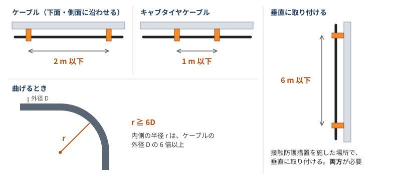

| 取り付け方 | 支持点間の距離 |
|---|---|
| ケーブルを造営材の下面や側面に沿わせる | **2 m 以下** |
| 接触防護措置を施した場所で、垂直に取り付ける | **6 m 以下** |
| キャブタイヤケーブルを造営材の下面や側面に沿わせる | **1 m 以下** |

曲げるときは、内側の半径を**ケーブルの外径の 6 倍以上**にする。

### 施工のルール

- **ほかの管や線に触れさせない**：弱電流電線（電話線など）、水管、ガス管に接触しないようにする。
- **防護**：重量物の圧力や著しい機械的衝撃を受けるおそれがある箇所には、防護装置を設ける。ケーブルのシースは防護にはならない。
- **金属製の部分の接地**：防護装置の金属製部分、金属製の接続箱、電線被覆の金属体が対象。300 V 以下は D 種、300 V を超えると C 種。
- **コンクリートへの埋設**：一般の VVF は、コンクリートに直接埋め込めない。金属管や合成樹脂管に収める。直接埋め込めるのは、MI ケーブルやコンクリート直埋用ケーブルなど。

防護装置の金属製部分は、「絶縁抵抗と接地抵抗」の章に書いた金属管と同じ 4 m・8 m の条件で接地を省略できるとされている。金属製の接続箱には、この長さの条件は使えない。

### 地中に埋める場合

直接埋設式で使えるのはケーブルで、埋める深さは場所で決まる。

| 場所 | 埋設の深さ | 防護 |
|---|---|---|
| 車両などの重量物の圧力を受けるおそれがある | **1.2 m 以上** | 堅牢なトラフなどに収める |
| それ以外 | **0.6 m 以上** | 上部を堅牢な板などで覆う |

### 間違えやすい点

- **6 m の条件**：垂直なだけでは 2 m に戻る。接触防護措置と垂直の両方が必要。
- **キャブタイヤケーブル**：一般のケーブルとは別で 1 m 以下。
- **曲げ半径**：外径の 3 倍のような選択肢に注意。
- **コンクリートへの直接埋設**：問題文に「臨時配線工事の場合を除く」のような例外が付くことがある。

[解説サイト](https://denkikoujishi-roadmap.com/79/)によると、2026 年度上期の学科試験では、条文の数値を埋める形で 2 m と 6 m を入れ替えた選択肢が出たとされている。

### 確認状況（ケーブル工事）

- **動画**：[ガミデンキちゃんねるの動画](https://www.youtube.com/watch?v=66CxzSHFUIs)の 12:54〜18:15 がケーブル工事のチャプターだが、字幕の本文を取得できず、動画の内容は確認できていない。この章は解説サイトをもとにまとめたもので、動画の説明と一致するかは確認していない。
- **数値**：解説サイトの本文で確認したもので、解釈の原文とは照合していない。
- **6 m の条件**：「垂直」と書く解説が 2 件あり、それに従った。[eleking の解説](https://eleking.net/k21/k21c/k21c-cablework.html)は「造営材の上に沿って」と読め、本文に文字化けもあるので、原文での確認が必要。
- **曲げ半径**：外径の 6 倍は複数の解説で一致した。一方で、[解説サイト](https://denkikoujishi-roadmap.com/79/)は「多心は外径の 6 倍、単心は 8 倍」と一律に覚えることは不正確として、ケーブルの種類や規格で確認するとしている。単心の 8 倍はこのノートに入れていない。試験では、問題文の条件に従う。
- **地中の埋設**：[デンキペンギンの解説](https://denkipenguin.hateblo.jp/entry/2024/03/29/205300)は、学科試験で出題される可能性は低いとしている。
- **間違えやすい点**：解説サイトの記載をまとめたもので、実際の過去問は確認していない。

### 覚え方（ケーブル工事）

> 支持点間は、ケーブル 2 m、垂直かつ接触防護措置で 6 m、キャブタイヤ 1 m。曲げるときは外径の 6 倍以上。

> VVF はコンクリートに直接埋めない。弱電流電線、水管、ガス管に接触させない。

### 参考文献（ケーブル工事）

- [ケーブル工事の施工方法｜支持間隔 2 m・6 m・1 m と防護・接地](https://denkikoujishi-roadmap.com/79/)：支持点間の距離、防護、接地、コンクリートへの埋設
- [ケーブル工事とがいし引き工事の施工ルール](https://www.tenisyoku.com/media/electrician/dainishu-denki-kojishi/678)：6 m の条件、曲げ半径、ひっかけ
- [ケーブル工事｜eleking](https://eleking.net/k21/k21c/k21c-cablework.html)：支持点間の距離、曲げ半径、管や弱電流電線との関係。本文に文字化けあり
- [地中電線路の施設について【直接埋設式】｜デンキペンギン](https://denkipenguin.hateblo.jp/entry/2024/03/29/205300)：埋設の深さと防護
- [ケーブル工事について詳しく解説【支持点 2 m・曲げ 6 倍】｜HARITA の設計室](https://harita2021.com/%E9%9B%BB%E6%B0%97%E8%A8%AD%E8%A8%88%E3%81%AE%E8%A7%A3%E8%AA%AC%EF%BD%9C%E3%82%B1%E3%83%BC%E3%83%96%E3%83%AB%E5%B7%A5%E4%BA%8B%E3%81%AB%E3%81%A4%E3%81%84%E3%81%A6%E8%A9%B3%E3%81%97%E3%81%8F%E8%A7%A3/)（要約のみ）
- [ガミデンキちゃんねる「電気工事の工事方法まとめ｜暗記ポイントを理解【Part1】」](https://www.youtube.com/watch?v=66CxzSHFUIs)：チャプターのみ確認

## 金属管工事

電線を金属製の管に通して配線する工事。ケーブル工事と違って、管が電線を守る。試験では、**電線の条件、管内で接続しないこと、同じ管に入れること、管の曲げ半径、接地**が問われる。

### 管の種類

| 種類 | 図面の表記 | 特徴 | 主な用途 |
|---|---|---|---|
| 厚鋼電線管 | G | いちばん肉厚 | 屋外の露出配管 |
| 薄鋼電線管 | C | 厚鋼より肉薄 | 屋内 |
| ねじなし電線管 | E | いちばん肉薄。ねじなしカップリングと止めねじでつなぐ | 屋内 |

### 施工のルール

| 項目 | ルール |
|---|---|
| 使える電線 | 絶縁電線。**屋外用ビニル絶縁電線（OW）は使えない** |
| 電線の太さ | より線、または直径 3.2 mm 以下の単線（短小な管に収めるものは除く）|
| 管内の接続 | **接続点を設けない**。接続はボックスの中で行う |
| 交流回路の電線 | **1 回路の電線を全部同じ管に入れる**（電磁的平衡）|
| 曲げ半径 | 内側の半径を**管の内径の 6 倍以上**にする |
| 管の厚さ | コンクリートに埋め込むものは **1.2 mm 以上**、それ以外は 1 mm 以上 |
| 管の端 | ブッシングを付けて、電線の被覆を守る |

管の厚さには例外があり、継手がなく長さ 4 m 以下で、乾燥した展開した場所に施設する場合は 0.5 mm 以上でよいとされている。

### 同じ管に入れる理由と接続の場所

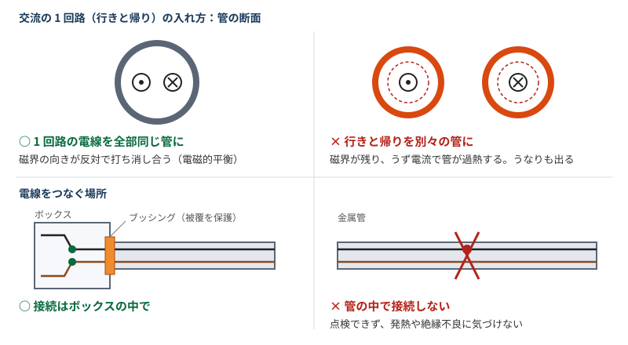

行きと帰りの電流は向きが反対なので、同じ管に入れると、周りにできる磁界が打ち消し合う。別々の管に入れると磁界が残り、鉄の管にうず電流が流れて、管が熱くなったり、うなりが出たりする。

これは 3 本以上の回路でも同じで、同じ回路の線を全部まとめれば電流の合計がゼロになる。三相 3 線式なら 3 本とも同じ管に入れる。

### 電線を何本まで入れられるか（占有率）

電線の**被覆を含む**断面積の合計を、管の内断面積の **32 % 以下**にするのが原則。

$$\text{占有率} = \frac{\text{電線の断面積（被覆を含む）の合計}}{\text{管の内断面積}} \le 32\,\%$$

例として、太さ 25 mm の薄鋼電線管に、断面積 8 mm² の IV 線を 3 本入れる場合を計算する。

| 項目 | 値 |
|---|---|
| 薄鋼電線管 C25 の内径 | 22.2 mm（「25」は外径に近い呼び方で、内径はもっと小さい）|
| 管の内断面積 | $\pi/4 \times 22.2^2 \approx 387\ \mathrm{mm^2}$ |
| 8 mm² の IV 線の外径（被覆を含む）| 6.0 mm |
| 電線 1 本の断面積 | $\pi/4 \times 6.0^2 \approx 28\ \mathrm{mm^2}$ |
| 3 本の合計 | 約 85 mm² |
| 占有率 | $85 / 387 \approx 22\,\%$ で、32 % 以下 |

**8 mm² × 3 本 = 24 mm² で計算しない**。8 mm² は導体だけの断面積で、被覆が入っていない。

管の屈曲が少なく、電線を簡単に引き入れ、引き替えできる場合で、電線が同じ太さの 8 mm² 以下なら、**48 % 以下**まで緩和される。

試験では計算するより、結論を覚えるほうが早い。「太さ 25 mm の薄鋼電線管に 8 mm² を 3 本」は**適切**な選択肢として繰り返し出ている（令和 8 年度上期 問 23、令和 6 年度下期 問 23、令和 3 年度下期 午前 問 23）。この 3 回とも、不適切な答えは「薄鋼電線管どうしの接続にコンビネーションカップリングを使う」。

[動画](https://www.youtube.com/watch?v=1c209dc0HaU)では、内線規程の目安として次の表が示されていた。

| 電線管の太さ（呼び）| 収容できる 8 mm² の本数の目安 |
|---|---|
| 19 mm | 1 本 |
| 25 mm | 2〜3 本 |
| 31 mm | 4〜6 本 |

### 接地

「絶縁抵抗と接地抵抗」の章の金属管の条件が、そのまま使える。

| 使用電圧 | 接地工事 |
|---|---|
| 300 V 以下 | D 種 |
| 300 V を超える | C 種（接触防護措置を施せば D 種でよい）|

| 接地を省略できる条件 | 細かい条件 |
|---|---|
| 乾燥した場所で、長さが **4 m 以下** | |
| 対地電圧 150 V 以下で、長さが **8 m 以下** | 乾燥した場所に施設するか、簡易接触防護措置を施す |

長さは、管を接続したあとの全長で判定する。

### 接地の省略問題の解き方

出題頻度が高いとされている形。長さの次に**対地電圧**を確認するのがコツ。

| 配線方式 | 対地電圧 | 「150 V 以下」の条件 |
|---|---|---|
| 単相 2 線式 100 V | 100 V | 使える |
| 単相 3 線式 100/200 V | 100 V | 使える |
| 三相 3 線式 200 V | **200 V** | **使えない** |

金属管は、次の順に判定する。

1. **全長 4 m 以下で乾燥した場所**なら省略できる（対地電圧は問わない）。
2. **全長 8 m 以下**で、対地電圧が **150 V 以下**、かつ乾燥した場所か簡易接触防護措置を施した場所なら省略できる。
3. どちらにも当てはまらなければ省略できない。

例題：簡易接触防護措置を施した乾燥した場所に施設する低圧屋内配線工事で、D 種接地工事を省略できないものは（令和 2 年度下期 午前 問 22）。

| 選択肢 | 判定 | 理由 |
|---|---|---|
| イ：三相 3 線式 200 V の合成樹脂管工事に使う金属製ボックス | 省略できる | 乾燥した場所の条件を満たす |
| **ロ：三相 3 線式 200 V の金属管工事で、全長 5 m の金属管** | **省略できない（答え）** | 4 m を超え、対地電圧も 200 V で 150 V を超える |
| ハ：単相 100 V の電動機の鉄台 | 省略できる | 対地電圧 150 V 以下で、乾燥した場所 |
| ニ：単相 100 V の金属管工事で、全長 5 m の金属管 | 省略できる | 対地電圧 100 V で、8 m 以下 |

ロとニは長さがどちらも 5 m で、違うのは対地電圧だけ。問題の「三相 200 V」「単相 100 V」から対地電圧を読み取れるかがポイント。

### 工具と材料

| 名前 | 用途 |
|---|---|
| 金切りのこ | 管を切る |
| リーマ（クリックボールに付ける）| 切ったあとの管の内側のばりを取る。ばりが残ると通線時に被覆を傷つける |
| パイプベンダ | 管を曲げる |
| カップリング | 管と管をつなぐ |
| ボックスコネクタ | 管とボックスをつなぐ |
| ブッシング | 管の端に付けて、電線の被覆を守る。接続はしない |

パイプレンチとトーチランプは、鋼製の電線管の切断や曲げには使わない。工具の写真は「工事で使う工具（写真）」の章にまとめた。

### 間違えやすい点

- **管内の接続**：絶縁テープを巻いても、管の中では接続できない。
- **別々の管**：行きと帰りを 1 本ずつ別の管に入れるのは不可。
- **電線の太さ**：3.2 mm は単線の直径で、断面積と混同しない。
- **曲げ半径**：ケーブルは「外径」の 6 倍、金属管は「内径」の 6 倍。
- **管の厚さ**：1.2 mm はコンクリートに埋め込む場合の条件。

### 確認状況（金属管工事）

- **動画**：[ガミデンキちゃんねるの動画](https://www.youtube.com/watch?v=66CxzSHFUIs)の 18:15〜25:43 が金属管工事のチャプターだが、字幕の本文を取得できず、動画の内容は接地の省略問題の画面 1 枚しか確認できていない。この章のそのほかの部分は解説サイトをもとにまとめたもの。
- **接地の省略問題**：問題文、答え、ロとニの判断は動画の画面と[ふくラボの解説](https://denkikouji2nd.fukulabo-e9.com/2021/11/2p-r02s-a22/)で確認した。年度と問題番号はふくラボの記載による。判定の順番は規定の内容を手元で並べたもので、「まず 4 m、次に 8 m」という順番自体に決まりがあるわけではない。
- **数値と条件**：解説サイトの本文で確認したもので、解釈第 159 条の原文とは照合していない。
- **管の厚さ**：薄鋼 1.6 mm、ねじなし 1.2 mm と書く解説もあったが、[HARITA の設計室](https://harita2021.com/%E9%9B%BB%E6%B0%97%E8%A8%AD%E5%82%99%E3%81%AE%E5%9F%BA%E6%9C%AC%E7%9F%A5%E8%AD%98%E3%80%80%EF%BC%83%EF%BC%90%EF%BC%90%EF%BC%95%E3%80%90%E9%87%91%E5%B1%9E%E7%AE%A1%E5%B7%A5%E4%BA%8B%E3%80%91/)は、これを製品の一般的な厚さとして規定の最小値と分けているので、表には規定の値を載せた。0.5 mm の例外は[解説サイト](https://denkikoujishi-roadmap.com/80/) 1 件で確認した。
- **「電流の合計がゼロ」**：3 本以上の回路に広げた説明は、手元で考えたもの。解説で確認したのは、行きと帰りの磁界が打ち消し合うという説明と、1 回路の電線を全部同じ管に入れるという規定まで。
- **占有率**：32 % の原則と計算は[ふくラボの解説](https://denkikouji2nd.fukulabo-e9.com/2021/12/2p-r03s-a23/)で、C25 の内径は[電線管の規格の解説](https://electric-facilities.jp/denki4/haikan.html)で、8 mm² の外径は[メーカーの IV 線仕様書](https://www.sds-kaeruya.com/download/SF-0010B_IV.pdf)で確認した。48 % の条件は[個人の学習記事](https://zenn.dev/cotton0930/articles/2b78a805ae18c9)の引用によるもの。**本数の表は動画の画面だけが根拠で、内線規程の原文とは照合していない**。面積だけで計算すると、C19 に 2 本は約 28 %、C31 に 7 本は約 31 % で 32 % 以下に収まり、表の本数より多く入る。内線規程の表には面積以外の余裕が含まれている可能性があるが、理由は確認できていない。
- **図**：規定の内容を説明するために描いたもので、磁界やうず電流の分布を正確に表したものではない。

### 覚え方（金属管工事）

> 金属管は「OW はダメ、管内で接続しない、1 回路はまとめて同じ管に」。曲げるときは内径の 6 倍以上。コンクリートに埋めるなら 1.2 mm 以上。

> 接地の省略は、乾燥した場所で 4 m 以下、または対地電圧 150 V 以下で 8 m 以下。三相 200 V は対地電圧 200 V なので、8 m の条件は使えない。

> 占有率は被覆を含めて 32 % 以下。太さ 25 mm の薄鋼電線管に 8 mm² を 3 本は適切。

### 参考文献（金属管工事）

- [金属管工事・PF 管工事・CD 管工事をわかりやすく解説](https://denkikoujishi-roadmap.com/80/)：電線の条件、管の厚さ、接地、間違えやすい点
- [電気設備の基本知識 ＃005【金属管工事】｜HARITA の設計室](https://harita2021.com/%E9%9B%BB%E6%B0%97%E8%A8%AD%E5%82%99%E3%81%AE%E5%9F%BA%E6%9C%AC%E7%9F%A5%E8%AD%98%E3%80%80%EF%BC%83%EF%BC%90%EF%BC%90%EF%BC%95%E3%80%90%E9%87%91%E5%B1%9E%E7%AE%A1%E5%B7%A5%E4%BA%8B%E3%80%91/)：同じ管に入れる理由、曲げ半径、管の厚さ、管内で接続しない理由
- [配線と配線器具の施工方法](https://e-sysnet.com/%E9%9B%BB%E6%B0%97%E5%B7%A5%E4%BA%8B%E7%94%A8%E3%81%AE%E6%9D%90%E6%96%99-%E7%85%A7%E6%98%8E%E5%99%A8%E5%85%B7/)：電磁的平衡、曲げ半径、コンクリートに埋め込む管の厚さ
- [第 4 回 金属管工事](https://www.denkou2.com/hikkishiken-4.html)：曲げ半径、接地の省略、工具と材料
- [Panasonic 用語集 金属管工事](https://www2.panasonic.biz/jp/terasu/skill/dictionary/metaltube.html)：管の種類と図面の表記、接地、接続
- [第二種電気工事士の鑑別問題の解説](https://denkikoujishi-roadmap.com/78/)：加工の工具と接続材料
- [ふくラボ D 種接地工事を省略できる条件（令和 2 年度下期 午前 問 22）](https://denkikouji2nd.fukulabo-e9.com/2021/11/2p-r02s-a22/)：接地の省略問題と各選択肢の解説
- [ふくラボ 金属管工事による低圧屋内配線の施工方法（令和 3 年度下期 午前 問 23）](https://denkikouji2nd.fukulabo-e9.com/2021/12/2p-r03s-a23/)：占有率の計算（C25 に 8 mm² を 3 本）
- [ガミデンキちゃんねる「【第二種電気工事士】実物あり。問11~30の暗記問題に苦戦していませんか？｜R8年上期完全解説シリーズ」](https://www.youtube.com/watch?v=1c209dc0HaU)：占有率 32 % と本数の目安の表（画面 1 枚のみ確認）
- [電線管の種類と規格](https://electric-facilities.jp/denki4/haikan.html)：薄鋼電線管の外径と内径、占有率の原則
- [IV 線の仕様書（SF-0010B）](https://www.sds-kaeruya.com/download/SF-0010B_IV.pdf)：8 mm² の外径 6.0 mm
- [個人の学習記事「電気設備工事、低圧引込工事、その他」](https://zenn.dev/cotton0930/articles/2b78a805ae18c9)：32 % と 48 % の条件の文言
- [ガミデンキちゃんねる「電気工事の工事方法まとめ｜暗記ポイントを理解【Part1】」](https://www.youtube.com/watch?v=66CxzSHFUIs)：チャプターと、接地の省略問題の画面 1 枚を確認

## 電線管の比較（金属管と合成樹脂管）

ケーブルを管で守るときも含めて、管をどう選ぶかの整理。

### 金属管と合成樹脂管

| 比較する点 | 金属管 | 合成樹脂管 |
|---|---|---|
| 強度 | **強い** | 弱く、圧力や振動、衝撃に弱い |
| 熱・火 | **不燃性** | 熱で変形や溶融をしやすい |
| 接地 | **必要**（D 種、300 V を超えると C 種）| 管自体は不要 |
| 腐食 | さびる場合がある | **さびない** |
| 重さ・加工 | 重く、手間がかかる | **軽く、切断や施工が容易** |
| コスト | 高くなりやすい | **低めになりやすい** |

金属管のいちばんのメリットは、衝撃に強いことと、熱や火に強いこと。ただし接地工事の手間が増える。

### 合成樹脂管の種類

| 管 | 自己消火性 | 特徴 | 主な使い方 |
|---|---|---|---|
| VE 管 | あるとされる | 硬い。熱で曲げられる | 屋内や屋外の露出配管 |
| HIVE 管 | （未確認）| VE 管の耐衝撃性を高めたもの | 衝撃が気になる場所 |
| PF 管 | **あり** | 柔らかく曲げやすい。クリーム系やグレー系 | 衝撃の少ない場所 |
| CD 管 | **なし** | 柔らかく曲げやすい。オレンジ色など。耐候性や耐熱性も高くない | 基本的にコンクリートに埋め込む |

強度は、おおよそ「金属管 → HIVE 管 → VE 管 → PF 管・CD 管」の順に弱くなる。CD 管は、周りのコンクリートが守ってくれるので、管自体が弱くても問題になりにくい。

### 自己消火性と不燃性は違う

- **自己消火性**：火に触れている間は燃えても、火から離れると自然に消える性質。熱で変形や溶融をしないという意味ではない。
- **不燃性**：そもそも燃えない性質。

VE 管は「熱には弱いが、燃えにくい」と考えるとわかりやすい。

| 性質 | VE 管 | 実感としての現れ方 |
|---|---|---|
| 燃えにくさ | 自己消火性があるとされる | あぶって加工しても燃え上がらない |
| 熱への弱さ | 熱で柔らかくなる | **あぶると曲げられる** |

すぐ燃え上がる材料なら、バーナーであぶって曲げる施工は成り立たない。ただし、燃えないわけではなく、あぶり続ければ焦げる。そのため、一点に炎を当てず、管を回しながら均一に温める。柔らかくなることと燃えにくいことは別の性質。

温度変化で伸び縮みするので、長い配管には伸縮カップリングを使う。

### 使い分けの目安

| 条件 | 向いている管 |
|---|---|
| 一般の屋内や屋外の露出配管で、水気があってさびが心配 | VE 管 |
| 強い衝撃がありそう | 金属管、または HIVE 管 |
| 高温の場所 | VE 管は避ける |
| コンクリートに埋め込む | CD 管（PF 管も使える）|
| 爆燃性粉じんや可燃性ガスのある場所 | 金属管（合成樹脂管工事はできない。「特殊な場所の工事」の章を参照）|

### 確認状況（電線管の比較）

- **比較の表**：電線管を解説したサイトで確認した、一般的な使い分けの説明。条文で金属管が必要と定められているかは確認していない。
- **VE 管の自己消火性**：JIS C 8430 の旧版（1993 年）を引用した資料の「不燃性または自消性のある難燃性」と、燃焼性を「自己消火性」と書いた資料を、検索結果の要約で見ただけ。現行版は別の規格（JIS C 8461-21）を参照していて、判定基準は確認できていない。
- **VE 管の温度**：JIS の加熱の試験が 60℃、衝撃の試験が −5℃ なのは確認したが、これは試験の条件で、使用温度ではない。使用温度、軟化温度、伸び縮みの量は確認できていない。メーカーの PDF は開けなかった。
- **HIVE 管の自己消火性**：確認できていない。
- **推定や手元の考え**：強度の順のうち VE 管と PF 管・CD 管の間、「あぶって曲げられるから燃えにくい」という推論、「管を回しながら均一に温める」、使い分けの目安の表は、資料そのものの記載ではない。
- **確認できなかった話題**：防火区画の貫通処理、シールドによるノイズ対策は、資料で確認できなかったので入れていない。

### 覚え方（電線管の比較）

> 金属管は強くて燃えないが、接地が要る。合成樹脂管は軽くてさびないが、弱くて熱に弱い。

> 自己消火性は PF 管にあって CD 管にない。CD 管はオレンジ色でコンクリートに埋める。

> VE 管は、あぶって曲げられる（熱に弱い）のに燃え上がらない（燃えにくい）。

### 参考文献（電線管の比較）

- [電線管の種類と特長｜モノタロウ](https://www.monotaro.com/note/productinfo/densenkan_type/)：金属管と合成樹脂管の違い（要約のみ）
- [電線管の種類を徹底解説](https://www.denzai-net.jp/blog/column/conduit-tube/)：用途別の選び方（要約のみ）
- [電線管の種類と規格](https://electric-facilities.jp/denki4/haikan.html)：種類と規格（要約のみ）
- [電線保護の基礎知識｜合成樹脂可とう電線管](https://electric-facilities.jp/denki7/ko/008.html)：PF 管と CD 管（要約のみ）
- [Panasonic 用語集 CD 管](https://www2.panasonic.biz/jp/terasu/skill/dictionary/cdkan.html)：PF 管と CD 管の自己消火性、色、使い方（要約のみ）
- [Panasonic 用語集 硬質ビニル電線管](https://www2.panasonic.biz/jp/terasu/skill/dictionary/vinylelectric.html)：VE 管の特徴（要約のみ）
- [Panasonic 用語集 HIVE 管](https://www2.panasonic.biz/jp/terasu/skill/dictionary/biepai.html)：耐衝撃性と使用禁止の場所（要約のみ）
- [電気の森 合成樹脂製可とう電線管の解説](https://www.asahi-net.or.jp/~qq3y-nkdo/ocl/feet/DenkoE1/DKE004.html)：PF 管と CD 管の燃焼の実験例（要約のみ）
- [JIS C 8430:2019 硬質ポリ塩化ビニル電線管](https://kikakurui.com/c8/C8430-2019-01.html)：試験の温度と、火災の延焼の試験の参照先
- [硬質塩化ビニル電線管（VE 管）の施工ルール](https://www.tenisyoku.com/media/electrician/dainishu-denki-kojishi/1969)：熱に弱いこと、伸縮カップリング

## 特殊な場所の工事

爆発や火災のおそれがある場所では、工事の種類が限られる。出題頻度が高いとされている。

### 施工できる工事

| 工事の種類 | 可燃性ガス | 爆燃性粉じん | 可燃性粉じん | 危険物 |
|---|---|---|---|---|
| **ケーブル工事** | ○ | ○ | ○ | ○ |
| **金属管工事** | ○ | ○ | ○ | ○ |
| **合成樹脂管工事** | **×** | **×** | ○ | ○ |

- **使えるのはこの 3 種類だけ**：2 種金属製可とう電線管の工事は含まれない。
- **ケーブル工事は最強**：4 つの場所すべてで使える（金属管工事も同じ）。
- **合成樹脂管工事**：「ガス」と「爆燃性」の場所では使えない。VE 管も合成樹脂管なので、この 2 つの場所では使えない。

名前が似ているので、「爆燃性粉じん」と「可燃性粉じん」を間違えやすい。

| 場所 | 例 |
|---|---|
| 可燃性ガス | プロパンガスを小さな容器に詰め替える場所、自動車の吹付塗装を行う場所 |
| 爆燃性粉じん | マグネシウム、アルミニウムなどの粉 |
| 可燃性粉じん | 小麦粉、でん粉など |

### 細かい条件

| 工事の種類 | 条件 |
|---|---|
| ケーブル工事 | がい装ケーブルや MI ケーブルを除いて、管などの防護装置に収める |
| 金属管工事 | 薄鋼電線管、またはそれと同等以上の強度の管を使う |
| 合成樹脂管工事 | 厚さ 2 mm 以上の管を使う。CD 管は除く |

### 確認状況（特殊な場所）

- **施工できる工事の表**：[ガミデンキちゃんねるの動画](https://www.youtube.com/watch?v=66CxzSHFUIs)の画面 1 枚と、[eleking の解説](https://eleking.net/k21/k21c/k21c-special.html)の検索結果の要約で一致した。解釈第 175〜177 条の原文とは照合していない。「最強」は動画の表現。
- **場所の例と細かい条件**：eleking の本文は文字化けが多く、場所の名前と例の対応がずれて読めた。この表は、一般的な分類に合わせて私が対応させ直したもので、原文での確認が必要。ガソリンスタンドなどの危険物の例は読み取れなかったので入れていない。
- **合成樹脂管の条件**：「2 mm 以上」と「CD 管は除く」は文字化けした本文と別の解説から読み取ったもので、確実ではない。どの場所に適用される条件かまでは確認できていない。金属管の「薄鋼電線管」も検索結果の要約によるもので、本文では最初の語が文字化けしていて確認できなかった。

### 覚え方（特殊な場所）

> ケーブルと金属管はどこでも OK。合成樹脂管は「ガス」と「爆燃性」でダメ。2 種金属製可とう電線管はどこもダメ。

### 参考文献（特殊な場所）

- [ガミデンキちゃんねる「電気工事の工事方法まとめ｜暗記ポイントを理解【Part1】」](https://www.youtube.com/watch?v=66CxzSHFUIs)：施工できる工事の表（画面 1 枚のみ確認）
- [特殊な場所の工事と施工できる場所｜eleking](https://eleking.net/k21/k21c/k21c-special.html)：工事の可否、細かい条件、場所の例。本文に文字化けあり
- [危険物存在場所の工事｜現場便利帳](https://blog.ec-watanabe.com/2025/10/14/%E5%8D%B1%E9%99%BA%E7%89%A9%E5%AD%98%E5%9C%A8%E5%A0%B4%E6%89%80%E3%81%AE%E5%B7%A5%E4%BA%8B%E3%81%8D%E3%81%91%E3%82%93%E3%81%B6%E3%81%A4%E3%81%9D%E3%82%93%E3%81%96%E3%81%84%E3%81%B0%E3%81%97%E3%82%87/)：危険物の場所での CD 管の除外（要約のみ）
- [特殊場所の解説｜でんけんマッスル](https://denken-muscle.com/sharedLaw/law-27-indoor-high-special.html)：特殊場所は金属管とケーブルが基本（要約のみ）
- [電気設備の技術基準の解釈（175〜199 条）の条文を載せたページ](https://ameblo.jp/denken3taisaku-mac/entry-12794397958.html)：第 175〜177 条の区分（要約のみ）

## そのほかの工事と電線の接続

[動画](https://www.youtube.com/watch?v=AmNS6s0CN04)のチャプターに沿って、地中埋設、金属線ぴ、金属ダクト、フロアダクト、ライティングダクト、がいし引き、小勢力回路、電線の接続をまとめる。数値が出るところを中心にした。

### 地中埋設工事

「ケーブル工事」の章の表のとおり、直接埋設式の深さは、重量物の圧力を受けるおそれがあれば **1.2 m 以上**、それ以外は **0.6 m 以上**。

### 金属線ぴ工事

線ぴは幅 5 cm 以下の金属製の樋のようなもの。幅が 5 cm を超えると金属ダクトになる。

| 項目 | 内容 |
|---|---|
| 種類 | 幅 **4 cm 未満が 1 種**、**4 cm 以上 5 cm 以下が 2 種** |
| 場所 | 使用電圧 300 V 以下で、展開した場所か点検できる隠ぺい場所の**乾燥した場所** |
| 接続 | 線ぴ内の接続は原則不可 |
| 接地 | **D 種**が原則 |
| 接地の省略 | 全長 **4 m 以下**、または対地電圧 150 V 以下で全長 **8 m 以下**（乾燥した場所か、簡易接触防護措置）|

線ぴ内で接続できる例外は、分岐する場合で、2 種線ぴを使い、接続点を容易に点検でき、D 種接地を施し、貫通部で被覆を損傷させないとき。

金属管の 4 m の条件には「乾燥した場所」が付くが、確認した解説では金属線ぴの 4 m には付いていない。

点検できない隠ぺい場所では使えない（TAC の一問一答の問題の例）。

### 金属ダクト工事

| 項目 | 内容 |
|---|---|
| ダクト | 幅 **5 cm を超え**、鉄板の厚さ **1.2 mm 以上** |
| 電線の断面積の合計 | ダクト内の断面積の **20 % 以下**（制御回路などの配線だけなら **50 % 以下**）|
| 接続 | 分岐する場合で、容易に点検できるときだけ可 |
| 支持点間 | **3 m 以下**（取扱者以外が出入りできない場所で垂直に取り付けるなら **6 m 以下**）|
| 接地 | 300 V 以下は D 種、300 V を超えると C 種 |
| 場所 | 展開した場所か点検できる隠ぺい場所の**乾燥した場所** |

湿気の多い場所では使えない（TAC の一問一答の問題の例）。

### フロアダクト工事

床に埋め込むダクト。

| 項目 | 内容 |
|---|---|
| 電線 | 絶縁電線（OW を除く）。より線、または直径 3.2 mm 以下の単線 |
| 接続 | ダクト内の接続は原則不可。分岐する場合で、容易に点検できるときは可 |

### ライティングダクト工事

照明器具などを好きな位置に取り付けられるレール状のダクト。

| 項目 | 内容 |
|---|---|
| 開口部 | **下向き**（人が触れるおそれがなく、じんあいが入りにくければ横向きも可）|
| 支持点間 | **2 m 以下** |
| 終端部 | **閉そくする** |
| 造営材 | 堅ろうに取り付ける。**貫通はできない** |
| 接地 | **D 種**が原則。対地電圧 150 V 以下で長さ 4 m 以下なら省略できる |
| 場所 | 乾燥した、展開した場所か点検できる隠ぺい場所 |

### がいし引き工事

| 項目 | 内容 |
|---|---|
| 電線 | 絶縁電線。**OW、DV、DE は使えない** |
| 電線相互の間隔 | **6 cm 以上** |
| 造営材との離隔 | 300 V 以下は **2.5 cm 以上**、300 V を超えると **4.5 cm 以上**（乾燥した場所なら 2.5 cm 以上）|
| 支持点間 | 造営材の上面や側面に沿うときは **2 m 以下**（300 V を超えるその他の場合は 6 m 以下）|
| 弱電流電線との離隔 | **10 cm 以上**（裸電線なら 30 cm 以上）|
| がいし | 絶縁性、難燃性、耐水性のもの |

造営材を貫通するところは、電線ごとに、難燃性と耐水性のある絶縁管に収める。

### 小勢力回路

呼び鈴やインターホンなどの回路。

| 項目 | 内容 |
|---|---|
| 最大使用電圧 | **60 V 以下** |
| 電源 | **絶縁変圧器**を使う。1 次側の対地電圧は 300 V 以下 |

### 電線の接続

電線の接続には、次の条件がある。

1. **電気抵抗を増加させない**。
2. **引張強さを 20 % 以上減少させない**。
3. **接続管などの器具を使うか、ろう付けする**。
4. **絶縁**：接続部は、元の被覆と同等以上の絶縁効力のあるもので覆う。

ビニルテープは、**半幅以上重ねて 2 回以上**巻く。ほかのテープの巻き方は「過去問で補う内容」の章にある。リングスリーブと差込形コネクタの使い方は「N と L、ボックス内の結線」の章にある。

### 確認状況（そのほかの工事）

- **動画**：確認できたのはチャプターだけで、字幕の本文は取得できず、内容は確認できていない。動画の説明と一致するかは確認していない。
- **条文を載せたページ**：がいし引き、フロアダクト、ライティングダクト、小勢力回路は、解釈の条文を載せた個人のブログで確認した。条文は一部省略されていて、経済産業省の PDF はツールで開けなかったので、原文とは直接照合していない。
- **がいし引きの電線**：[Panasonic の用語集](https://www2.panasonic.biz/jp/terasu/skill/dictionary/gaishibikikouji.html)は DV、DE、OW を「使用される電線」としているが、解釈の条文を載せたページと[日本電気技術者協会の解説](https://www.jeea.or.jp/course/contents/11107/)は「除く」としているので、「使えない」とした。
- **電線の接続**：引張強さと電気抵抗は検索結果の要約で確認した。「20 %」は 2008 年版の資料によるとされていて、現行版とは照合していない。[別の解説](https://denkikoujishi-roadmap.com/79/)の例題には「15 % 減少まで規定の制限内」という記述があるが、これは 20 % の規定の範囲内という例だと読める。「元の被覆と同等以上の絶縁効力」は検索の要約にあった一般的な説明。
- **入れなかった内容**：次は記憶にあるが、資料で確認できなかったので本文に入れていない。参考書で確認すること。
  - 小勢力回路の最大使用電流の表（15 V 以下 5 A、30 V 以下 3 A、60 V 以下 1.5 A）と、電線の太さ（直径 0.8 mm 以上）
  - ライティングダクトの漏電遮断器の条件
  - フロアダクトの接地と施設場所

### 覚え方（そのほかの工事）

> 線ぴは 1 種が 4 cm 未満、2 種が 4〜5 cm。5 cm を超えると金属ダクト。

> 金属ダクトは断面積 20 % 以下、支持点間 3 m 以下。

> ライティングダクトは開口部を下向き、支持点間 2 m 以下、終端を閉そく、貫通は不可。

> がいし引きは電線相互 6 cm、造営材 2.5 cm（300 V 超は 4.5 cm）、支持点間 2 m、弱電流電線と 10 cm。

> 小勢力回路は 60 V 以下。電線の接続は抵抗を増やさず、引張強さを 20 % 以上減らさない。

### 参考文献（そのほかの工事）

- [ガミデンキちゃんねる「電気工事の工事方法まとめ｜暗記ポイントを理解【Part2】」](https://www.youtube.com/watch?v=AmNS6s0CN04)：チャプターのみ確認
- [金属線ぴ・金属ダクト・バスダクト工事の解説](https://denkikoujishi-roadmap.com/81/)：金属線ぴと金属ダクトの条件
- [【法令文】電気設備の技術基準の解釈（156〜171 条）配線工事](https://ameblo.jp/denken3taisaku-mac/entry-12794824844.html)：がいし引き、フロアダクト、ライティングダクトの条文（一部省略あり）
- [【法令文】電気設備の技術基準の解釈（175〜199 条）](https://ameblo.jp/denken3taisaku-mac/entry-12794397958.html)：小勢力回路の条文（一部省略あり）
- [日本電気技術者協会 電気設備技術基準・解釈の解説〔その 7〕](https://www.jeea.or.jp/course/contents/11107/)：がいし引きの電線、がいし、弱電流電線との離隔
- [Day,11 電気設備工事、低圧引込工事、その他](https://zenn.dev/cotton0930/articles/2b78a805ae18c9)：ライティングダクトの開口部、接地、施設場所
- [Panasonic 用語集 ダクト](https://www2.panasonic.biz/jp/terasu/skill/dictionary/duct.html)：金属ダクトの幅と鉄板の厚さ（要約のみ）
- TAC の一問一答（[金属ダクト工事](https://www.tac-school.co.jp/kouza_denkikoujisi/denkikoujisi_quiz/denkikoujisi_quiz_057.html)、[ライティングダクト工事](https://www.tac-school.co.jp/kouza_denkikoujisi/denkikoujisi_quiz/denkikoujisi_quiz_059.html)、[施設場所](https://www.tac-school.co.jp/kouza_denkikoujisi/denkikoujisi_quiz/denkikoujisi_quiz_076.html)）：施設場所の問題の例（金属ダクトとライティングダクトは本文を確認、施設場所は要約のみ）
- [TAC の一問一答 電線を接続するときに使う工具器具](https://www.tac-school.co.jp/kouza_denkikoujisi/denkikoujisi_quiz/denkikoujisi_quiz_034.html)：接続管やろう付け（要約のみ）
- [Panasonic 用語集 ビニルテープ](https://www2.panasonic.biz/jp/terasu/skill/dictionary/vinyltape.html)：半幅以上重ねて 2 回以上（要約のみ）

## 計器の記号

計器の目盛板には、動作原理と置き方を表す記号が書かれている。**記号から「どの原理か、直流か交流か、どう置くか」を読み取る問題**がよく出るとされている。

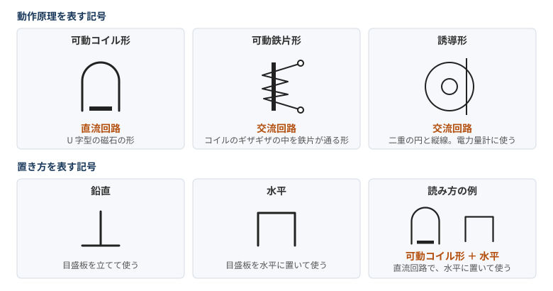

### 動作原理を表す記号

| 動作原理 | 記号の形 | 使える回路 | 補足 |
|---|---|---|---|
| **可動コイル形** | U 字型の磁石の形 | **直流** | 永久磁石の磁界とコイルの電流で動く |
| **可動鉄片形** | コイルのギザギザの中を鉄片が通る形 | **交流** | コイルの磁力で鉄片を動かす |
| **誘導形** | 二重の円と縦線 | **交流** | 円盤のうず電流で回る。電力量計に使う |
| 整流形 | ダイオードのマークが入る | 交流 | 交流を直流に変えて可動コイル形で測る。テスターに使う |

大まかには、**磁石の絵なら直流、それ以外は交流**と覚えるとよい。

### 置き方を表す記号

| 置き方 | 記号の形 | 使い方 |
|---|---|---|
| **鉛直** | 棒と地面のような形 | 目盛板を立てて使う |
| **水平** | コの字を下向きにした形 | 目盛板を水平に置いて使う |
| 傾斜 | （形は未確認）| 目盛板を斜めにして使う |

### 例題

目盛板に可動コイル形と水平の記号がある計器の意味で、正しいものは（令和 2 年度下期 午前 問 27）。

| 選択肢 | 判定 | 理由 |
|---|---|---|
| **永久磁石可動コイル形で、目盛板を水平に置いて、直流回路で使う** | **○** | 記号の読みと一致 |
| 永久磁石可動コイル形で、目盛板を水平に置いて、交流回路で使う | × | 可動コイル形は直流 |
| 可動鉄片形で、目盛板を鉛直に立てて、直流回路で使う | × | 記号が違う |
| 可動鉄片形で、目盛板を水平に置いて、交流回路で使う | × | 記号が違う |

### 計器のつなぎ方（電圧、電流、電力、力率の測定）

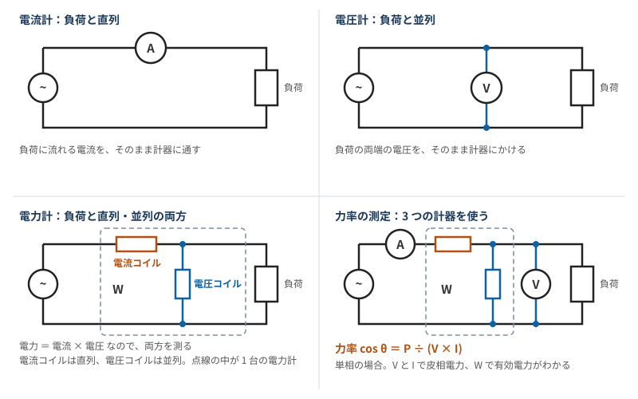

| 計器 | 図記号 | 負荷とのつなぎ方 |
|---|---|---|
| 電流計 | A | **直列** |
| 電圧計 | V | **並列** |
| 電力計 | W | **直列と並列の両方** |

電力計は、電力 ＝ 電流 × 電圧 なので、電流と電圧の両方を測る必要がある。中に 2 つのコイルが入っていて、**電流コイルは負荷と直列、電圧コイルは負荷と並列**につなぐ。

測定回路の問題は、3 つの計器を一度に考えず、電流計と電圧計を先につないでから、電力計を足すと解きやすい。

### 力率の測定

単相の負荷の力率は、**電圧計、電流計、電力計**の 3 つで求める。

$$\cos\theta = \frac{P}{VI}$$

電圧計と電流計で皮相電力 $VI$ が、電力計で有効電力 $P$ がわかる。「電力」の章の $\cos\varphi = P/S$ と同じ式。

例題：交流回路で単相負荷の力率を求める場合に必要な測定器の組み合わせは（平成 21 年度 問 27）。答えは「電圧計、電流計、電力計」。絶縁抵抗計、接地抵抗計、漏れ電流計は力率の測定には要らない。

### 確認状況（計器の記号）

- **図と表**：可動コイル形、可動鉄片形、誘導形、鉛直、水平の記号と使える回路は、[動画](https://www.youtube.com/watch?v=QY0dFgLJWuo)の画面 1 枚を拡大して確認し、それをもとに描いた。動画の残りのチャプター（計器の種類、力率の測定など）は、字幕を取得できず確認できていない。
- **記号の形の説明と補足**：[解説サイト](https://www.tenisyoku.com/media/electrician/dainishu-denki-kojishi/1034)による。「磁石の絵なら直流」もこの解説の考え方。整流形は動画の画面になく、この解説だけで確認した。整流形の記号は図に入れていない。
- **可動鉄片形**：動画は交流回路としているが、解説サイトには「交流・直流両用で、試験では交流用として扱われることが多い」と書くものがある。
- **誘導形**：動画と複数の解説は交流としている。「交直両用」と書くページも検索結果にあったが、少数なので交流とした。
- **「コの字」「棒と地面」**：形を説明するための私の言い方で、正式な呼び方ではない。
- **傾斜**：検索結果の要約で意味を確認しただけで、記号の形は確認できていない。
- **例題**：[過去問ドットコム](https://2shudenkikoujishi.kakomonn.com/questions/51790)で問題文と答えを確認した。× の理由の表現は整理したもの。
- **計器のつなぎ方の図**：動画の画面の電力計の図を参考に、説明のため 2 つのコイルを分けて描き直したもの。動画の図では、W の丸に線をつないだ形で描かれている。
- **つなぎ方と力率**：電力計の接続は動画の画面と解説サイトで確認した。電流計の直列と電圧計の並列は[解説サイト](https://e-sysnet.com/%E8%A9%A6%E9%A8%93%E7%94%A8%E5%99%A8%E5%85%B7%E3%81%AE%E6%80%A7%E8%83%BD%E5%8F%8A%E3%81%B3%E4%BD%BF%E7%94%A8%E6%96%B9%E6%B3%95/)による。動画の「力率の測定」のチャプターの内容は確認できていない。三相の力率の測り方は資料で確認できなかったので入れていない。

### 覚え方（計器の記号）

> 磁石の絵（可動コイル形）は直流。ギザギザの可動鉄片形と、二重丸の誘導形は交流。誘導形は電力量計。

> 棒と地面の形は鉛直（立てる）。下向きのコの字は水平（置く）。

> 電流計は直列、電圧計は並列、電力計は両方。力率は電圧計、電流計、電力計の 3 つで、cos θ = P ÷ VI。

### 参考文献（計器の記号）

- [ガミデンキちゃんねる「電気工事の測定と検査まとめ｜計測器の問題【Part1】」](https://www.youtube.com/watch?v=QY0dFgLJWuo)：動作原理と置き方の記号の表、電力計の接続（画面 2 枚のみ確認）
- [試験用器具の性能及び使用方法](https://e-sysnet.com/%E8%A9%A6%E9%A8%93%E7%94%A8%E5%99%A8%E5%85%B7%E3%81%AE%E6%80%A7%E8%83%BD%E5%8F%8A%E3%81%B3%E4%BD%BF%E7%94%A8%E6%96%B9%E6%B3%95/)：電流計、電圧計、電力計の接続、力率の測定
- [電圧、電流、電力の測定回路｜eleking](https://eleking.net/k21/k21h/k21h-measure.html)：電力計の 2 つのコイルと、測定回路の考え方。本文に文字化けあり
- [第二種電気工事士の過去問 平成 21 年度 問 27｜過去問ドットコム](https://2shudenkikoujishi.kakomonn.com/questions/10237)：力率の測定に必要な計器
- [メーターの記号「◎に縦線」は何？計器の動作原理と使用回路を完全攻略](https://www.tenisyoku.com/media/electrician/dainishu-denki-kojishi/1034)：記号の形の説明、使える回路、用途
- [第二種電気工事士の過去問 令和 2 年度下期 午前 問 27｜過去問ドットコム](https://2shudenkikoujishi.kakomonn.com/questions/51790)：例題と解説
- [測定器 動作原理の区別｜愛知県総合教育センター](https://apec.aichi-c.ed.jp/kyouka/kougyo/denki/2018/jissyu/keisoku/genrikubetu.html)：動作原理と使える回路（要約のみ）
- [指示計器の種類と特徴](https://e-sysnet.com/%E6%8C%87%E7%A4%BA%E8%A8%88%E5%99%A8/)：動作原理の比較（要約のみ）
- [計器の種類と計器に表示されている記号｜eleking](https://eleking.net/k21/k21h/k21h-meter.html)：計器の種類と置き方。本文に文字化けあり

## 竣工検査

建物の電気工事が終わったときに行う検査。**目で見て、抵抗値を測って、導通を確かめる**という流れで覚える。

| 順番 | 検査 | 内容 | 使う計器 |
|---|---|---|---|
| ① | **目視点検** | 電気設備技術基準に適合しているか、器具の取り付けは適切かなどを、目で見て点検する | なし |
| ② | **絶縁抵抗試験** | 絶縁抵抗値が決められた値**以上**か確認する | 絶縁抵抗計（メガー）|
| ③ | **接地抵抗試験** | 接地抵抗値が決められた値**以下**か確認する | 接地抵抗計 |
| ④ | **導通試験** | 回路が正しく接続されているかを調べる | 回路計（テスタ）など |

- **②と③は順番が前後してもよい**。
- **絶縁抵抗は「以上」、接地抵抗は「以下」**。絶縁は漏らさないために大きく、接地は逃がすために小さくする。
- **判定値**：「絶縁抵抗と接地抵抗」の章の表の値と比べる。

たとえば単相 3 線式 100/200 V の「200 V」の回路は対地電圧 100 V なので、絶縁抵抗は 0.1 MΩ 以上。三相 3 線式 200 V の回路は対地電圧が 150 V を超えるので、0.2 MΩ 以上。

### 確認状況（竣工検査）

- **検査の流れと内容**：[動画](https://www.youtube.com/watch?v=3b4aAQ_tHgM)の画面 2 枚で確認した。使う計器は[解説サイト](https://denkikoujishi-roadmap.com/82/)による。
- **順番**：この解説サイトは、目視のあとの導通、絶縁、接地の順番は固定されておらず、「唯一の全国共通の手順として暗記しない」としている。動画は導通試験を最後に置いている。試験で順番を問われたら、問題文に従う。無充電での測定を終えてから通電後の確認に進む流れは共通とされている。
- **「大きく、小さく」の説明**：「絶縁抵抗と接地抵抗」の章の整理を当てはめたもの。
- **入れなかった内容**：竣工検査で一般に行わないもの（電力測定など）は過去問でよく問われると思うが、資料で確認できなかったので入れていない。通電後の確認（電圧、極性、相順など）の詳細も入れていない。

### 覚え方（竣工検査）

> 目で見て（目視）、抵抗値を測って（絶縁は以上、接地は以下）、導通試験。絶縁と接地は順番が前後してもよい。

### 参考文献（竣工検査）

- [ガミデンキちゃんねる「電気工事の測定と検査まとめ｜竣工検査で工事完了【Part4】」](https://www.youtube.com/watch?v=3b4aAQ_tHgM)：竣工検査の流れと内容（画面 2 枚のみ確認）
- [絶縁抵抗測定・接地抵抗測定の方法と判定基準](https://denkikoujishi-roadmap.com/82/)：各検査の目的と計器、順番についての注意、判定の例

## 法令

第二種電気工事士の範囲で押さえる法律は、**電気事業法、電気工事士法、電気工事業法、電気用品安全法**の 4 つ。

| 法律 | 誰に向けたものか、何を定めるか |
|---|---|
| 電気事業法 | 電気工作物の種類、電圧の種別（技術基準の省令）|
| 電気工事士法 | 工事をする**人**の資格と義務 |
| 電気工事業法 | 工事をする**事業者**の登録や義務 |
| 電気用品安全法 | 電気用品を**作る、売る、使う**人の決まり |

### 電圧の種別

| 種別 | 直流 | 交流 |
|---|---|---|
| **低圧** | **750 V 以下** | **600 V 以下** |
| **高圧** | 750 V を超え 7000 V 以下 | 600 V を超え 7000 V 以下 |
| **特別高圧** | 7000 V を超える | 7000 V を超える |

### 電気工作物の種類

| 区分 | 種類 | 例 |
|---|---|---|
| 一般用 | **一般用電気工作物** | **600 V 以下**で受電する住宅、小規模な店舗など |
| 事業用 | **小規模事業用電気工作物** | 構内に設置する小規模発電設備のうち、出力が一般用の範囲を超えるもの |
| 事業用 | **自家用電気工作物** | **600 V を超えて**受電する工場、ビルなど |
| 事業用 | **電気事業用電気工作物** | 発電所、送電線路など |

基本は、**600 V 以下（低圧）なら一般用、600 V を超える（高圧）なら自家用**。

**600 V 以下でも一般用にならない条件**は次の 3 つ。

1. **構内以外の場所にある電気工作物と電気的につながっている**（受電用の電線路は除く）
2. **同じ構内に、小規模発電設備以外の発電設備がある**
3. **爆発性や引火性の物がある場所に設置する**（火薬類を製造する事業場、石炭坑）

3 つ目は、危険な施設だからと考えると覚えやすい。

### 発電設備の出力

| 発電設備 | 小規模発電設備の範囲 | このうち一般用 | 残りは小規模事業用 |
|---|---|---|---|
| **太陽電池** | **50 kW 未満** | **10 kW 未満** | 10 kW 以上 50 kW 未満 |
| **風力** | **20 kW 未満** | **なし** | 20 kW 未満 |
| **水力**（ダムなしなどの条件あり）| **20 kW 未満** | 20 kW 未満 | |
| **内燃力** | **10 kW 未満** | 10 kW 未満 | |
| **燃料電池**（条件あり）| **10 kW 未満** | 10 kW 未満 | |
| **スターリングエンジン** | **10 kW 未満** | 10 kW 未満 | |

同じ構内で電気的につないだ設備の出力の合計は **50 kW 未満**。

> 注意：動画の「小出力発電設備」の表は、上の「小規模発電設備の範囲」の列と同じ数値。改正前は、この範囲が全部一般用に入っていた。改正後は、用語が「小規模発電設備」に変わり、太陽電池の 10 kW 以上と風力は小規模事業用に分かれた。

第二種の作業範囲は一般用と小規模事業用を合わせたものなので、第二種の範囲としては、この列の数値のままでよい。問題が「一般用」を聞いているのか、改正前の用語で聞いているのかに注意する。

### 電気工事士法：資格と作業の範囲

目的は、**電気工事の欠陥による災害の発生の防止**。

| 資格 | 作業できる範囲 |
|---|---|
| **第二種電気工事士** | **一般用電気工作物等**（一般用と小規模事業用）|
| 第一種電気工事士 | 一般用電気工作物等と、自家用電気工作物（**最大電力 500 kW 未満**の需要設備など）|
| 認定電気工事従事者 | 自家用のうち、**600 V 以下**の簡易な工事（電線路を除く）|
| 特種電気工事資格者 | ネオン工事、非常用予備発電装置工事 |

### 電気工事士の義務と免状

- **技術基準**：作業するときは、電気設備の技術基準に適合させる。
- **免状の携帯**：作業するときは、免状を**携帯**する。
- **報告**：都道府県知事から求められたら、業務について報告する。

| 手続き | 内容 | 申請先 |
|---|---|---|
| 交付 | 申請書と資格を証明する書類を出す | 都道府県知事 |
| **再交付** | よごし、損じ、失ったとき。**申請できる** | **交付した**都道府県知事 |
| **書換え** | 記載事項に変更があったとき。**申請しなければならない** | **交付した**都道府県知事 |
| 返納 | 電気工事士法や電気用品安全法に違反したとき、知事が命じる | 命じた都道府県知事 |

再交付のあとで失った免状を見つけたら、再交付を受けた知事に遅滞なく提出する。

第一種電気工事士には、免状の交付から **5 年以内**ごとの講習がある。第二種にはこの規定がない。

### 資格がなくてもできること

**軽微な工事**（電気工事士法の「電気工事」に当たらない）：

| | 工事 | 具体例、補足 |
|---|---|---|
| 1 | 600 V 以下の接続器や開閉器に、**コードやキャブタイヤケーブルを接続**する | 接続器は差込み接続器、ねじ込み接続器、ソケット、ローゼットなど。開閉器はナイフスイッチ、カットアウトスイッチ、スナップスイッチなど |
| 2 | 600 V 以下の電気機器（**配線器具を除く**）や蓄電池の端子に、電線を**ねじ止め**する | 電動機の端子や蓄電池の端子。電線にはコード、キャブタイヤケーブル、ケーブルも含む |
| 3 | 600 V 以下の**電力量計、電流制限器、ヒューズ**を取り付け、取り外す | 電流制限器はアンペアブレーカー |
| 4 | 二次電圧 **36 V 以下**の小型変圧器の**二次側**の配線 | 電鈴、インターホーン、火災感知器、豆電球などに使うもの |
| 5 | 電線を支持する**柱や腕木**などを設置、変更する | |
| 6 | 地中電線用の**暗渠や管**を設置、変更する | |

間違えやすい点：

- **配線器具**：2 は配線器具を除くので、コンセントやスイッチの端子への接続には使えない。
- **小型変圧器**：軽微な工事なのは二次側だけ。一次側の配線は含まれない。
- **ローゼットなどの接続器**：1 で軽微になるのは、コードやキャブタイヤケーブルを接続する工事。[動画](https://www.youtube.com/watch?v=1c209dc0HaU)の画面では、天井側のボディ（引掛シーリングなど）は対象外とされていた。

令和 8 年度上期 問 28「電気工事士でなければ従事できない工事又は作業」は、この表を使うと解ける。答えはロ。

| 選択肢 | 判定 | 理由 |
|---|---|---|
| イ：差込み接続器にコードを接続する工事 | 資格は不要 | 表の 1 |
| **ロ：配電盤を造営材に取り付ける作業** | **資格が必要** | 下の「資格が必要な作業」の表に入っている |
| ハ：地中電線用の暗きょを設置する工事 | 資格は不要 | 表の 6 |
| ニ：火災感知器に使用する小型変圧器（二次電圧が 36 V 以下）二次側の配線工事 | 資格は不要 | 表の 4 |

**資格が必要な作業**（これ以外の作業は「軽微な作業」で、資格がなくてもできる）：

| 作業 | 例外や補足 |
|---|---|
| 電線相互を接続する | |
| がいしに電線を取り付け、取り外す | |
| 電線を直接、造営材などに取り付け、取り外す | |
| 電線管、線ぴ、ダクトなどに電線を収める | |
| 配線器具を造営材などに取り付け、取り外す。電線を接続する | **露出型の点滅器やコンセントの取り換えは除く** |
| 電線管を曲げ、ねじ切りする。電線管どうしや、電線管とボックスなどを接続する | |
| 金属製のボックスを造営材などに取り付け、取り外す | |
| 造営材を貫通する部分に、金属製の防護装置を取り付け、取り外す | |
| 金属製の電線管などを、メタルラス張りなどの部分に取り付け、取り外す | |
| 配電盤を造営材に取り付け、取り外す | |
| 接地線の取り付けや接続、接地極の埋設 | 600 V 以下の電気機器に関するものは除く |
| 600 V を超えて使う電気機器に電線を接続する | |

電線の接続とがいしへの取り付けの補助作業も、資格なしでできる。

### 電気工事業法

| 項目 | 内容 |
|---|---|
| 登録 | 電気工事業を営むには登録する。**有効期間は 5 年** |
| 建設業者 | 電気工事業を始めたら、遅滞なく**届け出る** |
| 自家用のみの業者 | 始めたら、遅滞なく**通知する** |
| **主任電気工事士** | 一般用の工事を行う営業所ごとに置く。**第一種**、または**第二種で免状の交付後 3 年以上の実務経験** |
| **備える器具** | 一般用のみの営業所は、**絶縁抵抗計、接地抵抗計、回路計**（抵抗と交流電圧を測れるもの）|
| **標識** | **営業所と施工場所ごと**に掲げる（1 日で終わる工事の施工場所は除く）|
| **帳簿** | 営業所ごとに備え、**記載の日から 5 年間保存**する |

帳簿に書く項目は、注文者の氏名、工事の種類と施工場所、施工年月日、主任電気工事士と作業者の氏名、配線図、検査結果。

### 電気用品安全法

目的は、**電気用品による危険と障害の発生の防止**。特に危険なものが特定電気用品で、表示のマークが違う。

| 区分 | PSE マークの形 | 表示するもの |
|---|---|---|
| **特定電気用品** | **ひし形** | 記号、届出事業者、**検査機関** |
| 特定電気用品以外 | **丸形** | 記号、届出事業者 |

| 区分 | 主な品目 |
|---|---|
| **特定電気用品** | 絶縁電線（100 mm² 以下）、**ケーブル（22 mm² 以下）**、コード、キャブタイヤケーブル（100 mm² 以下）、ヒューズ、点滅器（30 A 以下）、配線用遮断器と漏電遮断器（100 A 以下）、接続器（50 A 以下）、ジョイントボックス、電流制限器 |
| 特定電気用品以外 | **ケーブル（22 mm² を超え 100 mm² 以下）**、**電線管、フロアダクト、線ぴ、ライティングダクト**、ケーブル配線用スイッチボックス、電磁開閉器 |

表にはそれぞれ定格電圧などの条件が付く（電線は 100 V 以上 600 V 以下、配線器具は 100 V 以上 300 V 以下など）。

- **販売の制限**：製造、輸入、販売の事業者は、表示のない電気用品を販売や陳列してはならない。
- **使用の制限**：電気工事士などは、表示のない電気用品を電気工作物の設置や変更の工事に使ってはならない。

### 確認状況（法令）

- **条文**：電圧の種別、電気工作物、発電設備の出力、資格と義務、免状、軽微な工事と作業、電気工事業法、電気用品の区分は、[e-Gov 法令検索](https://laws.e-gov.go.jp/)の API で取得した現行の条文で確認した。条文の一部は要約を介して読んだもので、特に「接地線」の例外は条文の表現を短くまとめている。
- **動画**：[ガミデンキちゃんねるの動画](https://www.youtube.com/watch?v=TbPysD6DC5g)は画面 5 枚とチャプターだけ確認した。電圧の種別は条文と一致している。動画は 3 年前のもので、「小出力発電設備」の表と電気工作物の分類は改正前の内容になっている（小規模事業用電気工作物がない）。同じシリーズの Part 2〜4（免状、資格がなくてもできる作業、電気用品安全法）は見ていない。
- **試験との関係**：現行の条文に合わせて書いた。試験の出題年度や教材によっては、「小出力発電設備」という改正前の用語や数値で出る可能性がある。試験の直前に、最新の参考書か過去問で確認すること。
- **PSE マークの形**：検索結果の要約で確認した。省令の別表の図は確認していない。
- **「誰に向けたものか」の表と、表の品目の選び方**：試験向けに自分で整理したもの。品目は一部で、全部ではない。
- **入れなかった内容**：罰則、登録の申請先の細かい区分、品目の全リストは入れていない。

### 覚え方（法令）

> 低圧は直流 750 V、交流 600 V 以下。7000 V を超えると特別高圧。

> 第二種は一般用と小規模事業用まで。自家用の 500 kW 未満は第一種。

> 600 V 以下でも一般用にならないのは、構外とつながる、ほかの発電設備がある、爆発や引火のおそれがある場所の 3 つ。

> 小規模発電設備は太陽電池 50 kW、風力と水力 20 kW、内燃力と燃料電池とスターリング 10 kW、合計 50 kW（すべて未満）。

> 免状の再交付は「できる」、書換えは「しなければならない」。どちらも交付した知事へ。

> 帳簿は 5 年保存。主任電気工事士は第一種か、第二種で実務 3 年以上。器具は絶縁抵抗計、接地抵抗計、回路計。

> 特定電気用品はひし形。ケーブルは 22 mm² 以下が特定。電線管や線ぴは特定以外。

> 軽微な工事は 6 つ。コードをつなぐ、端子にねじ止め、電力量計とヒューズ、36 V 以下の二次側、柱と腕木、暗渠と管。

### 参考文献（法令）

e-Gov 法令検索：

- [電気事業法](https://laws.e-gov.go.jp/law/339AC0000000170) 第 38 条：電気工作物の定義
- [電気事業法施行規則](https://laws.e-gov.go.jp/law/407M50000400077) 第 48 条：一般用電気工作物の範囲、発電設備の出力
- [電気設備に関する技術基準を定める省令](https://laws.e-gov.go.jp/law/409M50000400052) 第 2 条：電圧の種別
- [電気工事士法](https://laws.e-gov.go.jp/law/335AC0000000139) 第 1〜5 条、第 9 条：目的、作業の制限、免状、義務、報告
- [電気工事士法施行令](https://laws.e-gov.go.jp/law/335CO0000000260) 第 1 条、第 4〜6 条：軽微な工事の 6 項目と具体例、再交付、書換え、返納
- [電気工事士法施行規則](https://laws.e-gov.go.jp/law/335M50000400097) 第 1 条の 2、第 2 条、第 2 条の 2、第 2 条の 3：自家用の範囲、軽微な作業、特殊電気工事、簡易電気工事
- [電気工事業の業務の適正化に関する法律](https://laws.e-gov.go.jp/law/345AC1000000096) 第 3、19、24〜26、34 条：登録、主任電気工事士、器具、標識、帳簿、届出と通知
- [同 施行規則](https://laws.e-gov.go.jp/law/345M50000400103) 第 11〜13 条：器具、標識、帳簿の詳細
- [電気用品安全法](https://laws.e-gov.go.jp/law/336AC0000000234) 第 1、2、10、27、28 条：目的、定義、表示、販売と使用の制限
- [電気用品安全法施行令](https://laws.e-gov.go.jp/law/337CO0000000324) 別表第一、別表第二：特定電気用品とそれ以外の品目
- [電気用品安全法施行規則](https://laws.e-gov.go.jp/law/337M50000400084) 第 17 条：表示の方式

そのほか：

- [ガミデンキちゃんねる「【第二種電気工事士】実物あり。問11~30の暗記問題に苦戦していませんか？｜R8年上期完全解説シリーズ」](https://www.youtube.com/watch?v=1c209dc0HaU)：軽微な工事の整理。天井側のボディが対象外という補足は、この画面だけが根拠で条文には書かれていない（画面 1 枚のみ確認）
- [令和 8 年度上期 第二種電気工事士 学科試験 問題](https://www.shiken.or.jp/construction/upload/20260524_co_second_q01.pdf)、[解答](https://www.shiken.or.jp/construction/upload/20260524_co_second_a01.pdf)｜電気技術者試験センター：問 28 の選択肢と答え
- [ガミデンキちゃんねる「電気工作物の概念、整理できてる？｜法令問題要点まとめ【Part1】」](https://www.youtube.com/watch?v=TbPysD6DC5g)：電圧の種別、電気工作物の種類、一般用にならない条件、小出力発電設備の表（画面 5 枚とチャプターのみ確認）
- [PSE マークの解説｜TÜV SÜD](https://www.tuvsud.com/ja-jp/resource-centre/stories/pse)：マークの区分と品目の例（要約のみ）
- [PSE マークの解説｜THE CKB](https://www.theckb.com/psemark_electronics)：ひし形と丸形（要約のみ）

## 過去問の一覧（問題と解答）

第二種電気工事士の学科試験の、公式の問題と解答の一覧。令和 8 年度から平成 29 年度までの 10 年度分で、26 組ある。

| 試験 | 実施日 | 問題 | 解答 |
|---|---|---|---|
| 令和 8 年度下期 | 2026 年 10 月 25 日 | [問題](https://www.shiken.or.jp/construction/upload/20261025_co_second_q01.pdf) | [解答](https://www.shiken.or.jp/construction/upload/20261025_co_second_a01.pdf) |
| 令和 8 年度上期 | 2026 年 5 月 24 日 | [問題](https://www.shiken.or.jp/construction/upload/20260524_co_second_q01.pdf) | [解答](https://www.shiken.or.jp/construction/upload/20260524_co_second_a01.pdf) |
| 令和 7 年度下期 | 2025 年 10 月 26 日 | [問題](https://www.shiken.or.jp/construction/upload/20251026_co_second_q01.pdf) | [解答](https://www.shiken.or.jp/construction/upload/20251026_co_second_a01.pdf) |
| 令和 7 年度上期 | 2025 年 5 月 25 日 | [問題](https://www.shiken.or.jp/construction/upload/20250525_co_second_q01.pdf) | [解答](https://www.shiken.or.jp/construction/upload/20250525_co_second_a01.pdf) |
| 令和 6 年度下期 | 2024 年 10 月 27 日 | [問題](https://www.shiken.or.jp/construction/upload/20241027_co_second_q01.pdf) | [解答](https://www.shiken.or.jp/construction/upload/20241027_co_second_a01.pdf) |
| 令和 6 年度上期 | 2024 年 5 月 26 日 | [問題](https://www.shiken.or.jp/construction/upload/20240526_co_second_q01.pdf) | [解答](https://www.shiken.or.jp/construction/upload/20240526_co_second_a01.pdf) |
| 令和 5 年度下期（午前） | 2023 年 10 月 29 日 | [問題](https://www.shiken.or.jp/construction/upload/20231029_co_second_q01.pdf) | [解答](https://www.shiken.or.jp/construction/upload/20231029_co_second_a01.pdf) |
| 令和 5 年度下期（午後） | 2023 年 10 月 29 日 | [問題](https://www.shiken.or.jp/construction/upload/20231029_co_second_q02.pdf) | [解答](https://www.shiken.or.jp/construction/upload/20231029_co_second_a02.pdf) |
| 令和 5 年度上期（午前） | 2023 年 5 月 28 日 | [問題](https://www.shiken.or.jp/construction/upload/20230528_co_second_q01.pdf) | [解答](https://www.shiken.or.jp/construction/upload/20230528_co_second_a01.pdf) |
| 令和 5 年度上期（午後） | 2023 年 5 月 28 日 | [問題](https://www.shiken.or.jp/construction/upload/20230528_co_second_q02.pdf) | [解答](https://www.shiken.or.jp/construction/upload/20230528_co_second_a02.pdf) |
| 令和 4 年度下期（午前） | 2022 年 10 月 30 日 | [問題](https://www.shiken.or.jp/construction/upload/20221030_co_second_q01.pdf) | [解答](https://www.shiken.or.jp/construction/upload/20221030_co_second_a01.pdf) |
| 令和 4 年度下期（午後） | 2022 年 10 月 30 日 | [問題](https://www.shiken.or.jp/construction/upload/20221030_co_second_q02.pdf) | [解答](https://www.shiken.or.jp/construction/upload/20221030_co_second_a02.pdf) |
| 令和 4 年度上期（午前） | 2022 年 5 月 29 日 | [問題](https://www.shiken.or.jp/construction/upload/20220529_co_second_q01.pdf) | [解答](https://www.shiken.or.jp/construction/upload/20220529_co_second_a01.pdf) |
| 令和 4 年度上期（午後） | 2022 年 5 月 29 日 | [問題](https://www.shiken.or.jp/construction/upload/20220529_co_second_q02.pdf) | [解答](https://www.shiken.or.jp/construction/upload/20220529_co_second_a02.pdf) |
| 令和 3 年度下期（午前） | 2021 年 10 月 24 日 | [問題](https://www.shiken.or.jp/construction/upload/220211024_co_second_q01.pdf) | [解答](https://www.shiken.or.jp/construction/upload/220211024_co_second_a01.pdf) |
| 令和 3 年度下期（午後） | 2021 年 10 月 24 日 | [問題](https://www.shiken.or.jp/construction/upload/220211024_co_second_q02.pdf) | [解答](https://www.shiken.or.jp/construction/upload/220211024_co_second_a02.pdf) |
| 令和 3 年度上期（午前） | 2021 年 5 月 30 日 | [問題](https://www.shiken.or.jp/construction/upload/20210530_co_second_q01.pdf) | [解答](https://www.shiken.or.jp/construction/upload/20210530_co_second_a01.pdf) |
| 令和 3 年度上期（午後） | 2021 年 5 月 30 日 | [問題](https://www.shiken.or.jp/construction/upload/20210530_co_second_q02.pdf) | [解答](https://www.shiken.or.jp/construction/upload/20210530_co_second_a02.pdf) |
| 令和 2 年度下期（午前） | 2020 年 10 月 4 日 | [問題](https://www.shiken.or.jp/construction/upload/20201004_co_second_q01.pdf) | [解答](https://www.shiken.or.jp/construction/upload/20201004_co_second_a01.pdf) |
| 令和 2 年度下期（午後） | 2020 年 10 月 4 日 | [問題](https://www.shiken.or.jp/construction/upload/20201004_co_second_q02.pdf) | [解答](https://www.shiken.or.jp/construction/upload/20201004_co_second_a02.pdf) |
| 2019 年度下期 | 2019 年 10 月 6 日 | [問題](https://www.shiken.or.jp/construction/upload/20191006_co_second_q01.pdf) | [解答](https://www.shiken.or.jp/construction/upload/20191006_co_second_a01.pdf) |
| 2019 年度上期 | 2019 年 6 月 2 日 | [問題](https://www.shiken.or.jp/construction/upload/20190602_co_second_q01.pdf) | [解答](https://www.shiken.or.jp/construction/upload/20190602_co_second_a01.pdf) |
| 平成 30 年度下期 | 2018 年 10 月 7 日 | [問題](https://www.shiken.or.jp/construction/upload/20181007_co_second_q01.pdf) | [解答](https://www.shiken.or.jp/construction/upload/20181007_co_second_a01.pdf) |
| 平成 30 年度上期 | 2018 年 6 月 3 日 | [問題](https://www.shiken.or.jp/construction/upload/20180603_co_second_q01.pdf) | [解答](https://www.shiken.or.jp/construction/upload/20180603_co_second_a01.pdf) |
| 平成 29 年度下期 | 2017 年 9 月 30 日 | [問題](https://www.shiken.or.jp/construction/upload/20170930_co_second_q01.pdf) | [解答](https://www.shiken.or.jp/construction/upload/20170930_co_second_a01.pdf) |
| 平成 29 年度上期 | 2017 年 6 月 4 日 | [問題](https://www.shiken.or.jp/construction/upload/20170604_co_second_q01.pdf) | [解答](https://www.shiken.or.jp/construction/upload/20170604_co_second_a01.pdf) |

- **午前と午後**：令和 2 年度下期から令和 5 年度下期までは、午前と午後で問題が違う。
- **試験の名前**：令和 4 年度までは「筆記試験」、令和 5 年度からは「学科試験」。2019 年度は公式の表記のまま書いた。
- **令和 2 年度**：公式の一覧には下期しかない。
- **解答の内容**：問 1〜50 の記号（イ、ロ、ハ、ニ）だけで、解説はない。
- **古い回の注意**：古い回の 1 ページ目には、その回で使う図記号の規格と「電気設備の技術基準の解釈」の扱いが書かれている。当時の決まりで作られた問題なので、法令の問題は「法令」の章の「試験との関係」も見る。

### 確認状況（過去問の一覧）

- **確認した内容**：52 ファイルすべてを 2026 年 11 月 2 日にダウンロードして開き、1 ページ目の年度、期、午前午後が表と合うことを確認した。解答は 26 組とも問 1〜50 と記号 50 個がそろい、注記はなかった。
- **午前と午後が違うこと**：令和 4〜5 年度は問題文を比べ、令和 2〜3 年度は文字を取り出せなかったので解答の違いから判断した。
- **問題の中身**：問題は解いていない。古い回の問題が今の法令と違うかも調べていない。
- **令和 3 年度下期のファイル名**：先頭が `220211024` で、日付の前に 2 が付いている。公式の一覧のリンクがこの名前で、`20211024` の URL は 404 を返した。
- **令和 2 年度上期がない理由**：新型コロナで中止されたと記憶しているが、資料では確認できていない。

### 参考文献（過去問の一覧）

- [第二種電気工事士試験の問題と解答｜電気技術者試験センター](https://www.shiken.or.jp/construction/second/qa/)：試験名、実施日、PDF へのリンク。令和 6 年度上期以前は [2 ページ目](https://www.shiken.or.jp/construction/second/qa/index_2.html)、[3 ページ目](https://www.shiken.or.jp/construction/second/qa/index_3.html)、[4 ページ目](https://www.shiken.or.jp/construction/second/qa/index_4.html)に載っている

## 過去問で補う内容（令和 8 年度上期）

[令和 8 年度上期の学科試験](https://www.shiken.or.jp/construction/upload/20260524_co_second_q01.pdf)（[解答](https://www.shiken.or.jp/construction/upload/20260524_co_second_a01.pdf)）を見て、これまでの章にない内容をまとめた。一般問題 30 問と配線図 20 問の計 50 問で、配点は 1 問 2 点。

次の問題は、これまでの章の内容で解ける。

| 問 | 内容 | 答え | 章 |
|---|---|---|---|
| 8 | 3.5 mm² を 4 本、減少係数 0.63 | 37 × 0.63 = 23.31 → 23 A | 電線の許容電流 |
| 9 | 電動機 10 A、電熱器 15 A + 20 A の幹線 | $I_M \le I_H$ なので 10 + 35 = 45 A | 分岐回路 |
| 10 | 遮断器、電線、コンセントの組み合わせ | 20 A、2.0 mm、20 A | 分岐回路 |
| 12 | 0.75 mm² のゴムコードで使える電熱器具 | 7 A × 100 V = 700 W なので 600 W | 電線の許容電流 |
| 20 | ケーブルの支持点間 | 2 m と 6 m | ケーブル工事 |
| 22 | D 種接地の省略 | 水気のある場所は省略不可 | 絶縁抵抗と接地抵抗 |
| 25 | 絶縁抵抗の基準 | 対地電圧 200 V で 0.18 MΩ は不適合 | 絶縁抵抗と接地抵抗 |
| 28 | 電気工事士でなければできない作業 | 配電盤を造営材に取り付ける | 法令 |
| 31 | 小勢力回路の最大電圧 | 60 V | そのほかの工事 |
| 39 | 200 V 回路の絶縁抵抗の最小値 | 単相 3 線式なので対地電圧 100 V、0.1 MΩ | 絶縁抵抗と接地抵抗 |

### コンセントの極配置（刃受）

問 37 で、図記号「250V E」のコンセントの刃受を選ぶ問題が出た。答えは、横一直線の刃受に接地極が付いた形。形の読み方と一覧は「コンセントの種類と形」の章にまとめた。

### 図記号の追加

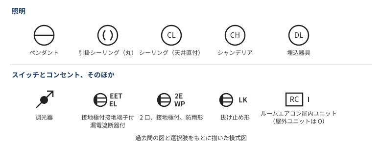

| 問 | 問われた内容 | 答え |
|---|---|---|
| 33 | ●L | 確認表示灯を内蔵する点滅器 |
| 34 | コンセントの EET、EL | 接地極付接地端子付漏電遮断器付コンセント |
| 35 | ペンダントの図記号 | 丸に横線 |
| 36 | ルームエアコンの屋内ユニットの傍記 | **I**（屋外は O）|
| 38 | 抜け止め形の傍記 | **LK** |
| 40 | DL | 埋込器具 |
| 46 | 矢印付きの黒丸 | 調光器（つまみの付いた器具）|
| 48 | 斜線の丸 | VVF 用ジョイントボックス（透明なカバー状の材料）|
| 50 | 配線図で使われていないスイッチ | 四路スイッチ |

問 17 と問 48 の透明なカバー状のものが、VVF 用ジョイントボックス。問 16 の写真は幅 25 mm の金属の樋で、金属線ぴ。

### 絶縁テープの巻き方

問 19 で、不適切なものを選ぶ問題が出た（1.6 mm の VVF をリングスリーブで終端接続した場合）。

決まっているのは「何 mm 以上」ではなく、**テープの種類ごとの巻く回数**。問題文の厚さは、どのテープかを示している。薄いビニルテープは多く、厚いテープは少なく巻く。

| テープ | 厚さ | 巻き方 | 厚さの合計（参考）|
|---|---|---|---|
| ビニルテープ | 約 0.2 mm | 半幅以上重ねて **2 回以上**（4 層以上）| 約 0.8 mm |
| 黒色粘着性ポリエチレン絶縁テープ | 約 0.5 mm | 半幅以上重ねて **1 回以上**（2 層以上）| 約 1.0 mm |
| 自己融着性絶縁テープ | 約 0.5 mm | 半幅以上重ねて **1 回以上**（2 層以上）巻き、**さらに保護テープを半幅以上重ねて 1 回以上**巻く | 約 1.0 mm と保護テープ |

- **層の数**：半幅以上重ねて 1 回巻くと 2 層になる。層の数は回数の 2 倍。
- **多く巻く分には問題ない**：3 回（6 層）は、ビニルテープでも黒色のテープでも適切。
- **テープがいらないもの**：差込形コネクタと、リングスリーブ用の絶縁キャップ。

同じ形の問題の答えは、次の 2 パターンに分かれる。

| 出題 | 答え（不適切な選択肢）| 理由 |
|---|---|---|
| 令和 8 年度上期 問 19 | 自己融着性絶縁テープを 1 回（2 層）| 保護テープがない |
| 令和 5 年度下期 午前 問 19 | 自己融着性絶縁テープを 1 回（2 層）| 保護テープがない |
| 令和 6 年度下期 問 19 | ビニルテープを 1 回（2 層）| 2 回以上必要 |
| 令和 3 年度下期 午後 問 19 | ビニルテープを 1 回（2 層）| 2 回以上必要 |

> **憶測**：ビニルテープ 2 回は 0.2 mm × 4 層 = 0.8 mm で、直径 1.6 mm や 2.0 mm の IV 線の絶縁体の厚さ（0.8 mm）と同じ。「接続部分は電線の絶縁物と同等以上の絶縁効力で被覆する」という決まりと結びつけると覚えやすい。ただし、回数の根拠を明記した資料は見つけていない。直径 2.6 mm の IV 線は絶縁体が 1.0 mm なので、どの太さにも当てはまるわけではない。

### 測定器の使い分け

| 測定器 | 用途 |
|---|---|
| 回路計（テスタ）| 導通試験 |
| 検相器 | 三相回路の相順（相回転）の確認 |
| 電力計 | **消費電力**の測定（**消費電力量**ではない。問 24 の答え）|
| クランプ式電流計 | 負荷電流の測定（問 44）|
| クランプ形漏れ電流計 | 漏れ電流の測定（問 27）|

**クランプのはさみ方**が問われる。

- **負荷電流**：電線を **1 本**はさむ。
- **漏れ電流**：**全部の線をまとめて**はさむ（単相 3 線式なら中性線も含めた 3 本。問 27）。行きと帰りの電流は打ち消し合うので、漏れがなければゼロになる。

測定の注意点も出題された。

- **接地抵抗計（問 26）**：測定の前に、接地極の**地電圧**が許容値以下であることを確認する。
- **絶縁抵抗（問 25）**：分電盤で一括して測って 1.5 MΩ なら、基準を十分超えているので、個別の分岐回路の測定を省略してよい。一括の値は各回路の並列なので、各回路の値より低く出るため。

### 工具と材料

工具の写真は「工事で使う工具（写真）」の章にまとめた。

| 名前 | 用途 |
|---|---|
| ノックアウトパンチャ | 金属製キャビネットに穴をあける |
| 羽根ぎり | 木造の天井板などに、電線管を通す穴をあける |
| 張線器 | 電線やメッセンジャワイヤのたるみを取る |
| プリカナイフ | **薄鋼電線管の切断には使わない**（問 13 の答え）。2 種金属製可とう電線管の切断に使う |
| ガストーチ | **硬質ポリ塩化ビニル電線管の曲げ加工**に使う（問 18）|
| TS カップリング | 硬質ポリ塩化ビニル電線管**どうしの接続**（問 11）|
| コンビネーションカップリング | 種類の違う管の接続。**同じ薄鋼電線管どうしには使わない**（問 23 の答え）|
| ロックナット | 薄鋼電線管とアウトレットボックスの接続部に使う |

問 21 の答えは「CD 管を木造の床下や壁の内部、天井裏に配管した」。CD 管はコンクリートに埋め込むものなので不適切。

### 基礎の計算

| 問 | 内容 | 考え方 |
|---|---|---|
| 2 | 軟銅線の抵抗 | 長さに比例し、**断面積に反比例**（2 乗に反比例ではない）。温度が上がると大きくなる。抵抗率はアルミより低い |
| 3 | 300 W を 2 時間使ったときの発熱量 | $Q = Pt$。$300 \times 2 \times 3600 = 2160$ kJ |
| 4 | コンデンサで力率を 100 % に改善 | 無効分の電流が減るので、電流計の値は**減る** |
| 5 | Y 接続の 1 相が断線 | 断線前は $200/\sqrt{3} \approx 116$ V、断線後は 2 本の直列になるので $200/2 = 100$ V |
| 6 | 2 線で 12 m、16 A の電圧降下 | 往復 24 m で $5.0 \times 0.024 = 0.12\ \Omega$、$16 \times 0.12 \approx 2$ V |
| 7 | 単相 3 線式の負荷を平衡にする | スイッチを閉じると中性線の電流がゼロになる。電圧降下が 2 線分から 1 線分に減り、99 V から 102 V へ 3 V 上がる |

### 三相誘導電動機

問 14 と問 15 の内容は、「三相誘導電動機と進相コンデンサ」の章にまとめた。

### 法令の追加

- **問 30**：「電気設備に関する技術基準を定める省令」は**電気事業法**に基づく。電気工事士法ではない。
- **問 29**：特定電気用品の組み合わせは「タイムスイッチ、配線用遮断器」。

| 品目 | 区分 |
|---|---|
| タンブラースイッチ、フロートスイッチ、タイムスイッチ、配線用遮断器、差込み接続器 | 特定電気用品 |
| カバー付ナイフスイッチ、電磁開閉器、ライティングダクト | 特定電気用品以外 |

### 配線図の問題の前提

配線図の問題には注意書きが付く。令和 8 年度上期では、次の内容だった。

- 屋内配線は、特記がなければ VVF のケーブル工事。
- 漏電遮断器は定格感度電流 30 mA、動作時間 0.1 秒以内。
- 点滅器の写真は、特記がなければ一般形（問 46 だけワイド形と書かれていた）。
- ジョイントボックスを経由する電線は、すべて接続箇所を設けている。
- 三路スイッチの「0」の端子には、電源側か負荷側の電線をつなぐ。

### 確認状況（令和 8 年度上期）

- **問題文、答え、図**：[試験センターの問題](https://www.shiken.or.jp/construction/upload/20260524_co_second_q01.pdf)と[解答](https://www.shiken.or.jp/construction/upload/20260524_co_second_a01.pdf)で確認した。ただし公式の解答は記号だけで、解説はない。表の「考え方」や理由は自分で付けたもの。
- **コンセントの形**：125 V 15 A の接地極付、125 V 20 A、250 V 20 A、250 V 15 A の接地極付は問 37 の図で確認した。図と確認状況は「コンセントの種類と形」の章に移した。
- **図記号**：問 35 の 4 つの図と、配線図の記号をもとに描いた。CL、CH、引掛シーリング（丸）、調光器の対応は、問題文に名前と図が直接並んでいるわけではなく、選択肢や配線図、写真から読み取った。
- **絶縁テープ**：回数は[ふくラボの解説 1](https://denkikouji2nd.fukulabo-e9.com/2021/11/2p-r02s-p19/)、[解説 2](https://denkikouji2nd.fukulabo-e9.com/2021/12/2p-r03s-p19/)の本文と、各回の問 19 の答えで確認した。内線規程の原文とは照合していない。IV 線の絶縁体の厚さは[メーカーの仕様書](https://www.sds-kaeruya.com/download/SF-0010B_IV.pdf)による。
- **クランプの原理の説明、ロックナットの用途**：ロックナットは問 23 の選択肢で「適切」と読み取った。
- **一括測定の理由**：[解説サイト](https://denkikoujishi-roadmap.com/82/)による。
- **配線図の問 32、41、42、47、49**：答えは確認したが、複線図を描いて本数やスリーブの数を確かめてはいないので、ここには解き方を入れていない。問 1 も入れていない。

### 覚え方（令和 8 年度上期）

> コンセントは平行が 125 V、一直線が 250 V。T 字や L 字が付くと 20 A、下に丸で接地極付。

> テープはビニル 2 回、黒色 1 回、自己融着 1 回 ＋ 保護テープ 1 回。

> 負荷電流は 1 本、漏れ電流は全部まとめてはさむ。接地抵抗の測定の前に地電圧を確認する。

> 電力計は電力、電力量計は電力量。CD 管は木造に使わない。

> 電動機は 2 本入れ替えで逆転、周波数が下がると回転も下がる。進相コンデンサは力率改善。

### 参考文献（令和 8 年度上期）

- [令和 8 年度上期 第二種電気工事士 学科試験 問題](https://www.shiken.or.jp/construction/upload/20260524_co_second_q01.pdf)、[解答](https://www.shiken.or.jp/construction/upload/20260524_co_second_a01.pdf)｜電気技術者試験センター
- [ふくラボ コンセントの極配置（令和 2 年度下期 午後 問 31）](https://denkikouji2nd.fukulabo-e9.com/2021/11/2p-r02s-p31/)：100 V 系と 200 V 系、15 A と 20 A の形
- [コンセントの種類と定格の見分け方](https://denki2.towelswitch.com/kizai/outlets/)：20 A の T 字形と接地極付
- [ふくラボ ビニル絶縁ビニルシースケーブルの接続部分絶縁処理（令和 2 年度下期 午後 問 19）](https://denkikouji2nd.fukulabo-e9.com/2021/11/2p-r02s-p19/)：テープの巻き方
- [ふくラボ リングスリーブで接続したときの絶縁処理（令和 3 年度下期 午後 問 19）](https://denkikouji2nd.fukulabo-e9.com/2021/12/2p-r03s-p19/)：テープの巻き方、接続部分の絶縁の考え方
- 令和 6 年度下期 [問題](https://www.shiken.or.jp/construction/upload/20241027_co_second_q01.pdf)、[解答](https://www.shiken.or.jp/construction/upload/20241027_co_second_a01.pdf)、令和 5 年度下期 午前 [問題](https://www.shiken.or.jp/construction/upload/20231029_co_second_q01.pdf)、[解答](https://www.shiken.or.jp/construction/upload/20231029_co_second_a01.pdf)｜電気技術者試験センター：問 19 のテープの出題パターン
- [IV 線の仕様書（SF-0010B）](https://www.sds-kaeruya.com/download/SF-0010B_IV.pdf)：導体の太さと絶縁体の厚さ
- [TAC の一問一答 電線管工事で使う工具器具](https://www.tac-school.co.jp/kouza_denkikoujisi/denkikoujisi_quiz/denkikoujisi_quiz_031.html)：薄鋼電線管の切断とプリカナイフ（要約のみ）
- [大阪公立大学高専 電気機器の講義資料](https://www2-kawakami.ct.osakafu-u.ac.jp/omu-content/uploads/sites/1161/Lecture_Data/Electrical_Machinery_II/01_Lecture/13_lecture_electrical_machinery_II.pdf)：同期速度と回転速度（要約のみ）

## 工事で使う工具（写真）

「電気工事の作業と使用する工具の組合せ」のような問題に対応するためのまとめ。試験の見た目で覚えられるよう、写真はなるべく過去問のものを使った。出典の「R8 下」は令和 8 年度下期を表す。

### 組合せ問題の解き方

**工具の相手になる材料**を見ると解きやすい。金属板、木、コンクリート、金属管、合成樹脂管、可とう電線管のどれに使う工具なのかで判断する。

令和 8 年度上期 問 13「電気工事の作業と使用する工具の組合せとして、誤っているものは」の答えはニ。

| 選択肢 | 判定 | 理由 |
|---|---|---|
| イ：金属製キャビネットに穴をあける作業とノックアウトパンチャ | 正しい | 金属板の穴あけ |
| ロ：木造天井板に電線管を通す穴をあける作業と羽根ぎり | 正しい | 木材の穴あけ |
| ハ：電線、メッセンジャワイヤ等のたるみを取る作業と張線器 | 正しい | たるみ取りの専用工具 |
| **ニ：薄鋼電線管を切断する作業とプリカナイフ** | **誤り** | プリカナイフは 2 種金属製可とう電線管（プリカチューブ）を切る。薄鋼電線管には金切りのこやパイプカッタを使う |

同じ形の出題は次のとおり。

| 出題 | 問われた内容 | 答え |
|---|---|---|
| R8 下 問 13、R5 上 午前 問 13 | コンクリート壁に金属管を取り付ける材料と工具 | サドル、振動ドリル、カールプラグ、木ねじ |
| R7 下 問 13 | ねじなし電線管の曲げ | パイプベンダ（トーチランプ、ディスクグラインダ、パイプレンチは違う）|
| R7 上 問 13 | 工事の種類と工具 | 金属管工事とパイプベンダ（合成樹脂管工事とリード型ねじ切り器、ライティングダクト工事と合成樹脂管用カッタ、金属線ぴ工事とボルトクリッパは違う）|
| R6 下 問 13 | ノックアウトパンチャの用途 | 金属製キャビネットに穴をあける |
| R6 上 問 13 | 硬質ポリ塩化ビニル電線管の切断と曲げ | 合成樹脂管用カッタ、面取器、トーチランプ |
| R6 上 問 18 | クリックボールの用途 | リーマと組み合わせて、金属管の面取りに使う |
| R8 下 問 44 | 木造部分に配線用の穴をあける工具（写真）| 木工用のドリル |
| R8 下 問 49 | FEP 防護管を切断する工具（写真）| 金切りのこ |

配線図の問題で「一般的に使用されることのないものは」と聞かれたら、図の記号から工事の種類を読み、関係のない工具を選ぶ。

| 図の記号など | 工事 | 使わない工具の例 |
|---|---|---|
| E19、E31 | ねじなし電線管 | リード型ねじ切り器（ねじを切らない）|
| F2 がない | 2 種金属製可とう電線管を使わない | プリカナイフ |
| E や C だけ | 金属管 | 合成樹脂管用カッタ |

### 穴をあける

| 写真 | 工具 | 使い方 | 出典 |
|---|---|---|---|
| 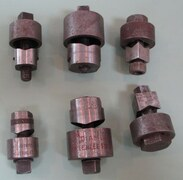 | **ノックアウトパンチャ** | 金属製キャビネットや分電盤に、電線管を通す穴をあける。写真は同じように打ち抜く海外の手動工具で、試験の写真とは見た目が違う可能性がある | Commons |
| 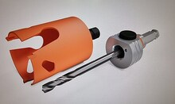 | **ホルソ** | ドリルに付けて、金属板などに丸い穴をあける | Commons |
| 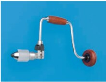 | **クリックボール** | 手で回す工具。先に**リーマ**や**羽根ぎり**を付ける | R6 上 問 18 |
| 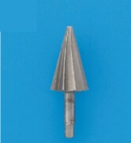 | **リーマ** | クリックボールに付けて、切った**金属管の内側のばり**を取る | R8 下 問 44 ハ |
| 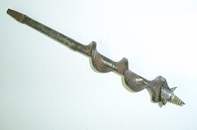 | **羽根ぎり** | クリックボールに付けて、**木材**に穴をあける。鉄板には使わない。写真は海外の同種の工具 | Commons |
| 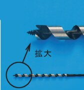 | **木工用のドリル** | **木材**に穴をあける。先端がねじ状 | R8 下 問 44 ニ |
| 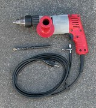 | **振動ドリル** | **コンクリート**に穴をあける。カールプラグを入れる穴に使う | Commons |
| 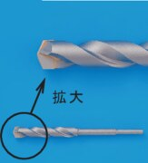 | **ドリルの刃** | 木工用ではない刃の例。先端がねじ状ではない。木造の穴あけの問題では選ばない | R8 下 問 44 イ |

### 切る、被覆をはぐ

| 写真 | 工具 | 使い方 | 出典 |
|---|---|---|---|
| 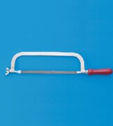 | **金切りのこ** | 金属管や合成樹脂管を切る。FEP 防護管にも使う | R8 下 問 49 ロ |
| 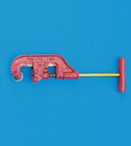 | **パイプカッタ** | 金属管を切る | R8 下 問 49 イ |
|  | **プリカナイフ** | **2 種金属製可とう電線管**（プリカチューブ）を切る。薄鋼電線管には使わない | R7 下 問 49 ロ |
|  | **合成樹脂管用カッタ** | 合成樹脂管を切る。はさみの形で、金属管には使わない | R6 上 問 43 ロ |
|  | **ケーブルカッタ** | 太い電線やケーブルを切る | R6 下 問 49 ロ |
| 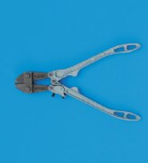 | **ボルトクリッパ** | 太い電線、メッセンジャワイヤ、鉄線を切る。刃が直線状 | R8 下 問 49 ニ |
|  | **ペンチ** | 電線を切ったり、曲げたりする | R8 下 問 49 ハ |
|  | **電工ナイフ** | 電線の被覆をはぐ。折りたたみ式 | R7 下 問 49 ニ |
|  | **ケーブルストリッパ** | VVF ケーブルの外装と絶縁被覆をはぐ | R5 上 午前 問 18 |

### 曲げる、ねじを切る、電線を通す

| 写真 | 工具 | 使い方 | 出典 |
|---|---|---|---|
| 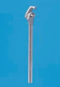 | **パイプベンダ** | **金属管**を曲げる | R7 上 問 45 ニ |
| 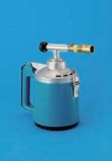 | **トーチランプ** | **硬質ポリ塩化ビニル電線管**を温めて曲げる | R6 上 問 43 ニ |
| 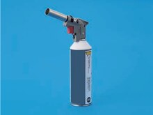 | **ガストーチ** | トーチランプと同じく、硬質ポリ塩化ビニル電線管の曲げ加工に使う | R7 上 問 18 |
| 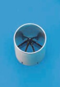 | **面取器** | **合成樹脂管**の切り口の面取りをする | R6 上 問 43 ハ |
| 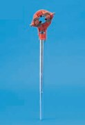 | **リード型ねじ切り器** | 金属管の端にねじを切る。**ねじなし電線管には使わない** | R7 上 問 45 イ |
| 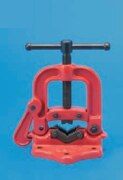 | **パイプバイス** | 切断やねじ切りのときに、金属管を固定する | R7 上 問 45 ロ |
| 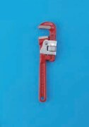 | **パイプレンチ** | 管をつかんで回す。切断や曲げには使わない | R6 上 問 43 イ |
| 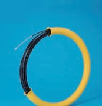 | **呼び線挿入器** | 電線管に電線を通す | R5 下 午前 問 47 ハ |
| 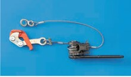 | **張線器** | 架空線やメッセンジャワイヤのたるみを取る | R7 下 問 18 |

### 接続する、確かめる

| 写真 | 工具 | 使い方 | 出典 |
|---|---|---|---|
| 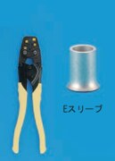 | **圧着ペンチ（黄色の柄）** | リングスリーブ（E 形）を圧着する | R6 上 問 46 イ |
| 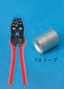 | **圧着ペンチ（赤色の柄）** | P 形スリーブを圧着する。接地線の直線重合せ接続は、この組み合わせが正解 | R6 上 問 46 ニ |
| 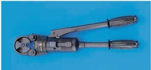 | **手動油圧式圧着器** | 太い電線を油圧で圧着する | R6 下 問 18 |
| 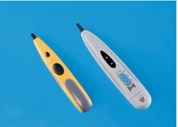 | **低圧検電器** | 低圧の回路が充電されているかを確かめる | R8 下 問 18 |

### 似ている工具の見分け方

| 比べるもの | 見分け方 |
|---|---|
| リーマとホルソ | リーマは円すい形、ホルソは筒形 |
| 合成樹脂管用カッタとパイプカッタ | 合成樹脂管用カッタははさみの形、パイプカッタは管をはさんで回す形 |
| ケーブルカッタとボルトクリッパ | ボルトクリッパは刃が直線状で、柄が長い |
| プリカナイフと電工ナイフ | プリカナイフは木の柄にまっすぐな刃、電工ナイフは折りたたみ式 |
| パイプベンダとパイプレンチ | パイプベンダは先が曲げ型の金属棒、パイプレンチはあごで管をつかむ形 |
| 木工用のドリルとほかのドリルの刃 | 木工用は先端がねじ状 |

### 確認状況（工具）

- **問題文と答え**：試験センターの問題と解答で確認した。公式の解答は記号だけで、解説はない。「理由」や「見分け方」は自分で付けたもの。
- **問題文に名前があるもの**：手動油圧式圧着器（R6 下 問 18）。ほかの写真には名前が書かれていないので、次の方法で対応づけた。
- **解説と照合したもの**：パイプバイス、パイプベンダ、金切りのこ、リード型ねじ切り器は、[ふくラボの解説](https://denkikouji2nd.fukulabo-e9.com/2021/11/2p-r03f-p45/)の名前と、令和 3 年度上期 午後 問 45 の同じ写真で確認した。プリカナイフと呼び線挿入器は、[別の解説](https://denkikouji2nd.fukulabo-e9.com/2021/12/2p-r03s-a50/)の名前と写真で確認した。
- **同じ回の問題文から読み取ったもの**：合成樹脂管用カッタ、面取器、トーチランプは、令和 6 年度上期 問 13 の答えに名前がある。
- **検索結果の要約で確認したもの**：リーマは、同じ構成の選択肢の解説（[令和 2 年度下期 午前 問 47](https://2shudenkikoujishi.kakomonn.com/questions/51810)）の要約で確認した。
- **見た目から自分で判断したもの**：パイプカッタ、ペンチ、ボルトクリッパ、ケーブルカッタ、電工ナイフ、パイプレンチ、ガストーチ、ケーブルストリッパ、低圧検電器、木工用のドリル。用途のうち、ペンチ、ケーブルカッタ、電工ナイフ、パイプレンチは記憶に基づく。
- **圧着ペンチの色**：赤色の柄と P スリーブの組み合わせは R6 上 問 46 の答え。黄色の柄がリングスリーブ用という点は [Panasonic の用語集](https://www2.panasonic.biz/jp/terasu/skill/dictionary/ringsleeve.html)で確認した。
- **過去問の写真が見つからなかったもの**：ノックアウトパンチャ、ホルソ、羽根ぎり、振動ドリル。平成 30 年度以降の公開分を探した範囲で見つからなかったので、Wikimedia Commons の写真を使った。特にノックアウトパンチャの写真は、海外のチャシーパンチで、試験に出る形とは限らない。
- **配線図の記号の表**：解説の例をもとにした一般化で、各回の配線図の記号までは照合していない。
- **Panasonic の工具資料**：検索で見つかった[資格向けの工具一覧](https://sitess-origin.panasonic.co.jp/ew/pewbct/shikaku/denki/dai2/pdf/kogu.pdf)は取得できず、照合に使っていない。

### 覚え方（工具）

> 材料で工具を選ぶ。金属板はノックアウトパンチャかホルソ、木は羽根ぎり、コンクリートは振動ドリル。

> プリカナイフはプリカチューブ専用で、薄鋼電線管は切らない。

> クリックボールにはリーマか羽根ぎりを付ける。リーマは金属管の内側のばり取り。

> 金属管はパイプベンダで曲げ、硬質ポリ塩化ビニル電線管はトーチランプで温めて曲げる。

> E の記号（ねじなし電線管）なら、リード型ねじ切り器は使わない。

> 圧着ペンチは、黄色の柄がリングスリーブ（E 形）、赤色の柄が P 形。

### 参考文献（工具）

過去問の写真は、試験センターの[過去問題の使用に関する留意点](https://www.shiken.or.jp/construction/second/qa/)に従って教育目的で使った。**いずれも切り抜いて縮小し、選択肢の記号（イ、ロなど）を消す改変をした。**

- 出典：令和 8 年度下期第二種電気工事士試験（問 13、18、44、49）：[問題](https://www.shiken.or.jp/construction/upload/20261025_co_second_q01.pdf)、[解答](https://www.shiken.or.jp/construction/upload/20261025_co_second_a01.pdf)
- 出典：令和 8 年度上期第二種電気工事士試験（問 13）：[問題](https://www.shiken.or.jp/construction/upload/20260524_co_second_q01.pdf)、[解答](https://www.shiken.or.jp/construction/upload/20260524_co_second_a01.pdf)
- 出典：令和 7 年度下期第二種電気工事士試験（問 13、18、49）：[問題](https://www.shiken.or.jp/construction/upload/20251026_co_second_q01.pdf)、[解答](https://www.shiken.or.jp/construction/upload/20251026_co_second_a01.pdf)
- 出典：令和 7 年度上期第二種電気工事士試験（問 13、18、45）：[問題](https://www.shiken.or.jp/construction/upload/20250525_co_second_q01.pdf)、[解答](https://www.shiken.or.jp/construction/upload/20250525_co_second_a01.pdf)
- 出典：令和 6 年度下期第二種電気工事士試験（問 13、18、49）：[問題](https://www.shiken.or.jp/construction/upload/20241027_co_second_q01.pdf)、[解答](https://www.shiken.or.jp/construction/upload/20241027_co_second_a01.pdf)
- 出典：令和 6 年度上期第二種電気工事士試験（問 13、18、43、46）：[問題](https://www.shiken.or.jp/construction/upload/20240526_co_second_q01.pdf)、[解答](https://www.shiken.or.jp/construction/upload/20240526_co_second_a01.pdf)
- 出典：令和 5 年度下期第二種電気工事士試験（午前）（問 47）：[問題](https://www.shiken.or.jp/construction/upload/20231029_co_second_q01.pdf)、[解答](https://www.shiken.or.jp/construction/upload/20231029_co_second_a01.pdf)
- 出典：令和 5 年度上期第二種電気工事士試験（午前）（問 13、18）：[問題](https://www.shiken.or.jp/construction/upload/20230528_co_second_q01.pdf)、[解答](https://www.shiken.or.jp/construction/upload/20230528_co_second_a01.pdf)
- 名前の照合：[令和 3 年度上期 第二種電気工事士試験（午後）問題](https://www.shiken.or.jp/construction/upload/20210530_co_second_q02.pdf)（問 45。写真は使っていない）
- 写真（縮小して使用）：[Chassis punches round and square](https://commons.wikimedia.org/wiki/File:Chassis_punches_round_and_square.jpg)（Enl public、CC BY-SA 3.0）、[TCT Tungsten Carbide Hole saw with arbor](https://commons.wikimedia.org/wiki/File:TCT_Tungsten_Carbide_Hole_saw_with_arbor.jpg)（Edenblijker、CC BY-SA 4.0）、[Auger brace bit](https://commons.wikimedia.org/wiki/File:Auger_brace_bit.jpg)（Luigizanasi、CC BY-SA 2.0 ca）、[Hammer drill-1](https://commons.wikimedia.org/wiki/File:Hammer_drill-1.jpg)（Shakespeare、CC BY-SA 3.0）
- [ふくラボ 電気工事の作業と使用する工具（令和 2 年度下期 午前 問 13）](https://denkikouji2nd.fukulabo-e9.com/2021/11/2p-r02s-a13/)：ノックアウトパンチャ、羽根ぎり、張線器、プリカナイフの用途
- [ふくラボ 電気工事の種類と使用工具（令和 3 年度上期 午前 問 13）](https://denkikouji2nd.fukulabo-e9.com/2021/11/2p-r03f-a13/)：リード型ねじ切り器、合成樹脂管用カッタ、パイプベンダ、ボルトクリッパの用途
- [ふくラボ 電線管工事で使用する工具・器具（令和 3 年度上期 午後 問 45）](https://denkikouji2nd.fukulabo-e9.com/2021/11/2p-r03f-p45/)：パイプバイス、パイプベンダ、金切りのこ、リード型ねじ切り器
- [ふくラボ 配線作業の工具（令和 3 年度下期 午前 問 50）](https://denkikouji2nd.fukulabo-e9.com/2021/12/2p-r03s-a50/)：呼び線挿入器、プリカナイフ、木工ドリルビット
- [TAC の一問一答 電線管工事で使う工具器具（9）](https://www.tac-school.co.jp/kouza_denkikoujisi/denkikoujisi_quiz/denkikoujisi_quiz_036.html)：硬質塩化ビニル電線管の金切りのこと面取器
- [過去問ドットコム 令和 2 年度下期 午前 問 47](https://2shudenkikoujishi.kakomonn.com/questions/51810)：リーマの用途（要約のみ）
- [Panasonic 用語集 ホルソ](https://www2.panasonic.biz/jp/terasu/skill/dictionary/holecutter.html)：ホルソの種類と用途（要約のみ）

## コンセントの種類と形

[ガミデンキの動画](https://www.youtube.com/watch?v=1UPomC-Sy7Q&list=PLcSb3IfZ6sU161uAbG_m3nUL9Cs_5_jUD&index=47)（暗記用のスライドと過去問 18 課題）を中心に、刃受の形、図記号、傍記をまとめる。写真は過去問のもの。動画の音声は確認できていないので、スライドから読み取った。出題の「R8 下」は令和 8 年度下期を表す。

### 刃受の形の読み方

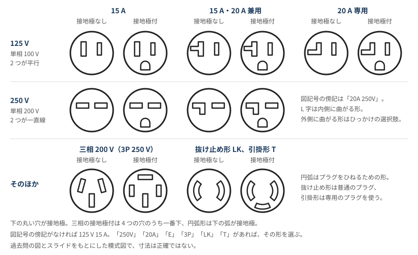

順に 3 か所を見る。

| 見る場所 | 形 | 意味 |
|---|---|---|
| 2 つの刃受の並び | **平行** | 125 V（単相 100 V）|
| | **一直線** | 250 V（単相 200 V）|
| 片側の刃受 | まっすぐ | 15 A |
| | **T 字** | 15 A・20 A 兼用（125 V）|
| | **L 字** | 125 V は 20 A 専用、250 V は 15 A・20 A 兼用 |
| 下の丸い穴 | あり | 接地極付（E）|

次の 2 つは形がはっきり違う。

- **三相 200 V（3P、250 V）**：接地極付は 4 つ穴で、一番下が接地極。工場の図面に出る。接地極なしは 3 つ穴。
- **抜け止め形（LK）、引掛形（T）**：穴が円弧で、プラグを差してひねると固定される。抜け止め形は普通のプラグ、引掛形は専用のプラグを使い、引掛形のほうが抜けにくい。

間違えやすい点は次のとおり。

- **傍記がなければ 125 V 15 A**：それ以外の定格は図記号に書かれる。動画は「250V と 20A は必ず表記」と強調している。
- **T 字が兼用になる理由**：T 字は「まっすぐ」と「L 字」を合わせた形なので、15 A と 20 A のどちらのプラグも入る。
- **L 字の向き**：250 V の L 字は内側に曲がる。R3 上 午前 問 35 では、外側に曲がる形が選択肢にあった。
- **写真では向きが変わる**：取付枠に付いた 250 V のコンセントは、2 つの穴が縦に並び、接地極が横に来る。刃受の図では横に一直線なので、「縦か横か」ではなく「平行か一直線か」で見る。
- **3P の電流値**：動画のスライドは 3P 20 A だが、R6 下 問 39 と R4 上 午前 問 40 は「3P 30A 250V E」で、答えは同じ 4 つ穴の形だった。試験では「3P」と「E」で選べる。
- **左の穴が少し長い**：125 V 15 A は左の穴が長い。長いほうが接地側（W）とされる。

### 図記号と取り付け場所

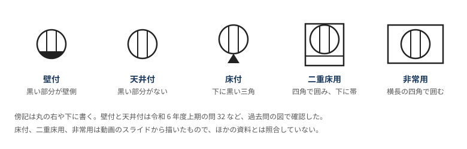

R6 上 問 32 は、黒い部分がない LK の図記号の取り付け場所を問う問題で、答えは天井面だった。

傍記は順に分けて読む。たとえば「2 LK EET WP」は、2 口、抜け止め形、接地極付接地端子付、防雨形。

### 種類の一覧（写真）

| 写真 | 名称 | 傍記 | 定格 | 見分け方 | 出典 |
|---|---|---|---|---|---|
| 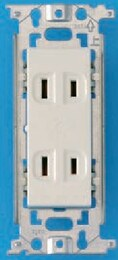 | 埋込形（基本形）の 2 口 | 2 | 125 V 15 A | 基本形が 2 つ。1 口なら傍記なし | R6 下 問 45 イ |
| 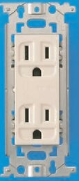 | 接地極付の 2 口 | 2E | 125 V 15 A | 丸い穴が付く。プラグの接地ピンが入る | R6 下 問 45 ロ |
| 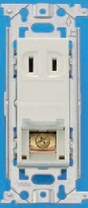 | 接地端子付 | ET | 125 V 15 A | 丸い穴はなく、**ねじの端子**がある。機器の接地線をつなぐ | R6 下 問 45 ハ |
|  | 接地極付接地端子付 | EET | 125 V 15 A | 丸い穴とねじの端子の両方がある。食器洗い機など | R6 下 問 45 ニ |
|  | 抜け止め形 | LK | 125 V 15 A | 穴が円弧。普通のプラグを差してひねる | R6 上 問 50 ロ |
|  | 接地極付（15 A・20 A 兼用）| 20A E | 125 V 20 A | 平行で **T 字**、丸い穴。エアコンなど | R7 下 問 43 ニ |
|  | 接地極付 | 250V E | 250 V 15 A | 一直線でまっすぐ、丸い穴。写真では縦に並ぶ | R7 下 問 43 イ |
|  | 接地極付 | 20A 250V E | 250 V 20 A | 一直線で **L 字**、丸い穴。写真では縦に並ぶ | R7 下 問 43 ハ |
|  | 三相 200 V 用の接地極付 | 3P 30A 250V E など | 250 V | 4 つ穴で、本体が黒い。写真は「20」の刻印があるので 20 A | R7 下 問 43 ロ |
|  | 防雨形（接地極付接地端子付、抜け止め形、2 口）| 2 LK EET WP | 125 V 15 A | カバー付きで、穴が円弧 | R4 上 午前 問 50 ハ |
|  | 防雨形（接地極付）| WP 20A 250V E | 250 V 20 A | カバー付きで、一直線の L 字。動画では電気自動車の充電スタンドの例 | R4 上 午前 問 50 イ |

写真を用意できなかった種類は次のとおり。

| 名称 | 傍記 | 内容 |
|---|---|---|
| 引掛形 | T | 125 V 15 A。穴が円弧で、専用のプラグを使う |
| 埋込形（20 A 専用）| 20A | 125 V。平行で L 字 |
| 接地端子付の 2 口 | 2ET | 125 V 15 A |
| 接地極付抜け止め形の 2 口 | 2 E LK | 125 V 15 A。2 つの円弧の下に、接地極の弧が付く |
| 防雨形のほかの例 | LK ET WP、3 LK ET WP、LK EET WP | 「LK EET WP」は入線機能付きで、給湯器などの制御線を通せる |
| 漏電遮断器付 | EL | |
| 医用 | H | |
| 防爆形 | EX | |

### 過去問の出題パターン

動画の 18 課題も似た問題の繰り返しで、動画は過去問 10 年分を解くことを勧めている。次の表は、公式の問題と解答で確認した分。

| 問われ方 | 出題 | 図の傍記など | 答え |
|---|---|---|---|
| 刃受の形 | R8 下 問 33、R3 上 午前 問 35 | 20A 250V E | 一直線、内側に曲がる L 字、接地極 |
| 刃受の形 | R8 上 問 37 | 250V E | 一直線でまっすぐ、接地極 |
| 刃受の形 | R6 上 問 33 | E20A | 平行、T 字、接地極 |
| 刃受の形 | R6 下 問 39、R4 上 午前 問 40 | 3P 30A 250V E | 4 つ穴 |
| 写真を選ぶ | R7 下 問 43 | 20A 250V E | 一直線で L 字の写真 |
| 写真を選ぶ | R6 下 問 45 | ET | ねじの端子があり、丸い穴がない写真 |
| 使っていないものを選ぶ | R6 上 問 50 | 図に 3P のコンセントがない | 三相の黒いコンセント |
| 使っていないものを選ぶ | R4 上 午前 問 50 | 図に ET がない | 接地端子付 |
| 傍記の意味 | R7 上 問 40 | 引掛形 | T（ほかの選択肢は EL、H、LK）|
| 傍記の意味 | R5 下 午前 問 32 | WP | 防雨形 |
| 取り付け場所 | R6 上 問 32 | 黒い部分がない図記号 | 天井面 |

### 確認状況（コンセント）

- **動画**：音声は聞いていない。字幕は取得できず（中身が空）、公開のプレビュー画像（10 秒ごと、320 × 180）でスライドを読んだ。動画が数える「24 種類」と、この章の行の対応は確かめていない。
- **刃受の形**：次は過去問の図で確認した。残りは同じ規則で描いた。
  - 250 V 15 A と 20 A の接地極付：R8 下 問 33
  - 125 V 15 A の接地極付、T 字の接地極付：R6 上 問 33
  - 125 V の L 字の接地極付、外側に曲がる形：R8 下 問 33 ハ、R3 上 午前 問 35 ハ、ニ
  - 三相の 3 つ穴と 4 つ穴：R6 下 問 39、R4 上 午前 問 40
- **動画のスライドとの違い**：20 A 125 V の刃受の小さな図は、右の穴が横向きに見えた。同じスライドの写真と過去問の図では縦なので、図は縦で描いた。プレビューの解像度が低く、見間違いの可能性もある。
- **T 字と L 字の意味**：[刃受の解説](https://eleking.net/k21/k21i/k21i-poles.html)の本文で確認した。このページの図そのものは取得できなかった。125 V の L 字に 15 A のプラグが差せないことは、「兼用」の説明からの推定で、直接は確認していない。
- **250 V の L 字の呼び方**：動画は「20A 250V 用」、解説サイトは「15 A・20 A 兼用」と書いている。試験の傍記は「20A 250V」。
- **L 字の向き**：R3 上 午前 問 35 の答えと[ふくラボの解説](https://denkikouji2nd.fukulabo-e9.com/2021/11/2p-r03f-a35/)による。
- **3P の 30 A**：過去問では 4 つ穴が答えだったが、実物の 30 A が同じ形かは確認していない。
- **図記号**：壁付と天井付は過去問の図で確認した。床付、二重床用、非常用は動画のスライドから描いた。[Panasonic の配線図記号](https://www2.panasonic.biz/jp/basics/electric/electricity/symbols/switches-outlets/)に床コンセントと非常コンセントの名前はあるが、形は照合していない。二重床用はそのページの文字情報では見つからなかった。
- **写真の名前**：問題文に名前はない。答えの記号、配線図の傍記、動画のスライドの同じ写真、[コンセントの解説](https://eleking.net/k21/k21k/k21k-wiring2.html)を照らし合わせた。解答に出ない選択肢は見た目からの判断。
- **写真のない種類**：調べた過去問の写真には見当たらなかった。全回の全ページは見ていない。
- **左の穴**：[All About の記事](https://allabout.co.jp/gm/gc/51052/)の要約のみ。
- **過去問の表**：公式の解答は記号だけで、解説はない。形の説明は自分で読み取ったもの。

### 覚え方（コンセント）

> 平行は 125 V、一直線は 250 V。写真では 250 V が縦に並ぶので、向きではなく並びで見る。

> まっすぐは 15 A、T 字は兼用、L 字は 20 A。下に丸で接地極付。

> LK は Locking、T は Twist、WP は WaterProof。

> 傍記がなければ 125 V 15 A。黒い部分がなければ天井付。

### 参考文献（コンセント）

過去問の写真は、試験センターの[過去問題の使用に関する留意点](https://www.shiken.or.jp/construction/second/qa/)に従って教育目的で使った。**いずれも切り抜いて縮小する改変をした。** 選択肢の記号は切り抜きの範囲から外した。

- [【第二種電気工事士】試験特化型!!コンセント頻出問題を見て聴いて覚える!!｜ガミデンキちゃんねる](https://www.youtube.com/watch?v=1UPomC-Sy7Q&list=PLcSb3IfZ6sU161uAbG_m3nUL9Cs_5_jUD&index=47)：種類、傍記、定格、用途、覚え方（スライドのみ）
- 出典：令和 7 年度下期第二種電気工事士試験（問 43）：[問題](https://www.shiken.or.jp/construction/upload/20251026_co_second_q01.pdf)、[解答](https://www.shiken.or.jp/construction/upload/20251026_co_second_a01.pdf)
- 出典：令和 6 年度下期第二種電気工事士試験（問 39、45）：[問題](https://www.shiken.or.jp/construction/upload/20241027_co_second_q01.pdf)、[解答](https://www.shiken.or.jp/construction/upload/20241027_co_second_a01.pdf)
- 出典：令和 6 年度上期第二種電気工事士試験（問 32、33、50）：[問題](https://www.shiken.or.jp/construction/upload/20240526_co_second_q01.pdf)、[解答](https://www.shiken.or.jp/construction/upload/20240526_co_second_a01.pdf)
- 出典：令和 4 年度上期第二種電気工事士試験（午前）（問 40、50）：[問題](https://www.shiken.or.jp/construction/upload/20220529_co_second_q01.pdf)、[解答](https://www.shiken.or.jp/construction/upload/20220529_co_second_a01.pdf)
- 図の確認のみ（写真は使っていない）：令和 8 年度下期（問 33）[問題](https://www.shiken.or.jp/construction/upload/20261025_co_second_q01.pdf)、[解答](https://www.shiken.or.jp/construction/upload/20261025_co_second_a01.pdf)、令和 8 年度上期（問 37）[問題](https://www.shiken.or.jp/construction/upload/20260524_co_second_q01.pdf)、[解答](https://www.shiken.or.jp/construction/upload/20260524_co_second_a01.pdf)、令和 7 年度上期（問 40）[問題](https://www.shiken.or.jp/construction/upload/20250525_co_second_q01.pdf)、[解答](https://www.shiken.or.jp/construction/upload/20250525_co_second_a01.pdf)、令和 5 年度下期 午前（問 32）[問題](https://www.shiken.or.jp/construction/upload/20231029_co_second_q01.pdf)、[解答](https://www.shiken.or.jp/construction/upload/20231029_co_second_a01.pdf)、令和 3 年度上期 午前（問 35）[問題](https://www.shiken.or.jp/construction/upload/20210530_co_second_q01.pdf)、[解答](https://www.shiken.or.jp/construction/upload/20210530_co_second_a01.pdf)
- [コンセントの刃受の形状（極配置）](https://eleking.net/k21/k21i/k21i-poles.html)：平行と一直線、まっすぐと T 形、L 形の見分け方、T 形が兼用になる理由
- [鑑別 コンセント](https://eleking.net/k21/k21k/k21k-wiring2.html)：接地極と接地端子の違い、抜け止め形と引掛形、防雨形、入線機能付、三相の接地極の位置
- [ふくラボ コンセントの図記号と極配置（令和 3 年度上期 午前 問 35）](https://denkikouji2nd.fukulabo-e9.com/2021/11/2p-r03f-a35/)：L 字の内側と外側（要約のみ）
- [コンセントの種類と定格の見分け方](https://denki2.towelswitch.com/kizai/outlets/)：T 字の 15 A・20 A 兼用、抜け止め形と引掛形のプラグ（要約のみ）
- [Panasonic の配線図記号（スイッチ・コンセント）](https://www2.panasonic.biz/jp/basics/electric/electricity/symbols/switches-outlets/)：床コンセント、非常コンセントの名前（要約のみ）
- [All About コンセントの極性の解説](https://allabout.co.jp/gm/gc/51052/)：左の穴が長く、長いほうが接地側（要約のみ）

## スイッチの種類と図記号

[ガミデンキの動画](https://www.youtube.com/watch?v=VEvDIUJd3KM&list=PLcSb3IfZ6sU161uAbG_m3nUL9Cs_5_jUD&index=48)（暗記用のスライド 20 種類と過去問 19 課題）を中心に、図記号、表示灯の回路、三路スイッチの配線をまとめる。写真は過去問のもの。動画の音声は確認できていないので、スライドから読み取った。出題の「R8 下」は令和 8 年度下期を表す。

### 図記号の読み方

黒丸（●）が基本で、傍記がなければ片切スイッチ。傍記はスイッチの用途を表す。

| 傍記 | 意味 | 動画の覚え方 |
|---|---|---|
| H | 位置表示灯内蔵 | Here（ここだよ）|
| L | 確認表示灯内蔵 | Lamp（動いてるよ）|
| D | 遅延 | Delay（遅れる）|
| A | 自動点滅器 | Auto（自動）|
| RAS | 熱線式自動スイッチ | Rays（光線）、Auto（自動）、Sensor（センサ）|
| R | リモコンスイッチ | Remote（リモート）|
| B | 電磁開閉器用押しボタン | Button（ボタン）|
| F / LF | フロートスイッチ / フロートレススイッチ電極 | Float（フロート）、Less（レス）|
| P | プルスイッチ / 圧力スイッチ | Pull（引く）/ Pressure（圧力）|
| TS | タイムスイッチ | Time Switch |

間違えやすい組み合わせは次のとおり。

- **●P と ◉P**：黒丸はプルスイッチ、丸で囲むと圧力スイッチ。傍記が同じなので形で見分ける。
- **●R と ⓉR**：黒丸はリモコンスイッチ、丸に T はリモコントランス。R6 上 問 37 では、選択肢に両方が並んだ。
- **●T と TS**：黒丸の T はタイマ付スイッチ、四角の TS はタイムスイッチ。
- **○ と ●L**：白丸は単体の確認表示灯、●L はスイッチに内蔵したもの。

### 写真の見分け方

片切と 2 極には、ON 側を示す黒い印がある。三路と四路にはない。

表示灯付きのスイッチは写真だけでは紛らわしいので、試験では写真の下に**接点の図**が付くことが多い。図で判断する。

| 接点の図 | スイッチ |
|---|---|
| 接点が 1 組 | 片切 |
| 接点が 2 組 | 両切（2 極）|
| 端子が 0、1、3 で、0 が 1 か 3 に切り替わる | 三路 |
| 端子が 1、2、3、4 で、まっすぐとたすき掛け | 四路 |
| 端子が 0、1、3 で、1 と 3 の間に丸がある | 確認表示灯内蔵（L）|
| 丸が接点をまたぐ | 位置表示灯内蔵（H）|
| 丸が接点をまたぎ、「遅れ機構」と書いてある | 遅延 |

### 種類の一覧（写真）

| 写真 | 名称 | 図記号 | 用途 | 出典 |
|---|---|---|---|---|
|  | **片切**（単極）| ● | 基本形。部屋の照明など | R5 上 午前 問 49 ニ |
|  | **両切**（2 極）| ● 2P | 単相 200 V の機器など。OFF で接点が 2 つとも切れる | R4 下 午前 問 49 ニ |
|  | **三路** | ● 3 | 2 か所から入切する。階段など | R5 上 午前 問 49 ハ |
|  | **四路** | ● 4 | 3 か所以上から入切する。三路 2 個と組み合わせる | R8 上 問 50 ニ |
|  | **位置表示灯内蔵**（ほたるスイッチ）| ● H | 暗い廊下や階段で、スイッチの場所を示す。**OFF で点灯** | R5 上 午前 問 49 ロ |
|  | **確認表示灯内蔵** | ● L | トイレの換気扇など、外から動作を確かめる。**ON で点灯** | R5 上 午前 問 49 イ |
|  | **遅延** | ● D | OFF にしてから一定時間後に切れる。玄関の照明など | R7 下 問 48 ロ |
|  | 位置表示灯内蔵（ワイド形）| ● H | 「切」で点灯 | R8 上 問 46 イ |
|  | 確認表示灯内蔵（ワイド形）| ● L | 「入」で点灯 | R8 上 問 46 ハ |
|  | **自動点滅器** | ● A | 周囲の明るさで自動で点滅する。屋外灯や街路灯 | R5 上 午前 問 17 |
|  | **熱線式自動スイッチ** | ● RAS | 人の接近（体温）で自動で点灯する。玄関など | R7 下 問 17 |
|  | **調光器** | ● に矢印 | 照明の明るさを調整する | R8 上 問 46 ニ |
|  | **確認表示灯付電磁開閉器用押しボタン** | ◉ BL | モーターの制御。ON、OFF のボタンの上に表示灯がある。工場やポンプ室 | R7 上 問 50 ロ |
|  | **フロートレススイッチ電極** | ◉ LF3 | 電極で水位を検知してポンプを制御する。3 は電極の数 | R7 上 問 50 イ |
|  | **タイムスイッチ** | TS | 設定した時刻に、照明などを入切する | R6 上 問 45 ロ |
|  | **リモコントランス** | Ⓣ R | 100 V を 24 V に下げて、リモコンの電源にする | R6 上 問 45 イ |
|  | **リモコンリレー**（片切）| 三角 | リモコンスイッチの操作で主回路を入切する | R6 上 問 45 ハ |
|  | **リモコンリレー**（両切）| 三角 | 200 V の回路用 | R6 上 問 45 ニ |

写真を用意できなかった種類は次のとおり。

| 名称 | 図記号 | 内容 |
|---|---|---|
| リモコンスイッチ | ● R | 1 つのスイッチで複数の照明を入切できる。ビルや大型施設の一括制御。リモコンリレーと専用のトランスが必要 |
| リモコンセレクタスイッチ | 丸に放射線 | リモコンスイッチが複数集まったもの |
| 電磁開閉器用押しボタン | ◉ B | モーターの制御。表示灯がない |
| フロートスイッチ | ◉ F | 浮きの上下で水位を検知する |
| プルスイッチ | ● P | ひもを引いて入切する |
| 圧力スイッチ | ◉ P | 空気、水、油などの圧力を検知して入切する |
| 防雨形スイッチ | ● WP | 雨水がかかる外壁などに使う |
| ワイドハンドル形スイッチ | ◆ | ハンドルが大きいスイッチ |

### 表示灯の点灯（パイロットランプ）

| 方式 | つなぎ方 | スイッチ ON | スイッチ OFF | 対応するスイッチ |
|---|---|---|---|---|
| 常時点灯 | L と N の間 | 点灯 | 点灯 | 動画の一覧にはない |
| 同時点滅 | **負荷と並列** | 点灯 | 消灯 | 確認表示灯内蔵（L）|
| 異時点滅 | **スイッチと並列** | 消灯 | 点灯 | 位置表示灯内蔵（H）|

**異時点滅で負荷が動かない理由**：OFF のとき、表示灯と負荷は直列になる。表示灯の内部抵抗は負荷よりとても大きいので、電圧はほとんど表示灯にかかる。だから表示灯だけが点灯する。ON のときは、スイッチが表示灯の両端を短絡するので、表示灯は消える。

単線図ではどれも同じ形になるので、技能試験の候補問題では、どの方式かが「特記」に書かれる。

### 三路スイッチの配線

動作の仕組みは「配線図」の章の「三路スイッチ」にまとめた。ここでは複線図の描き方をまとめる。動画の要点は、**三路スイッチ 2 個で 1 つの大きなスイッチ**と考えること。

複線図の 4 ステップに当てはめると、次のようになる。

| ステップ | 三路スイッチの場合 |
|---|---|
| ② N 側（白線）| 普通のスイッチと同じ。スイッチには行かない |
| ③ L 側（黒線）| **片方の三路スイッチの 0 番だけ**につなぐ |
| ④ 対応するもの | もう片方の 0 番をランプ類につなぐ。さらに **1 番どうし、3 番どうし**を渡り線でつなぐ |

三路スイッチをどちらの箱につなぐかで、箱の間の本数が変わる。次の図は、ジョイントボックス A と B に三路スイッチとランプ類が 1 つずつある回路。電源は A から入る。

| パターン | L 側につなぐ三路スイッチ | A と B の間の線 | 本数 |
|---|---|---|---|
| **1** | 電源に**近い**ほう | N、帰り線、渡り線 2 本 | **4 本** |
| 2 | 電源から**遠い**ほう | N、L、帰り線、渡り線 2 本 | 5 本 |

動画では、配線コストを減らすために最少本数にするのがセオリーで、配線図の問題も最少本数を問うと説明している。コツは次の 3 つ（図面によって変わるとの注記あり）。

1. 三路スイッチと、対応するランプ類の位置を確かめる。
2. 電源に近い三路スイッチを L 側とつなぐ。
3. 配線が行ったり来たりしないようにする。

ランプ類が B にしかなければ、A と B の間は N と渡り線 2 本の **3 本**になる。動画の最初の例はこの形。

### 過去問の出題パターン

動画の 19 課題のうち、公式の問題と解答で確認できたものに、最近の回を加えた。

| 問われ方 | 出題 | 図記号など | 答え |
|---|---|---|---|
| 名称 | R8 上 問 33 | ● L | 確認表示灯を内蔵する点滅器 |
| 名称 | R7 上 問 33 | ● H | 位置表示灯を内蔵する点滅器 |
| 名称 | R7 上 問 34 | ◉ BL | 確認表示灯付電磁開閉器用押しボタン |
| 名称 | R7 上 問 38 | ◉ LF3 | フロートレススイッチ電極 |
| 名称 | R7 下 問 38、R5 上 午前 問 32 | ◆ | ワイドハンドル形点滅器 |
| 名称 | R6 下 問 33、R4 上 午前 問 34 | ◉ B | 電磁開閉器用押しボタン |
| 名称 | R6 下 問 35 | ● A(6A) | 自動点滅器 |
| 名称 | R6 上 問 31 | 丸に放射線 | リモコンセレクタスイッチ |
| 名称 | R5 下 午前 問 33 | ● D | 遅延スイッチ |
| 名称 | R5 上 午前 問 37 | ● RAS | 熱線式自動スイッチ |
| 名称 | R4 下 午前 問 31 | ○ | 確認表示灯 |
| 図記号を選ぶ | R6 上 問 37 | リモコンリレーにつながる箱 | Ⓣ R（リモコントランス）|
| 写真の用途 | R7 下 問 17 | 熱線式自動スイッチの写真 | 人の接近による自動点滅 |
| 写真の用途 | R5 上 午前 問 17 | 自動点滅器の写真 | 周囲の明るさに応じた屋外灯などの自動点滅 |
| 写真を選ぶ | R8 上 問 46 | ● に矢印 | 調光器 |
| 写真を選ぶ | R8 下 問 47、R6 上 問 47 | 接点の図付き | 端子が 0、1、3 の確認表示灯内蔵 |
| 写真を選ぶ | R6 上 問 45 | 200 V 回路のリモコンリレー | 両切のリモコンリレー |
| 使っていないものを選ぶ | R8 上 問 50 | 接点の図付き | 四路 |
| 使っていないものを選ぶ | R7 下 問 48 | 接点の図付き | 位置表示灯内蔵 |
| 使っていないものを選ぶ | R7 上 問 50、R5 上 午前 問 49、R4 下 午前 問 49 | 接点の図付き | 確認表示灯内蔵 |

使っていないスイッチを選ぶ問題は、図面の傍記を読み、選択肢の接点の図と照らし合わせる。

### 確認状況（スイッチ）

- **動画**：音声は聞いていない。字幕は取得できず（中身が空）、説明欄の章立てと公開のプレビュー画像（10 秒ごと、320 × 180）でスライドを読んだ。スライドの種類を数えると 20 種類で、題名と一致した（リモコンリレーとトランスはリモコンスイッチの 1 枚に入っている）。
- **傍記の覚え方**：動画の覚え方で、公式の語源とは限らない。L については動画も「語源っぽい…？」と断定していない。BL のスライドの語源の欄は「R:Remote」で、前のスライドの流用に見えるので、ノートには入れなかった。
- **入れなかったスライドの内容**：片切スイッチの「電源 L 側」の表示は、動画が「なんか言ってたな、くらいで」と扱っている。2P のスライドの「D は両切り」は、D の意味が読み取れなかった。基本形の「15A 300V AC」は、ほかの資料と照合していない。
- **図記号**：●、◉、TS、Ⓣ R、確認表示灯の白丸、リモコンセレクタスイッチは、過去問の図と解答で確認した。ただし ◉ の二重の線は小さく、スライドと合わせて読んだ。● T は [Panasonic の配線図記号](https://www2.panasonic.biz/jp/basics/electric/electricity/symbols/switches-outlets/)の名前と、R6 下 問 35 の選択肢による。プルスイッチ、防雨形の図記号はスライドによる。A(6A) の括弧の数字の意味は確認していない。
- **用途の説明**：スライドと[スイッチの解説](https://eleking.net/k21/k21k/k21k-wiring1.html)による。黒い印の説明もこの解説で、遅延の写真の「玄関」の文字とも一致する。
- **写真の名前**：接点の図がある写真は図で判断した。ワイド形の H と L は、写真の「切」「入」で点灯という注記からの判断。リモコンリレーとトランスは、写真の文字とスライドの同じ写真で確認した。問題文に名前がない選択肢は、公式の裏づけがない。
- **パイロットランプ**：回路と理由は[確認表示灯の解説](https://eleking.net/k22/k22k/k22k-pilotlamp.html)、方式の定義は [Panasonic の用語集](https://www2.panasonic.biz/jp/terasu/skill/dictionary/pilotlamp.html)による。L が同時点灯、H が異時点滅という対応は、スライドと接点の図で確認した。解説は本文だけ読み、図は見ていない。
- **三路スイッチの図**：結線と本数は動画のスライドの図から読み取った。プレビューの解像度が低いので、線の色は細部まで確認できていない。「最少本数を問う」も動画の説明で、公式の記述ではない。
- **R6 上 問 45 の理由**：「200 V 用は両切りタイプ」はスライドの説明。公式の解答は記号（ニ）だけ。図で 200 V 回路に使っていることは確認した。
- **過去問の表**：公式の解答は記号だけなので、名前は選択肢、図記号は図や動画から対応させた。R5 上 午前 問 32、R4 上 午前 問 34、R8 下 問 47 は、図の記号を細かく見ていない。
- **照合できなかった課題**：動画の 19 課題のうち、リモコンリレーの写真の用途、リモコンセレクタスイッチの名称、風呂の ● L の問題は、今回見た回の問題と結びつかなかった（見ていない午後の問題の可能性）。表には入れていない。
- **写真のない種類**：調べた範囲の過去問で見つからなかった。全回の全ページは見ていない。

### 覚え方（スイッチ）

> H は Here で OFF のとき点灯、L は Lamp で ON のとき点灯。

> 丸が接点をまたぐと H（スイッチと並列）、端子が 0、1、3 で丸があると L（負荷と並列）。

> ● P はプル、◉ P は圧力。丸で囲むのは、押しボタン、フロート、圧力など、モーターやポンプの制御に使うもの（自分の整理）。

> 三路スイッチ 2 個で 1 つの大きなスイッチ。L 側は電源に近いほうの 0 番へ。

### 参考文献（スイッチ）

過去問の写真は、試験センターの[過去問題の使用に関する留意点](https://www.shiken.or.jp/construction/second/qa/)に従って教育目的で使った。**いずれも切り抜いて縮小する改変をした。** 選択肢の記号は切り抜きの範囲から外した。接点の図は問題の図をそのまま含む。

- [【第二種電気工事士】試験特化型!!スイッチ頻出問題を見て聴いて覚える!!｜ガミデンキちゃんねる](https://www.youtube.com/watch?v=VEvDIUJd3KM&list=PLcSb3IfZ6sU161uAbG_m3nUL9Cs_5_jUD&index=48)：種類、傍記、用途、覚え方、三路スイッチの 2 パターンと設計のコツ（スライドのみ）
- 出典：令和 8 年度上期第二種電気工事士試験（問 46、50）：[問題](https://www.shiken.or.jp/construction/upload/20260524_co_second_q01.pdf)、[解答](https://www.shiken.or.jp/construction/upload/20260524_co_second_a01.pdf)
- 出典：令和 7 年度下期第二種電気工事士試験（問 17、48）：[問題](https://www.shiken.or.jp/construction/upload/20251026_co_second_q01.pdf)、[解答](https://www.shiken.or.jp/construction/upload/20251026_co_second_a01.pdf)
- 出典：令和 7 年度上期第二種電気工事士試験（問 50）：[問題](https://www.shiken.or.jp/construction/upload/20250525_co_second_q01.pdf)、[解答](https://www.shiken.or.jp/construction/upload/20250525_co_second_a01.pdf)
- 出典：令和 6 年度上期第二種電気工事士試験（問 45）：[問題](https://www.shiken.or.jp/construction/upload/20240526_co_second_q01.pdf)、[解答](https://www.shiken.or.jp/construction/upload/20240526_co_second_a01.pdf)
- 出典：令和 5 年度上期第二種電気工事士試験（午前）（問 17、49）：[問題](https://www.shiken.or.jp/construction/upload/20230528_co_second_q01.pdf)、[解答](https://www.shiken.or.jp/construction/upload/20230528_co_second_a01.pdf)
- 出典：令和 4 年度下期第二種電気工事士試験（午前）（問 49）：[問題](https://www.shiken.or.jp/construction/upload/20221030_co_second_q01.pdf)、[解答](https://www.shiken.or.jp/construction/upload/20221030_co_second_a01.pdf)
- 表の確認のみ（写真は使っていない）：令和 8 年度下期（問 47）[問題](https://www.shiken.or.jp/construction/upload/20261025_co_second_q01.pdf)、[解答](https://www.shiken.or.jp/construction/upload/20261025_co_second_a01.pdf)、令和 6 年度下期（問 33、35）[問題](https://www.shiken.or.jp/construction/upload/20241027_co_second_q01.pdf)、[解答](https://www.shiken.or.jp/construction/upload/20241027_co_second_a01.pdf)、令和 5 年度下期 午前（問 33）[問題](https://www.shiken.or.jp/construction/upload/20231029_co_second_q01.pdf)、[解答](https://www.shiken.or.jp/construction/upload/20231029_co_second_a01.pdf)、令和 4 年度上期 午前（問 34）[問題](https://www.shiken.or.jp/construction/upload/20220529_co_second_q01.pdf)、[解答](https://www.shiken.or.jp/construction/upload/20220529_co_second_a01.pdf)
- [スイッチ（機器を ON/OFF する器具）](https://eleking.net/k21/k21k/k21k-wiring1.html)：片切、両切、三路、四路、表示灯、遅延、リモコン、押しボタン、フロート、タイムスイッチ、自動点滅器、熱線式の用途
- [確認表示灯（パイロットランプ）の常時点灯、同時点滅、異時点滅回路](https://eleking.net/k22/k22k/k22k-pilotlamp.html)：3 つの回路、異時点滅で負荷が動かない理由、候補問題の特記
- [Panasonic 用語集 パイロットランプ](https://www2.panasonic.biz/jp/terasu/skill/dictionary/pilotlamp.html)：3 つの点灯方式の定義（要約のみ）
- [Panasonic の配線図記号（スイッチ・コンセント）](https://www2.panasonic.biz/jp/basics/electric/electricity/symbols/switches-outlets/)：タイマスイッチの記号（要約のみ）

## N と L、ボックス内の結線

複線図の N と L の意味と、ジョイントボックスの中で線をつなぐ方法をまとめる。複線図の描き方は、「配線図（第二種電気工事士）」の章の 4 ステップにある。

### N と L

| 線 | 呼び方 | 色 | 対地電圧（100 V の回路）| つなぐ先 |
|---|---|---|---|---|
| **N** | 接地側電線、中性線 | **白** | ほぼ 0 V | ランプ類、コンセントの W 側 |
| **L** | 非接地側電線 | **黒** | 100 V | スイッチ、コンセント |
| 帰り線 | 負荷に結線する電線 | 3 芯なら赤、2 芯なら残った色 | スイッチ ON で 100 V | スイッチからランプ類へ |
| 接地線 | 接地線 | 緑 | ほぼ 0 V | 機器の金属外箱から接地極へ |

- **N はグランド側**：柱上変圧器の低圧側で B 種接地工事をしているので、大地との電圧がほぼ 0 V になる。N は Neutral の頭文字。
- **+ の線はない**：交流なので、L の電圧が N に対して + と − に入れ替わる。「N を基準にして、L に電圧がかかっている」と考える。
- **N と接地線は別物**：N は負荷の電流の帰り道で、単相 2 線式なら L と同じ電流が流れる。接地線はふだん電流が流れず、漏電のときに流れる。N を接地線の代わりにしてはいけない。
- **N にも触らない**：対地電圧がほぼ 0 V でも、電流が流れている線で、金属に触れると短絡や感電のおそれがある。
- **スイッチは L 側**：スイッチを切ると、ランプ類が L から切り離される。N 側に入れると、切ってもランプ類に 100 V がかかったままになる。
- **200 V の回路**：単相 3 線式の 200 V は L と L の間で取るので、白線を使わない。素子の数は「分岐回路の過電流遮断器」の章にある。

### 白線をつなぐ端子

N の白線は、器具の接地側の端子につなぐ。W と N は、どちらも接地側の表示。

| 器具 | 白線をつなぐ端子 |
|---|---|
| コンセント | 接地側極端子（W と表示）|
| ランプレセプタクル | 受金ねじ部の端子 |
| 引掛シーリング | 接地側極端子（接地側と表示）|
| 配線用遮断器（100 V の回路）| 接地側極端子（N と表示）|

埋込連用のスイッチには、W や N の表示がない。2 芯のケーブルでは帰り線として白線がスイッチに入ることがあるが、これは N ではない。

受金ねじ部に白線をつなぐのは、電球を替えるときに触れやすい金属部分を、対地電圧の低い側にするためだと考えられる（憶測）。

次の写真は、スイッチ（上）とコンセント（下）を 1 つの枠に付けた器具を裏から見たもので、R5 上 午前 問 45 の正解。

| 線 | つなぎ方 |
|---|---|
| 黒（非接地側）| スイッチに入れ、渡り線でコンセントの W ではない側へ送る |
| 白（接地側）| コンセントの **W 側**へ入れる。スイッチには行かない |
| 赤（負荷へ）| スイッチの反対側の端子から出す |

### ボックスの中で線をつなぐ

スイッチ、コンセント、ランプ類は、器具の端子に線を直接つなぐ。線どうしの接続は、ボックスの中で行う。

複線図で線がつながる点を、ここでは接続点と呼ぶ。**接続点 1 つにつき、接続材を 1 個使う**。接続点ごとの線の太さと本数で、接続材の種類が決まる。

| 比べること | リングスリーブ | 差込形コネクタ |
|---|---|---|
| つなぎ方 | 線を束ねて圧着する | 本数分の穴に差し込む |
| 選び方 | 線の太さと本数 | 線の本数 |
| 絶縁処理 | ビニルテープか絶縁キャップが必要 | テープは不要 |

どちらを使うかは、問題文で指定される。学科試験には「すべて圧着接続とする場合」「すべて差込形コネクタとする場合」という問いがあり、技能試験では施工条件に書かれている。

| 写真 | ボックス | 図記号 |
|---|---|---|
|  | **VVF 用ジョイントボックス** | 斜線の丸（R8 上 問 48）|

### リングスリーブの使い方

1. **被覆をむく**：芯線の露出は、スリーブの長さより 1.5〜3.5 mm 長くする。
2. **スリーブを選ぶ**：接続点の線の太さと本数で、下の表から選ぶ。
3. **圧着する**：黄色の柄の圧着ペンチで、スリーブに合うダイスを使って圧着する。
4. **確かめる**：はみ出した線をペンチで切り、引っ張って抜けないことを確かめ、刻印を見る。
5. **絶縁する**：ビニルテープか絶縁キャップで覆う。テープの巻き方は「過去問で補う内容」の章にある。

指で線をねじってテープを巻くだけの接続は、不適切（R4 上 午前 問 19）。

スリーブの大きさ（圧着前。同じ問題の写真なので、大きさを比べられる）：

| 小スリーブ | 中スリーブ | 大スリーブ |
|---|---|---|
|  |  |  |

圧着後の刻印（中央の文字が刻印を表す。問題文にそう書かれている）：

| 刻印 ○ | 刻印 小 | 刻印 中 |
|---|---|---|
|  |  |  |

スリーブと刻印の選び方：

| スリーブ | 刻印 | 1.6 mm だけ | 2.0 mm だけ | 2.6 mm だけ | 太さが混ざる場合 |
|---|---|---|---|---|---|
| 小 | **○** | **2 本** | | | |
| 小 | 小 | 3〜4 本 | 2 本 | | 2.0 × 1 + 1.6 × 1〜2 |
| 中 | 中 | 5〜6 本 | 3〜4 本 | 2 本 ※ | 2.0 × 1 + 1.6 × 3〜5、2.0 × 2 + 1.6 × 1〜3 |
| 大 | 大 | 7 本 | 5 本 | 3 本 | 2.0 × 1 + 1.6 × 6、2.0 × 4 + 1.6 × 1、2.6 × 1 + 2.0 × 3 |

※ 2.6 mm × 2 本だけ、メーカーの資料で確認できていない。

**小か中かの数え方**：2.0 mm を 1.6 mm の 2 本分として数える。**4 本分以下は小、5〜6 本分は中**。刻印は、1.6 mm × 2 本だけ ○ で、ほかはスリーブと同じ文字。

| 線 | 1.6 mm 換算 | スリーブ | 刻印 |
|---|---|---|---|
| 1.6 × 2 | 2 本分 | 小 | **○** |
| 1.6 × 3 | 3 本分 | 小 | 小 |
| 2.0 × 1 + 1.6 × 1 | 3 本分 | 小 | 小 |
| 1.6 × 4 | 4 本分 | 小 | 小 |
| 2.0 × 1 + 1.6 × 2 | 4 本分 | 小 | 小 |
| 2.0 × 2 | 4 本分 | 小 | 小 |
| 1.6 × 5 | 5 本分 | 中 | 中 |
| 2.0 × 1 + 1.6 × 3 | 5 本分 | 中 | 中 |
| 2.0 × 2 + 1.6 × 1 | 5 本分 | 中 | 中 |
| 1.6 × 6 | 6 本分 | 中 | 中 |
| 2.0 × 1 + 1.6 × 4 | 6 本分 | 中 | 中 |
| 2.0 × 2 + 1.6 × 2 | 6 本分 | 中 | 中 |
| 2.0 × 3 | 6 本分 | 中 | 中 |

7 本分以上は、中か大かがこの数え方では決まらない。たとえば 2.0 mm × 4 本は中、2.0 mm × 1 本 + 1.6 mm × 6 本は大で、どちらも 8 本分。大が正解になった問題もある（R4 上 午前 問 41）。2.6 mm はこの数え方に入れていない。

**足し算で選ぶ方法**（大まで判断するとき）：1.6 mm を 2、2.0 mm を 3.5、2.6 mm を 5.5 として足す。8 以下は小、14 以下は中、14 を超えたら大。例外として、1.6 mm × 7 本は合計 14 だが大を使う。

例：2.0 mm × 1 本 + 1.6 mm × 2 本は 3.5 + 2 + 2 = 7.5 なので小。2.0 mm × 2 本 + 1.6 mm × 1 本は 3.5 + 3.5 + 2 = 9 なので中。

スリーブには用途の違いもある。ボックスの中の終端接続には E 形（リングスリーブ）を使う。

| 写真 | 組み合わせ | 使う場面 |
|---|---|---|
|  | 黄色の柄 + E 形 | 終端接続（ボックスの中）|
|  | 赤色の柄 + P 形 | 直線重合せ接続（R6 上 問 46 の接地線）|

### 差込形コネクタ

穴の数を見て、接続点の線の本数に合うものを選ぶ。線が 3 本なら 3 本用。

| 2 本用 | 3 本用 | 4 本用 | 5 本用 |
|---|---|---|---|
|  |  |  |  |

色は過去問の写真の例で、製品によって違う可能性がある。試験では色ではなく穴の数で選ぶ。

### 過去問の出題パターン

**ボックスの中の接続**：ボックスにつながるものを数え、N、L、帰り線に分けて本数を出す。次の 3 問は、この方法で数えると公式の解答と一致した。

| 問 | ボックスにつながるもの | 接続点ごとの本数 | 答え |
|---|---|---|---|
| R8 上 問 49 | 電源、次のボックス、ランプ類 1、コンセント 2、スイッチ 1 | N 5 本、L 5 本、帰り線 2 本 | 5 本用 2 個、2 本用 1 個 |
| R7 上 問 48 | 電源側、ランプ類 3、コンセント 1、スイッチ 1 | N 5 本、L 3 本、帰り線 4 本 | 5 本用、3 本用、4 本用を 1 個ずつ |
| R8 上 問 47 | 電源側のボックス、ランプ類 1、三路スイッチ 1 | N 2 本、渡り線 2 本 × 2、帰り線 3 本 | 小スリーブ 4 個（刻印 ○ 3 個、小 1 個）|

R8 上 問 47 の帰り線は、三路スイッチの 0 番、このボックスのランプ類、電源側のボックスの先のランプ類へ行く 3 本。「スイッチの種類と図記号」の章の三路スイッチの図で、パターン 1 の箱 B と同じ形になる。

**スリーブの選び方**：小で足りる組み合わせに中を使う選択肢が、不適切なものとして出ている。

| 問 | 不適切なもの | 正しいもの |
|---|---|---|
| R7 下 問 19 | 2.0 mm × 2 本に中スリーブ、刻印 中 | 小スリーブ、刻印 小 |
| R6 上 問 19 | 1.6 mm × 4 本に中スリーブ、刻印 中 | 小スリーブ、刻印 小 |
| R6 上 問 19 | 1.6 mm × 2 本 + 2.0 mm × 1 本に中スリーブ、刻印 中 | 小スリーブ、刻印 小 |

**そのほか**：

- **器具の裏面の配線**：R5 上 午前 問 45 のように、写真から正しい配線を選ぶ。問題文に「白色は電源からの接地側電線、黒色は電源からの非接地側電線、赤色は負荷に結線する電線」とある。R4 上 午前 問 46、R4 下 午前 問 44 にも同じ文がある。
- **接続の条件**：R4 上 午前 問 19 の不適切な選択肢は、指で強くねじってテープを巻いたもの。「引張強さが 15 % 減少」は不適切な選択肢ではない。

### 確認状況（結線）

- **問題と解答**：表の問題文と答えは、試験センターの問題と解答で確認した。公式の解答は記号だけで、解説はない。ボックスの本数の数え方は自分で付けたもので、3 問とも配線図を読んで数え、解答と一致することを確かめた。R5 上 午前 問 45 の写真の上がスイッチ、下がコンセントという点は、配線図の ⑮ の記号と写真の W の表示から判断した。
- **白線と黒線**：令和 5 年度上期の技能試験の問題で、接地側電線は白、非接地側電線は黒、白線をつなぐ端子を確認した。この問題の端子の一覧に配線用遮断器はないので、N と表示の端子は第一種の問題（下記）と Panasonic の資料で確認した。
- **緑の接地線**：第一種の技能試験の問題を載せた TAC の PDF で確認した。第二種は、確認した技能試験の問題 3 つに記述がなかった。
- **スイッチを L 側に入れること**：R8 下 問 21 の問題文「負荷には電源からの接地側電線が直接に結線」と、技能試験の黒線の指定に合う。理由は自分の説明で、内線規程の条文は確認できていない。
- **N の対地電圧**：Panasonic の用語集は 0 V としている。「ほぼ」としたのは、電流が流れると電圧降下が出ると考えたため（自分の判断）。
- **スリーブの表**：2.6 mm × 2 本以外は、Panasonic の用語集の組み合わせと一致する。2.6 mm × 2 本（中）は、出典を示していない解説サイトで確認した。検索結果の要約には、大スリーブの適合を 2.6 mm × 2 心とする製品もあった。実物では製品の表を確認すること。
- **足し算で選ぶ方法**：解説サイトの方法で、公式の規定かは確認していない。Panasonic に載っている組み合わせは、すべてこの計算で同じ結果になった。
- **2.0 mm を 2 本分と数える方法**：出典は確認していない。Panasonic に載っている 1.6 mm と 2.0 mm の組み合わせと照らし、4 本分以下はすべて小、5〜6 本分はすべて中になることを自分で確かめた。実際の断面積は約 2.0 mm² と 3.14 mm² で 2 倍ではないので、覚えるための数え方。
- **大が正解の問題**：R4 上 午前 問 41 は、選択肢の写真と公式の解答で大 3 個が正解だと確認した。なぜ大になるかは、配線図で確かめていない。
- **コネクタの本数と色**：本数は写真の穴の数から読み取り、上の表の R8 上 問 49 と R7 上 問 48 の解答に合うことで確かめた。色は過去問の写真の例で、製品とは照合していない。
- **動画**：4 ステップの画面 4 枚をスクリーンショットで見た。音声は確認していない。接続点の図は、この動画の回路を描き直し、スリーブの選び方を足したもの。
- **写真がないもの**：絶縁キャップと、刻印 大のスリーブ。

### 覚え方（結線）

> N は Neutral でグランド側、白。L は Live で電圧のかかった線、黒。

> スイッチは L 側。白はランプ類とコンセントの W へ。

> 接続点 1 つに接続材 1 個。

> 1.6 は 2、2.0 は 3.5、2.6 は 5.5 として足す。8 以下は小、14 以下は中、超えたら大。1.6 mm × 7 本は例外で大。

> 2.0 mm は 1.6 mm の 2 本分。4 本分以下は小、5〜6 本分は中。

> 刻印 ○ は 1.6 mm × 2 本だけ。2.0 mm × 2 本は刻印 小。

> 差込形コネクタは穴の数で選ぶ。

### 参考文献（結線）

過去問の写真は、試験センターの[過去問題の使用に関する留意点](https://www.shiken.or.jp/construction/second/qa/)に従って教育目的で使った。**いずれも切り抜いて縮小する改変をした。** 選択肢の記号と個数の文字は、切り抜きの範囲から外した。刻印の文字は問題の写真のまま。圧着ペンチの写真は工具の章と同じもの。

- 出典：令和 8 年度上期第二種電気工事士試験（問 47、48）：[問題](https://www.shiken.or.jp/construction/upload/20260524_co_second_q01.pdf)、[解答](https://www.shiken.or.jp/construction/upload/20260524_co_second_a01.pdf)
- 出典：令和 7 年度上期第二種電気工事士試験（問 48）：[問題](https://www.shiken.or.jp/construction/upload/20250525_co_second_q01.pdf)、[解答](https://www.shiken.or.jp/construction/upload/20250525_co_second_a01.pdf)
- 出典：令和 6 年度上期第二種電気工事士試験（問 46、48）：[問題](https://www.shiken.or.jp/construction/upload/20240526_co_second_q01.pdf)、[解答](https://www.shiken.or.jp/construction/upload/20240526_co_second_a01.pdf)
- 出典：令和 5 年度上期第二種電気工事士試験（午前）（問 45）：[問題](https://www.shiken.or.jp/construction/upload/20230528_co_second_q01.pdf)、[解答](https://www.shiken.or.jp/construction/upload/20230528_co_second_a01.pdf)
- 問題の確認のみ（写真は使っていない）：令和 8 年度上期（問 49）、令和 8 年度下期（問 21）[問題](https://www.shiken.or.jp/construction/upload/20261025_co_second_q01.pdf)、令和 7 年度下期（問 19）[問題](https://www.shiken.or.jp/construction/upload/20251026_co_second_q01.pdf)、[解答](https://www.shiken.or.jp/construction/upload/20251026_co_second_a01.pdf)、令和 6 年度上期（問 19）、令和 4 年度上期 午前（問 19、41、46）[問題](https://www.shiken.or.jp/construction/upload/20220529_co_second_q01.pdf)、[解答](https://www.shiken.or.jp/construction/upload/20220529_co_second_a01.pdf)、令和 4 年度下期 午前（問 44）[問題](https://www.shiken.or.jp/construction/upload/20221030_co_second_q01.pdf)
- [令和 5 年度上期 第二種電気工事士 技能試験の問題](https://www.shiken.or.jp/construction/upload/20230723_co_second_q11.pdf)：線の色、白線をつなぐ端子、接続方法の指定
- [TAC 第一種電気工事士 技能試験の問題](https://www.tac-school.co.jp/file/tac/kouza_denkikoujisi/2026pdf/R8F_No2.pdf)：緑の接地線、配線用遮断器の N 端子に白線
- [ガミデンキちゃんねる「【第二種電気工事士】複線図化の手順は”ガミデンキ流、勝利の４step”で完了。｜複線図解説」](https://www.youtube.com/watch?v=xAHLZKbc5HM)：接続点の図の回路（スクリーンショットのみ）
- [Panasonic 用語集 中性線](https://www2.panasonic.biz/jp/terasu/skill/dictionary/chuseisen.html)：N と Live の呼び方、柱上変圧器側の接地、0 V、接地線の代わりにしないこと、触らないこと
- [Panasonic 用語集 極性表示（W、N）](https://www2.panasonic.biz/jp/terasu/skill/dictionary/Polargroundsidedisplay.html)：W と N の意味、表示のある器具とない器具、白線と黒線のつなぎ方
- [Panasonic 用語集 圧着マーク](https://www2.panasonic.biz/jp/terasu/skill/dictionary/crimpingmark.html)：刻印と線の太さ・本数の組み合わせ
- [Panasonic 用語集 リングスリーブ](https://www2.panasonic.biz/jp/terasu/skill/dictionary/ringsleeve.html)：使い方の手順、E 形と P 形・B 形の違い、黄色の柄の圧着ペンチ
- [リングスリーブの組み合わせは最低限で OK](https://www.japan-ems.jp/post-15418/)：足し算で選ぶ方法、1.6 mm × 7 本の例外
- [リングスリーブ（E 形）の最大使用電流、電線組合わせ](https://electricwork.biz/%E3%83%AA%E3%83%B3%E3%82%B0%E3%82%B9%E3%83%AA%E3%83%BC%E3%83%96%EF%BC%88e%E5%BD%A2%EF%BC%89%E3%81%AE%E6%9C%80%E5%A4%A7%E4%BD%BF%E7%94%A8%E9%9B%BB%E6%B5%81%E3%80%81%E9%9B%BB%E7%B7%9A%E7%B5%84%E5%90%88/)：2.6 mm × 2 本が中
- [ELPA の E 形スリーブの製品情報](https://joshinweb.jp/diy/31174/4901087048489.html)：大スリーブの適合範囲（要約のみ）

## 三相誘導電動機と進相コンデンサ

令和 8 年度上期の問 14（誤っている記述）と問 15（進相コンデンサの目的）を中心にまとめる。電動機は問 14 あたりでほぼ毎回出ている。

### 回転速度の式

$$N = \frac{120 f (1 - s)}{p}$$

| 記号 | 意味 |
|---|---|
| $N$ | 回転速度（min⁻¹）|
| $f$ | 周波数（Hz）|
| $s$ | すべり |
| $p$ | 極数 |

$s = 0$ としたときの速度 $N_s = 120f/p$ が**同期速度**で、回転磁界の速さを表す。電動機は同期速度より少し遅く回り、その遅れの割合がすべり $s$。

**120 の由来**：電源の 1 周期で、回転磁界は 2 極分進む。$p$ 極の電動機は $p/2$ 周期で 1 回転するので、1 秒に $2f/p$ 回転、1 分に $120f/p$ 回転になる。

| 極数 | 50 Hz | 60 Hz |
|---|---|---|
| 2 | 3000 min⁻¹ | 3600 min⁻¹ |
| 4 | 1500 min⁻¹ | 1800 min⁻¹ |
| 6 | 1000 min⁻¹ | 1200 min⁻¹ |

「最も近い回転速度」や「同期速度」を聞かれたら、すべりを無視して $120f/p$ で計算する。

| 出題 | 条件 | 答え |
|---|---|---|
| 令和 6 年度下期 問 14 | 6 極、60 Hz | 1200 min⁻¹ |
| 令和 7 年度上期 問 14 | 6 極、50 Hz | 1000 min⁻¹ |
| 令和 5 年度上期 午前 問 14 | 4 極、60 Hz の同期速度 | 1800 min⁻¹ |

### 問 14 の判定

「一般用低圧三相かご形誘導電動機に関する記述で、誤っているものは」の答えはハ。

| 選択肢 | 判定 | 理由 |
|---|---|---|
| イ：負荷が増加すると回転速度はやや低下する | 正しい | 負荷が増えると、より大きなトルクが必要になり、すべりが増える |
| ロ：全電圧始動（じか入れ）での始動電流は全負荷電流の 4〜8 倍程度である | 正しい | 数字をそのまま覚える |
| **ハ：電源の周波数が 60 Hz から 50 Hz に変わると回転速度が増加する** | **誤り** | $N$ は $f$ に比例するので、**下がる**。5/6 倍になる |
| ニ：3 本の結線のうちいずれか 2 本を入れ替えると逆回転する | 正しい | 相の順序が逆になり、回転磁界の向きが逆になる |

### 始動電流とスターデルタ始動

じか入れでは大きな始動電流が流れるので、始動のときだけ巻線を Y 結線にして、回り始めたら Δ 結線に切り換える。これが**スターデルタ始動**で、一般用の三相かご形誘導電動機で使う（令和 8 年度下期 問 14、令和 7 年度下期 問 14）。

| じか入れと比べて | Y 結線での始動 | 理由 |
|---|---|---|
| 巻線の電圧 | $1/\sqrt{3}$ 倍 | 巻線に線間電圧ではなく相電圧がかかる |
| **始動電流**（線電流）| **1/3 倍** | Y は $V/(\sqrt{3}Z)$、Δ は $\sqrt{3}V/Z$ で、比が 1/3 |
| 始動トルク | 1/3 倍 | トルクは電圧の 2 乗に比例する |
| 始動時間 | 長くなる | トルクが小さくなるため |

令和 6 年度上期 問 14 は、じか入れと比べたスターデルタ始動の特徴を聞く問題で、答えは「**始動電流が小さくなる**」。「始動時間が短くなる」「始動トルクが大きくなる」「巻線に加わる電圧が大きくなる」は、どれも逆。

### 進相コンデンサ

低圧進相コンデンサ（写真は令和 5 年度下期 午前 問 17。答えは「低圧進相コンデンサ」）。

電動機に**並列**につなぐ目的は、**回路の力率を改善する**こと（令和 8 年度上期 問 15 の答えはイ）。

電動機にはコイルがあるので、電流が電圧より遅れ、遅れの無効電力が生じる。コンデンサの進みの無効電力でこれを打ち消すと、電源から見た無効電流が減る（力率の考え方は「電力」の章を参照）。

| 変わるもの | 変わらないもの |
|---|---|
| 力率が上がる | 電動機の回転速度 |
| 電線路を流れる電流が減る | 電動機の振動 |
| 電力損失と電圧降下が減る | 電源の周波数 |

問 15 の残りの選択肢（振動を防ぐ、周波数の変動を防ぐ、回転速度の変動を防ぐ）は、右の列にあるので誤り。

改善の効果が及ぶのは、コンデンサより**電源側**の部分。負荷に近いところに付けるほど、効果の範囲が広くなる。

### 電動機の力率の計算

令和 6 年度下期 問 5 は、定格電圧 $V$（V）、定格電流 $I$（A）の三相誘導電動機を $t$（h）運転して、消費電力量が $W$（kW·h）だったときの力率（%）を聞く問題。

$$W \times 10^3 = \sqrt{3}\,V I \cos\varphi \times t$$

$$\cos\varphi\ (\%) = \frac{W}{\sqrt{3}\,V I t} \times 10^5$$

kW·h を W·h に直す $10^3$ と、% に直す $10^2$ を合わせて $10^5$ になる。

### 確認状況（電動機）

- **問題文と答え**：試験センターの問題と解答で確認した。公式の解答は記号だけで、解説はない。表の「理由」は自分で付けたもの。
- **回転速度の式**：[動画](https://www.youtube.com/watch?v=1c209dc0HaU)の画面 1 枚と、大学の講義資料の要約で確認した。今回は講義資料に再度接続できず、本文は読み直していない。
- **自分で補った説明**：120 の由来、負荷とすべりの関係、2 本入れ替えで逆回転する理由、「変わらないもの」の列。資料の文言ではない。
- **スターデルタ始動**：電流の 1/3 は[三菱電機の解説](https://www.mitsubishielectric.co.jp/fa/ssl/learn/el/eln/course/fa_0136/cha_3/03030004.html)で確認した。電圧の $1/\sqrt{3}$ とトルクの 1/3 は検索結果の要約で確認した。理由の式は「三相交流」の章の Y と Δ の関係から自分で出した。
- **進相コンデンサの効果**：線路電流、電力損失、電圧降下と設置位置は [Panasonic の用語集](https://www2.panasonic.biz/jp/terasu/skill/dictionary/phaseadvance.html)による。並列につなぐ点は問 15 の問題文による。

### 覚え方（電動機）

> 回転速度は 120f/p。周波数に比例するので、60 Hz から 50 Hz で下がる。

> じか入れの始動電流は 4〜8 倍。2 本入れ替えで逆転。

> スターデルタ始動は、電圧が 1/√3 で、電流とトルクが 1/3。

> 進相コンデンサは並列で、目的は力率改善。

### 参考文献（電動機）

- [ガミデンキちゃんねる「【第二種電気工事士】実物あり。問11~30の暗記問題に苦戦していませんか？｜R8年上期完全解説シリーズ」](https://www.youtube.com/watch?v=1c209dc0HaU)：回転速度の式（画面 1 枚のみ確認）
- 出典：令和 8 年度上期第二種電気工事士試験（問 14、15）：[問題](https://www.shiken.or.jp/construction/upload/20260524_co_second_q01.pdf)、[解答](https://www.shiken.or.jp/construction/upload/20260524_co_second_a01.pdf)
- 出典：令和 8 年度下期第二種電気工事士試験（問 14）：[問題](https://www.shiken.or.jp/construction/upload/20261025_co_second_q01.pdf)、[解答](https://www.shiken.or.jp/construction/upload/20261025_co_second_a01.pdf)
- 出典：令和 7 年度下期第二種電気工事士試験（問 14）：[問題](https://www.shiken.or.jp/construction/upload/20251026_co_second_q01.pdf)、[解答](https://www.shiken.or.jp/construction/upload/20251026_co_second_a01.pdf)
- 出典：令和 7 年度上期第二種電気工事士試験（問 14）：[問題](https://www.shiken.or.jp/construction/upload/20250525_co_second_q01.pdf)、[解答](https://www.shiken.or.jp/construction/upload/20250525_co_second_a01.pdf)
- 出典：令和 6 年度下期第二種電気工事士試験（問 5、14）：[問題](https://www.shiken.or.jp/construction/upload/20241027_co_second_q01.pdf)、[解答](https://www.shiken.or.jp/construction/upload/20241027_co_second_a01.pdf)
- 出典：令和 6 年度上期第二種電気工事士試験（問 14）：[問題](https://www.shiken.or.jp/construction/upload/20240526_co_second_q01.pdf)、[解答](https://www.shiken.or.jp/construction/upload/20240526_co_second_a01.pdf)
- 出典：令和 5 年度下期第二種電気工事士試験（午前）（問 17）：[問題](https://www.shiken.or.jp/construction/upload/20231029_co_second_q01.pdf)、[解答](https://www.shiken.or.jp/construction/upload/20231029_co_second_a01.pdf)。写真は切り抜いて縮小した
- 出典：令和 5 年度上期第二種電気工事士試験（午前）（問 14）：[問題](https://www.shiken.or.jp/construction/upload/20230528_co_second_q01.pdf)、[解答](https://www.shiken.or.jp/construction/upload/20230528_co_second_a01.pdf)
- [三菱電機 スターデルタ始動の始動電流](https://www.mitsubishielectric.co.jp/fa/ssl/learn/el/eln/course/fa_0136/cha_3/03030004.html)：じか入れの 1/3
- [TAC 電験二種の解説](https://tac-school.co.jp/file/tac/kouza_denken/pdf/H30KS2.PDF)：Y 結線で相電圧が $1/\sqrt{3}$、線電流が 1/3（要約のみ）
- [Panasonic 用語集 進相コンデンサ](https://www2.panasonic.biz/jp/terasu/skill/dictionary/phaseadvance.html)：力率改善の効果と設置位置
